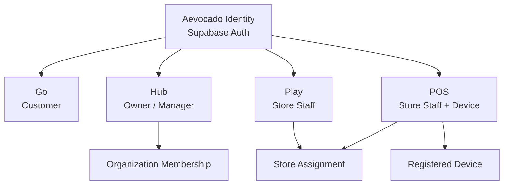
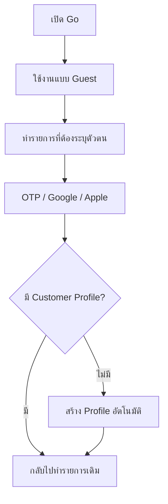
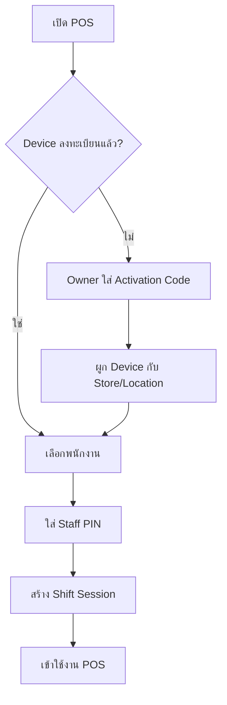

แนะนำให้ Aevocado ใช้ “บัญชีกลางหนึ่งบัญชี” แต่แยก Login UX, session และ authorization ของแต่ละแอปออกจากกันชัดเจน

ไม่ควรสร้าง Supabase Auth แยกสำหรับ Go, Hub, Play และ POS เพราะผู้ใช้คนเดียวอาจเป็นทั้งลูกค้าใน Go และเป็นเจ้าของร้านใน Hub ได้

## สถาปัตยกรรมที่แนะนำ



องค์ประกอบหลัก:

* `auth.users` เป็นตัวตนกลาง
* Go ตรวจ customer profile
* Hub ตรวจ organization membership
* Play/POS ตรวจ staff assignment ของร้าน
* POS ตรวจ device registration เพิ่มอีกชั้น
* PostgreSQL RLS ตรวจสิทธิ์จริงทุกครั้ง
* แต่ละแอปมี session ของตัวเอง แม้จะเป็นบัญชีเดียวกัน

Supabase Auth ใช้ JWT และเชื่อมกับ RLS ได้โดยตรง จึงเหมาะกับการเป็น Identity Provider กลางของหลายแอป ([Supabase Docs][1])

---

## 1. Login สำหรับ Go

Go เป็นแอปลูกค้า จึงควรเป็นแบบ guest-first และลดขั้นตอนการสมัครให้มากที่สุด

### วิธี Login

ลำดับที่แนะนำ:

1. เบอร์โทรศัพท์ + OTP
2. Google Sign-in
3. Apple Sign-in สำหรับ iOS
4. Email Magic Link เป็นทางเลือก
5. Email/password ไม่จำเป็นต้องเป็นตัวเลือกหลัก

### Guest mode

ผู้ใช้ที่ยังไม่ Login ควรทำได้:

* ค้นหาร้าน
* ดูแผนที่
* ดูรายละเอียดร้าน
* ดูเมนูและรีวิว
* ตรวจสอบช่วงเวลาว่างเบื้องต้น

บังคับ Login เมื่อผู้ใช้จะ:

* จอง
* สั่งอาหาร
* บันทึกร้าน
* เขียนรีวิวหรือคอมเมนต์
* รับคูปองและ EXP
* ดูประวัติรายการ

### Flow



สำหรับ Capacitor ให้ใช้ Authorization Code + PKCE และ callback ผ่าน Universal Link/App Link เป็นหลัก ส่วน custom URL scheme ใช้เป็น fallback เท่านั้น Supabase รองรับ PKCE และ Mobile Deep Linking โดยตรง ([Supabase Docs][2])

---

## 2. Login สำหรับ Hub

Hub มีข้อมูลธุรกิจ พนักงาน รายได้ และการตั้งค่าร้าน จึงต้องเข้มงวดกว่า Go

### วิธี Login

แนะนำ:

* Email + password
* Google Sign-in สำหรับบัญชีธุรกิจ
* Email Magic Link สำหรับ onboarding/recovery
* บังคับ TOTP MFA สำหรับ Owner และ Admin
* Manager สามารถเริ่มเป็น optional MFA แต่ควรบังคับก่อน production เต็มรูปแบบ

Supabase แยก session ที่มี MFA เป็น `aal2` ทำให้บังคับผ่าน RLS หรือ backend ก่อนทำรายการสำคัญได้ ([Supabase Docs][3])

### Hub ต้องมีสองเส้นทาง

#### ผู้ประกอบการใหม่

```text
สมัครบัญชี
→ ยืนยัน Email
→ สร้าง Organization
→ สร้างร้านแรก
→ เป็น Organization Owner
→ ตั้งค่า MFA
→ เข้า Hub
```

#### Manager ที่ถูกเชิญ

```text
Owner ส่ง Invitation
→ Manager เปิดลิงก์
→ Login หรือสร้างบัญชี
→ Accept Invitation
→ สร้าง Organization Membership
→ เข้าเฉพาะ Organization/ร้านที่ได้รับสิทธิ์
```

ห้ามให้ผู้ใช้ Login เข้า Hub แล้วสร้าง membership ด้วยตัวเองจาก frontend

หลัง Login ระบบต้องตรวจ:

```text
มี active organization membership หรือไม่?
├─ ไม่มี → แสดง No access / Create business / Accept invitation
└─ มี → ให้เลือก Organization และ Store
```

### Step-up authentication

แม้ Login อยู่แล้ว ควรขอ MFA ซ้ำก่อน:

* เปลี่ยนบัญชีรับเงิน
* คืนเงินจำนวนมาก
* เพิ่มหรือลบ Owner
* เปลี่ยนสิทธิ์ Manager
* Export ข้อมูลลูกค้า
* ดูหรือเปลี่ยน API credentials
* ปิดร้านหรือ Organization

---

## 3. Login สำหรับ Play

Play ใช้เฉพาะพนักงาน จึงไม่ควรมีปุ่มสมัครบัญชีสาธารณะ

### วิธีเข้าใช้งาน

1. Owner/Manager เพิ่มพนักงานจาก Hub
2. ระบบสร้าง `staff_invitation`
3. พนักงานได้รับลิงก์หรือรหัสเชิญ
4. พนักงาน Login ด้วยเบอร์โทร OTP หรือ Email
5. ระบบผูกบัญชีกับ `store_staff_assignments`
6. Play ตรวจว่าพนักงานมี assignment สำหรับร้านที่เลือก

พนักงานคนหนึ่งสามารถอยู่ได้หลายร้าน แต่ต้องเลือก active store ก่อนเริ่มงาน

ตัวอย่างบทบาท:

* `play_supervisor`
* `host`
* `queue_operator`
* `booking_operator`
* `service_staff`

ไม่ควรใช้ role เดียว เช่น `employee` เพราะจะควบคุมสิทธิ์ละเอียดภายหลังยาก

---

## 4. Login สำหรับ POS

POS ควรแยก “การยืนยันอุปกรณ์” ออกจาก “การยืนยันตัวพนักงาน”



### Device enrollment

Owner หรือ Manager สร้าง activation code อายุสั้นจาก Hub:

```text
Hub → Devices → Add POS
→ ได้ QR/Activation Code
→ กรอกในเครื่อง POS
→ เครื่องถูกผูกกับ store_id + location_id
```

จัดเก็บ:

* `device_id`
* `store_id`
* `location_id`
* `device_type`
* public key หรือ device credential
* `status`
* `last_seen_at`
* `revoked_at`

### Staff quick unlock

หลังลงทะเบียนเครื่องแล้ว:

* พนักงานเลือกชื่อ
* ใส่ PIN 4–6 หลัก
* Backend ตรวจทั้ง device และ staff assignment
* ออก shift session อายุสั้น
* Lock อัตโนมัติเมื่อไม่มีการใช้งาน
* เปลี่ยนพนักงานได้โดยไม่ต้อง logout อุปกรณ์

PIN ต้องไม่ถูกเก็บเป็น plaintext และไม่ควรใช้แทน Supabase Auth credential โดยตรง

รายการสำคัญ เช่น refund, void หรือแก้ยอด ต้องใช้:

* Supervisor PIN
* หรือ Hub approval
* หรือ step-up authentication

---

## 5. Account และ Role Model

อย่าเก็บ role เดียวใน `profiles.role` เพราะคนหนึ่งสามารถเป็นลูกค้า เจ้าของร้าน และพนักงานของอีกร้านได้พร้อมกัน

```text
auth.users
└── profiles
    ├── customer_profiles
    ├── organization_memberships
    ├── store_staff_assignments
    └── device_shift_sessions
```

ตารางแนะนำ:

```sql
profiles (
  user_id uuid primary key references auth.users,
  display_name text,
  phone text,
  account_status text
);

organizations (
  id uuid primary key,
  name text,
  status text
);

organization_memberships (
  organization_id uuid,
  user_id uuid,
  role text,
  status text,
  primary key (organization_id, user_id)
);

stores (
  id uuid primary key,
  organization_id uuid references organizations
);

store_staff_assignments (
  store_id uuid,
  user_id uuid,
  role text,
  status text,
  primary key (store_id, user_id)
);

staff_invitations (
  id uuid primary key,
  organization_id uuid,
  store_id uuid,
  email_or_phone text,
  role text,
  token_hash text,
  expires_at timestamptz,
  accepted_at timestamptz
);

registered_devices (
  id uuid primary key,
  store_id uuid,
  location_id uuid,
  device_type text,
  status text,
  credential_hash text,
  last_seen_at timestamptz
);

shift_sessions (
  id uuid primary key,
  device_id uuid,
  staff_user_id uuid,
  store_id uuid,
  started_at timestamptz,
  expires_at timestamptz,
  ended_at timestamptz
);
```

## 6. Permission model

ใช้ RBAC ระดับบทบาทร่วมกับ permissions ระดับ action

| App  | Role       | ตัวอย่างสิทธิ์                                    |
| ---- | ---------- | ------------------------------------------------- |
| Go   | Customer   | booking.create, review.create, favorite.manage    |
| Hub  | Owner      | organization.manage, billing.manage, staff.manage |
| Hub  | Manager    | store.manage, report.view, staff.invite           |
| Hub  | Finance    | payout.view, report.export                        |
| Play | Supervisor | queue.manage, booking.override                    |
| Play | Staff      | queue.update, booking.checkin                     |
| POS  | Supervisor | refund.approve, order.void                        |
| POS  | Cashier    | order.create, payment.collect                     |

ตรวจสิทธิ์จาก membership/assignment ในฐานข้อมูล ไม่ควรเชื่อข้อมูล role ที่ frontend ส่งมา

ไม่แนะนำให้ใส่รายชื่อร้านและ permissions ทั้งหมดไว้ใน JWT เพราะ:

* Token จะใหญ่
* สิทธิ์อาจเปลี่ยนระหว่าง session
* พนักงานที่ถูกถอดออกยังมี claim เก่าจนกว่า token จะ refresh

JWT ควรเก็บเฉพาะข้อมูลค่อนข้างคงที่ เช่น:

```json
{
  "sub": "user-id",
  "session_id": "session-id",
  "aal": "aal2",
  "app_id": "hub"
}
```

Supabase รองรับ Custom Access Token Hook แต่ควรใช้ claims แบบเล็กและไม่เปลี่ยนบ่อย ([Supabase Docs][4])

---

## 7. แยก session ของแต่ละแอป

ถึงจะใช้ Identity เดียวกัน ผมแนะนำให้ session แยกตามแอป:

| แอป             | อายุและลักษณะ Session                    |
| --------------- | ---------------------------------------- |
| Go Web          | ปกติและจำอุปกรณ์ได้                      |
| Go Mobile       | Refresh token ใน secure native storage   |
| Hub             | อายุสั้นกว่า Go และมี inactivity timeout |
| Play            | ผูกกับ staff/store และหมดอายุเมื่อเลิกกะ |
| POS             | Device session + shift session           |
| Admin/Moderator | สั้นที่สุดและบังคับ MFA                  |

Supabase session มี `session_id` ใน JWT และรองรับ inactivity timeout, maximum lifetime และการจำกัด session ตามแพ็กเกจ ([Supabase Docs][5])

บน Capacitor:

* Access token เก็บใน memory เมื่อเป็นไปได้
* Refresh token เก็บผ่าน secure storage ที่ใช้ Keychain/Keystore
* ไม่ควรเก็บ token สำคัญใน `Preferences` หรือ plain localStorage
* เมื่อ logout ให้ล้าง secure storage, query cache และข้อมูลส่วนบุคคลใน local database

---

## 8. SSO ระหว่างแอปควรทำหรือไม่

### ตอนนี้: ไม่จำเป็นต้องทำ seamless SSO เต็มรูปแบบ

Go และ Hub มีกลุ่มผู้ใช้และความเสี่ยงต่างกัน การแยก session ช่วยป้องกัน:

* ลูกค้าที่ Login Go แล้วเข้า Hub โดยไม่ได้ตั้งใจ
* Hub session ที่มีสิทธิ์สูงถูกนำไปใช้ในแอปลูกค้า
* การ logout แอปหนึ่งกระทบทุกแอป
* Cookie และ cross-subdomain complexity

แต่ใช้บัญชีกลางเหมือนกันได้ เช่น อีเมลเดียวกัน Login ได้ทั้ง Go และ Hub ถ้ามี membership

### อนาคต: Central SSO

เมื่อ ecosystem โตขึ้น ค่อยเพิ่ม:

```text
auth.aevocado.com
hub.aevocado.com
go.aevocado.com
play.aevocado.com
pos.aevocado.com
```

ใช้ OAuth 2.1 Authorization Code + PKCE และลงทะเบียนแต่ละแอปเป็น client แยก:

* `aevocado-go-web`
* `aevocado-go-mobile`
* `aevocado-hub`
* `aevocado-play`
* `aevocado-pos`

Supabase Auth รองรับ OAuth 2.1 server, client-specific claims และการควบคุมผ่าน `client_id` ได้แล้ว ([Supabase Docs][6])

อย่างไรก็ตาม สำหรับระยะแรก การใช้ Supabase Auth project เดียว พร้อม callback แยกแต่ละแอปจะง่ายและเสี่ยงน้อยกว่า

---

## 9. RLS ที่สำคัญ

ตัวอย่าง Hub:

```sql
create policy "members can view organization stores"
on stores
for select
to authenticated
using (
  exists (
    select 1
    from organization_memberships om
    where om.organization_id = stores.organization_id
      and om.user_id = (select auth.uid())
      and om.status = 'active'
  )
);
```

ตัวอย่าง Play/POS:

```sql
create policy "active staff can access store operations"
on store_orders
for select
to authenticated
using (
  exists (
    select 1
    from store_staff_assignments sa
    where sa.store_id = store_orders.store_id
      and sa.user_id = (select auth.uid())
      and sa.status = 'active'
  )
);
```

รายการการเงินหรือจัดการ Owner ให้เพิ่มเงื่อนไข `aal2` หรือบังคับผ่าน backend command endpoint

ทุกตารางที่เปิดผ่าน Supabase Data API ต้องเปิด RLS และต้องมีทั้ง ownership/membership predicate ไม่ใช่แค่ `TO authenticated`

---

## 10. ลำดับการ Implement

### Phase 1 — Identity foundation

* Supabase Auth project กลาง
* `profiles`
* callback URLs ของ Go, Hub และ Capacitor
* Google/Apple/Phone/Email providers
* session handling package กลาง

### Phase 2 — Organization authorization

* organizations
* organization memberships
* Hub owner onboarding
* manager invitations
* organization/store switcher
* RLS tests

### Phase 3 — Staff access

* staff invitations
* store assignments
* Play login guard
* role/permission matrix
* revoke staff access

### Phase 4 — POS device identity

* device enrollment
* activation code
* device revocation
* employee PIN
* shift sessions
* manager override

### Phase 5 — Security hardening

* Hub MFA
* step-up authentication
* session timeout
* login audit log
* rate limiting
* account recovery
* lost-device revocation
* suspicious-login notifications

## ข้อสรุป

โครงสร้างที่เหมาะกับ Aevocado คือ:

* **Supabase Auth กลางหนึ่งระบบ**
* **บัญชีผู้ใช้หนึ่งบัญชีสามารถมีหลายบริบท**
* **Go:** Guest-first + Phone OTP/Social Login
* **Hub:** Email/Google + Organization Membership + MFA
* **Play:** Invite-only + Store Assignment
* **POS:** Registered Device + Staff PIN + Shift Session
* **แยก session ของแต่ละแอป**
* **RLS ตรวจ membership จากฐานข้อมูล**
* **ยังไม่ต้องทำ seamless SSO ใน Phase แรก**
* **ไม่เก็บ role เดียวไว้ใน user profile**
* **ไม่เชื่อ authorization จาก frontend หรือ user-editable metadata**

[1]: https://supabase.com/docs/guides/auth?utm_source=chatgpt.com "Auth"
[2]: https://supabase.com/docs/guides/auth/sessions/pkce-flow?utm_source=chatgpt.com "PKCE flow"
[3]: https://supabase.com/docs/guides/auth/auth-mfa?utm_source=chatgpt.com "Multi-Factor Authentication"
[4]: https://supabase.com/docs/guides/auth/auth-hooks/custom-access-token-hook?utm_source=chatgpt.com "Custom Access Token Hook"
[5]: https://supabase.com/docs/guides/auth/sessions?utm_source=chatgpt.com "User sessions"
[6]: https://supabase.com/docs/guides/auth/oauth-server?utm_source=chatgpt.com "OAuth 2.1 Server"
