# Feed configuration and runtime flow graphs

เอกสารนี้สรุปภาพรวมของการตั้งค่า Feed และลำดับการทำงานของ Feed ในรูปแบบกราฟ เพื่อใช้เป็นแผนที่เดียวสำหรับทีม Core, Admin, Edge และ Client

> **สถานะ ณ 2026-09-27:** `BATCH-FEED-000` ถึง `BATCH-FEED-007` ผ่าน controlled gates แล้ว, FEED-008 มี Core-only Go Explore test-client slice, ลบ dead Explore implementation, ลบ old `/traces` list implementation และผ่าน connected local Core → Edge → Go browser smoke ที่ serialize payload TRACE/PLACE ครบ, FEED-009-READ/FEED-009-MUTATION/FEED-009-MODERATION มี Admin control slices ผ่าน checks, `DISCOVERY-006` มี Core explicit-intent + contextual re-ranking, connected outcome ingestion และ read-only outcome/guardrail evaluation snapshot, `DISCOVERY-006A` มี authenticated negative-feedback hide/unhide + private transition-history read slice และ anonymous session-local boundary, `DISCOVERY-007` มี connected Core module smoke, inventory-backed four-module portfolio smoke และ canonical source-health read boundary, `DISCOVERY-008` มี typed discovery-config lifecycle ผ่าน development DB, `DISCOVERY-004` มี profile-scoped rebuild/delete worker contract พร้อม account-deletion anonymization ผ่าน Supabase development DB, `DISCOVERY-003` มี connected high-confidence text-policy guard, bounded remediation, private media cleanup worker boundary, และ standalone `aevo-admin` Feed runtime smoke ผ่าน; Core migrations `0034_feed_moderation_adapter_boundary.sql`, `0035_feed_negative_feedback.sql`, `0036_feed_negative_feedback_history.sql` และ `0037_feed_negative_feedback_history_read_index.sql` ถูก apply/verify ใน development และ connected moderation/feedback/config/history/evaluation boundaries ผ่าน test แล้ว; ยังไม่มี public evidence/media pipeline, availability quota policy, production route switch, production worker schedule, authenticated deployed browser smoke, performance/load acceptance หรือ production rollout

> **เพิ่มเติม:** `BATCH-FEED-015` เพิ่ม Core-owned legacy Customer favorites reconciliation สำหรับ maintenance ใน development/test พร้อม Admin `/go/feed` panel, explicit mapping, idempotency/audit และ exact delete gate; production parity/ownership, target migration และ broad cleanup ยังไม่เปิด

## 1. ภาพรวมในหนึ่งประโยค

`aevo-admin` สร้าง config draft รวม discovery policy → Core ตรวจสอบและเก็บเป็น revision ที่แก้ย้อนหลังไม่ได้ → publish จะเลื่อน active pointer เพียงจุดเดียว → Feed runtime อ่านเฉพาะ config ที่ผ่าน validation → เมื่อเกิดปัญหาให้ใช้ last-known-good และสุดท้าย deterministic baseline

## 2. One source of truth ของ Feed config

```mermaid
flowchart LR
    ADMIN[aevo-admin / operator]
    API[Core Admin API]
    DRAFT[Immutable draft revision]
    VALIDATE[feed-config-v1 validator]
    RESULT[Stored validation result]
    PUBLISH[Publish transaction]
    POINTER[Active pointer<br/>GO_PUBLIC_FEED]
    OUTBOX[Core outbox<br/>FEED_CONFIG_PUBLISHED]
    RUNTIME[FeedConfigService<br/>runtime snapshot]
    FACADE[Public Feed facade<br/>FEED-003+]
    HEALTH[Guardrails +<br/>propagation health]
    LEGACY[Legacy Go flags<br/>read-only compatibility]
    REJECT[Rejected fields /<br/>validation errors]

    ADMIN --> API
    API --> DRAFT
    DRAFT --> VALIDATE
    VALIDATE --> RESULT
    RESULT -->|invalid| REJECT
    REJECT -->|แก้โดยสร้าง revision ใหม่| ADMIN
    RESULT -->|valid| PUBLISH
    PUBLISH --> POINTER
    POINTER --> OUTBOX
    POINTER --> RUNTIME
    OUTBOX --> RUNTIME
    RUNTIME --> FACADE
    RUNTIME --> HEALTH
    LEGACY -. mismatch telemetry only .-> HEALTH
```

หลักการสำคัญ:

- Core เป็นเจ้าของ Feed config เพียงแหล่งเดียว ภายใต้ scope `GO_PUBLIC_FEED`
- revision เป็น immutable; การแก้ไขให้สร้าง revision ใหม่ ไม่ update ของเดิม
- `publish` และ `rollback` เปลี่ยน active pointer แบบ atomic และเขียน audit/outbox
- draft ที่ยังไม่ผ่าน server validation ห้ามถูก runtime นำไป serve
- legacy flags (`mixed_feed`, `taste_ranking_v1`) อ่านได้เพื่อวัด mismatch เท่านั้น ไม่ใช่ authority และไม่ควรถูกเขียนเพื่อควบคุม Feed

## 3. Config มีอะไรบ้าง

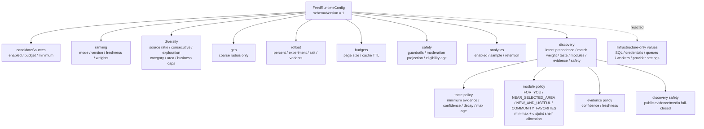

### Baseline config ที่ใช้เป็นจุดเริ่มต้น

ตัวอย่างนี้เป็น deterministic baseline ที่ Core runtime ใช้หลัง normalize ค่า
discovery defaults; migration `0010_feed_config_control_plane.sql` เป็น
pre-discovery seed ที่ยังอ่านได้แบบ backward-compatible และไม่ได้ถูกแก้ใน
`DISCOVERY-008`:

`order` ค่าเริ่มต้นยังเป็น `FOR_YOU` เพื่อ rollout แบบ backward-compatible แต่
Admin สามารถเลือก order ของ module ที่มีข้อมูล TRACE/PLACE รองรับได้ 4 แบบคือ
`FOR_YOU`, `NEAR_SELECTED_AREA`, `NEW_AND_USEFUL` และ
`COMMUNITY_FAVORITES`. Module ที่ต้องมี saved/booking/journey projection เช่น
`BECAUSE_YOU_SAVED`, `BOOKABLE_NOW` และ `CONTINUE_TRACE` ยังไม่อยู่ใน allowlist
ของ Core validator.

```json
{
  "schemaVersion": "1",
  "enabled": true,
  "killSwitch": false,
  "candidateSources": {
    "trace": { "enabled": true, "budget": 100, "minimum": 1 },
    "place": { "enabled": true, "budget": 100, "minimum": 1 }
  },
  "ranking": {
    "mode": "DETERMINISTIC",
    "version": "deterministic-v1",
    "freshnessWindowHours": 168,
    "weights": {
      "quality": 0.4,
      "freshness": 0.2,
      "proximity": 0.2,
      "taste": 0.2
    }
  },
  "diversity": {
    "maxConsecutiveSameSource": 2,
    "maxSourceRatio": 0.75,
    "explorationQuota": 0.1,
    "maxItemsPerCategory": 3,
    "maxItemsPerArea": 4,
    "maxItemsPerBusiness": 1
  },
  "geo": { "maxCoarseRadiusMeters": 50000 },
  "rollout": {
    "percent": 100,
    "experimentId": null,
    "salt": "feed-v1",
    "variants": []
  },
  "budgets": { "pageSize": 24, "cacheTtlSeconds": 30 },
  "safety": {
    "guardrailsEnabled": true,
    "requireModerationProjection": true,
    "maxEligibilityAgeSeconds": 60
  },
  "analytics": {
    "enabled": true,
    "samplePercent": 100,
    "retentionDays": 90
  },
  "discovery": {
    "intentPrecedence": "EXPLICIT_FIRST",
    "intentMatchWeight": 0.35,
    "taste": {
      "minimumEvidence": 2,
      "minimumConfidence": 0.4,
      "decayHalfLifeDays": 180,
      "maxAgeDays": 365
    },
    "modules": {
      "enabled": true,
      "minimumItems": 1,
      "maximumItems": 12,
      "order": ["FOR_YOU"]
    },
    "evidence": {
      "enabled": false,
      "minimumConfidence": 0.7,
      "maxAgeDays": 30
    },
    "safety": {
      "policyVersion": "ugc-safe-v1",
      "publicEvidenceEnabled": false,
      "publicMediaEnabled": false
    }
  }
}
```

### แบ่งค่าที่ Admin เปลี่ยนได้กับค่าที่ห้ามนำมาเป็น Feed config

| กลุ่ม | ตัวอย่าง | กติกา |
| --- | --- | --- |
| Runtime tunable | source budget, ranking weights, freshness, source/category/area/business diversity caps, coarse radius, rollout %, cache TTL, analytics sampling | ต้องมี type, min, max, default, cross-field validation และ safe fallback |
| Discovery policy | explicit intent precedence/match weight, taste evidence/confidence/decay, four bounded TRACE/PLACE-backed modules, evidence freshness | เป็น typed policy; pre-discovery revisions ได้ safe defaults; match weight ถูกจำกัด `0.05–0.8`; module ที่ต้องพึ่ง saved/booking/journey projection ถูก reject; public evidence/media flag เปิดไม่ได้จนกว่า pipeline ที่เชื่อมต่อจริงจะพร้อม |
| Safety invariant | moderation projection, kill switch, eligibility freshness | server บังคับค่าและต้อง fail closed เมื่อข้อมูลไม่ปลอดภัย |
| Infrastructure-only | SQL/table/RPC, credentials, Pub/Sub/Cloud Tasks, worker concurrency, storage/provider, arbitrary timeout/retry | ไม่รับผ่าน Feed config; ให้เปลี่ยนใน deployment/infrastructure boundary |

### Rollout assignment เป็น deterministic

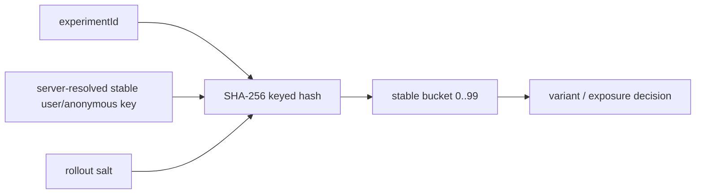

การ assign ใช้ค่าที่ Core resolve จาก server และไม่สร้าง per-user assignment table เป็นค่าเริ่มต้น การทดลองถูกบันทึกผ่าน Feed event; การ persist assignment เป็นข้อยกเว้นที่ต้องมีเหตุผลด้าน cross-device, regulated holdout หรือ support override ที่ตรวจสอบย้อนหลังได้

## 4. วงจรของ config

กราฟนี้อธิบายสถานะเชิงธุรกิจของ revision; ในฐานข้อมูลจริง revision และ audit history ยังคง immutable และ active status ถูกอ่านจาก active pointer กับ publication history:

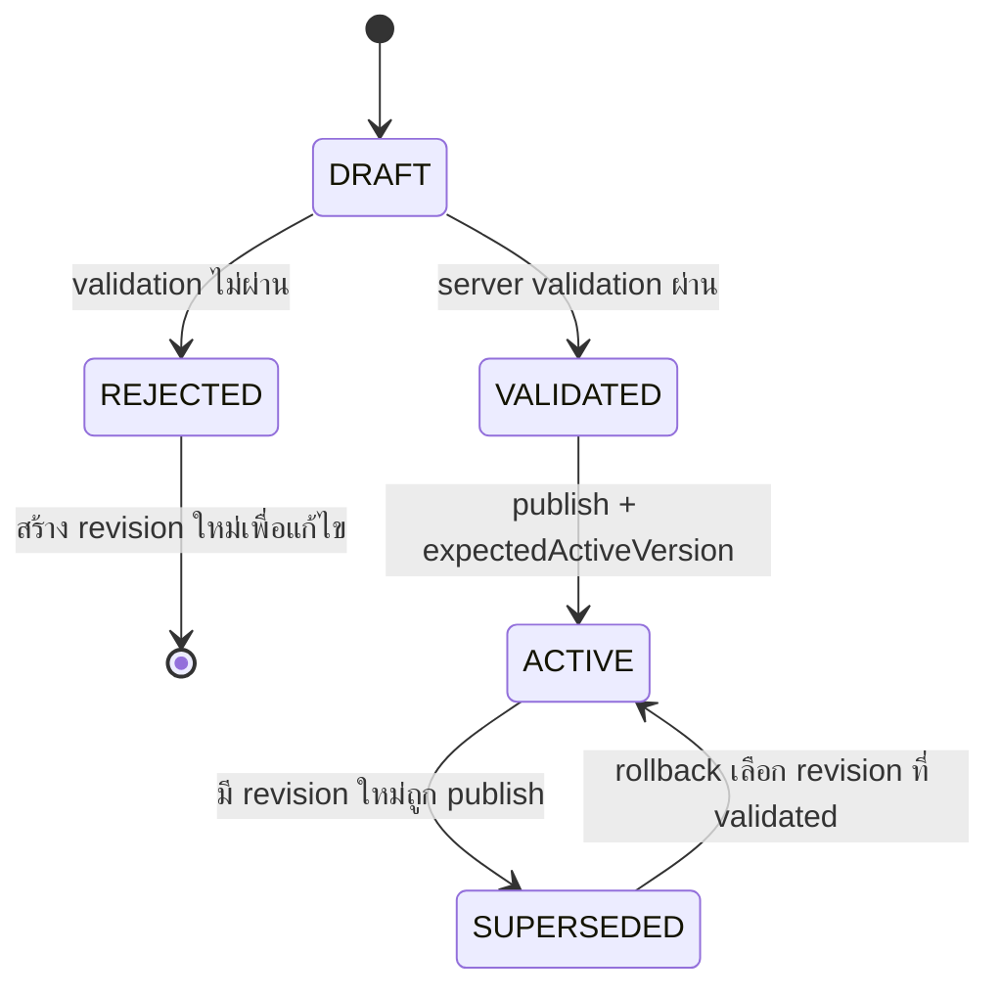

กติกาในแต่ละ action:

1. `Create draft` รับเฉพาะ JSON object ที่อยู่ในขนาดที่กำหนดและคำนวณ content hash
2. `Validate` ตรวจ schema, enum, bound, cross-field rule และ reject unknown/infrastructure fields แบบ recursive
3. `Publish` รับเฉพาะ revision ที่ validation ผ่าน, ตรวจ optimistic active-version และใช้ idempotency key
4. `Rollback` เลือก revision เก่าที่ validation ผ่าน แล้วเลื่อน pointer กลับโดยไม่ลบ history
5. ทุก mutation มีเหตุผลของ operator, actor จาก app-scoped Admin session, CSRF protection, audit event และ request id

## 5. Runtime fallback เมื่อ config มีปัญหา

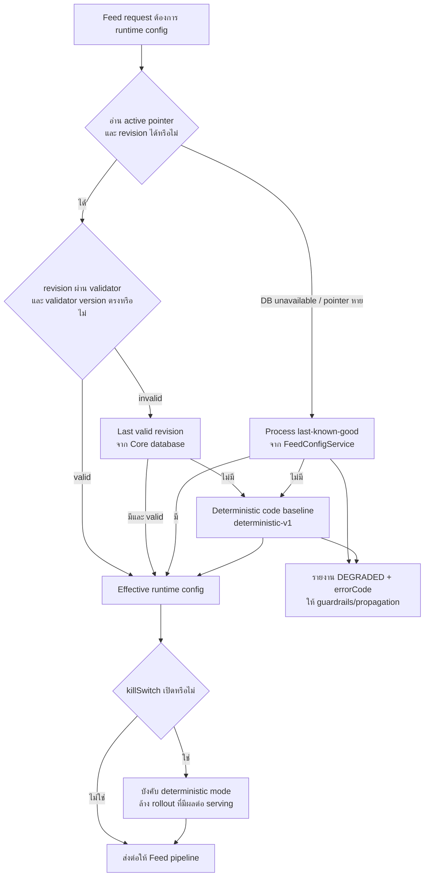

ลำดับความปลอดภัยคือ `ACTIVE_REVISION → LAST_KNOWN_GOOD → DETERMINISTIC_BASELINE` โดยไม่เคยเลือก unvalidated draft มา serve การ fallback จะถูกระบุด้วย `status=DEGRADED`, `source`, `errorCode` และ pointer version เพื่อให้ Admin เห็นว่าระบบกำลังทำงานด้วย config ใด

## 6. Target request flow ของ Feed

ส่วนนี้คือกราฟการ serve Feed โดย `FEED-002` เป็น config control plane และ `FEED-003` เป็น public facade/session boundary ที่อยู่ตรงกลางของ flow; candidate generation ในกราฟยังเป็น seam สำหรับ `FEED-004+`:

```mermaid
sequenceDiagram
    participant Client as Aevo Go / Web / PWA
    participant Edge as Edge Gateway
    participant Core as Core Feed facade
    participant Policy as Session + policy
    participant Config as FeedConfigService
    participant Sources as Private candidate ports
    participant Eligibility as Eligibility projection
    participant Rank as Calibration + ranking + diversity
    participant Modules as Server-owned discovery modules
    participant Hydration as Public hydration
    participant Serialize as Concrete TRACE/PLACE JSON serializer
    participant Events as Async event intake

    Client->>Edge: GET /api/v1/public/feed
    Edge->>Core: forward request + ingress signature
    Core->>Policy: resolve app session, principal, scope, filters
    Policy-->>Core: FeedSessionContext + policy limits
    Core->>Config: active validated runtime snapshot
    Config-->>Core: configVersion + rankingVersion + discovery policy + limits
    par TRACE candidate generation
        Core->>Sources: TRACE candidates
    and PLACE candidate generation
        Core->>Sources: PLACE candidates
    end
    Sources-->>Core: source-tagged candidate sets + generator telemetry
    Core->>Eligibility: moderation, publication, block/mute, freshness, dedupe
    Eligibility-->>Core: eligible candidates only
    Core->>Rank: entity calibration → explicit-intent blend → deterministic/SHADOW score
    Rank->>Rank: seen-key suppression → source/category/area/business/creator/lineage caps → exploration
    Rank-->>Core: stable ordered candidates + served-key window
    Core->>Modules: apply intent + bounded order/min-max + generator health
    Modules-->>Core: optional disjoint modules; omit empty shelves; mark affected shelves degraded
    Core->>Hydration: batch typed public fields
    Hydration-->>Eligibility: re-check moderation, deletion, feedback, type/identity
    Eligibility-->>Core: safe Feed items + item tokens
    Core->>Serialize: serialize concrete TRACE/PLACE union fields
    Serialize-->>Core: full v1 item payload; unsupported item implementations fail closed
    Core-->>Edge: FeedResponse v1 + signed cursor/seen-key window + version IDs
    Edge-->>Client: typed page / empty / error state
    Client-->>Events: allowlisted Feed event metadata
    Events-->>Core: async idempotent ingest
```

สิ่งที่ browser ไม่ควรเห็นหรือกำหนดเอง: source ภายใน, raw score, ranking expression, actor/tenant ที่อ้างจาก request, SQL, service credential, exact location และ private moderation fields

## 7. Config field ส่งผลกับขั้นตอนไหน

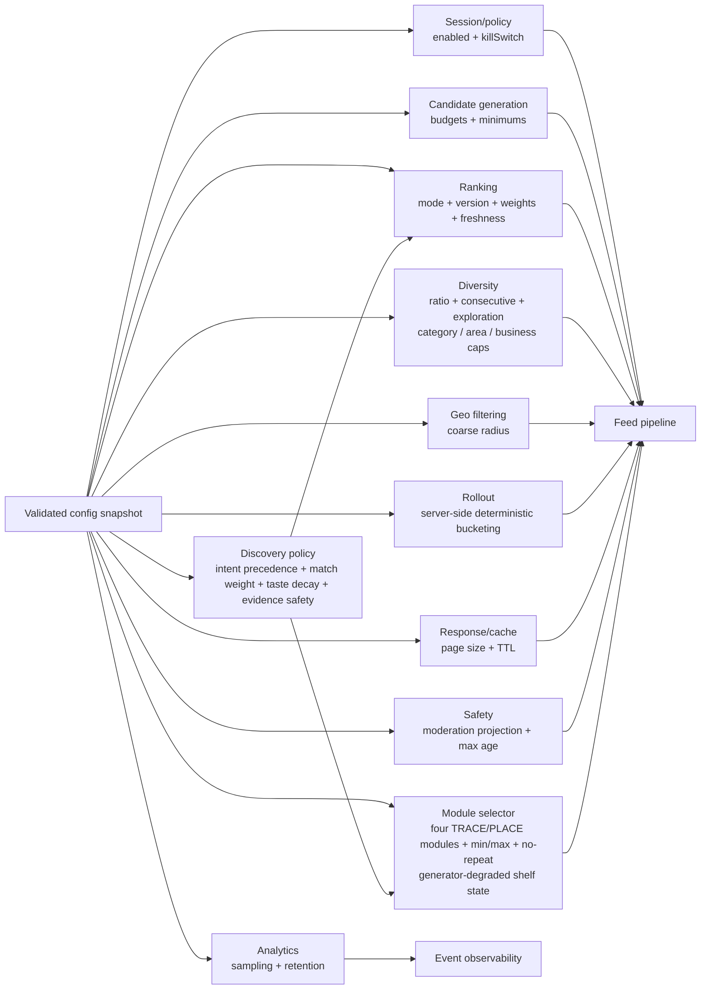

## 8. วิธีเปลี่ยน Feed config แบบปลอดภัย

```text
1. Operator ระบุ reason และสร้าง draft ใหม่
2. Core เก็บ immutable revision + content hash
3. กด validate และแก้เฉพาะ field ที่ validator อนุญาต
4. ตรวจ validation result, guardrails และ propagation state
5. publish ด้วย expectedActiveVersion + idempotency key
6. สังเกต configVersion, rankingVersion, error rate, empty rate, source ratio และ event lag
7. ถ้า guardrail ผิดปกติ ให้ rollback ไปยัง validated revision เดิม หรือเปิด kill switch
```

Admin API ที่รองรับใน FEED-002:

| การทำงาน | Method + route |
| --- | --- |
| อ่าน active config | `GET /api/v1/admin/go/feed/config` |
| ดู revision history | `GET /api/v1/admin/go/feed/config/revisions` |
| สร้าง draft | `POST /api/v1/admin/go/feed/config/drafts` |
| validate draft | `POST /api/v1/admin/go/feed/config/drafts/{revisionId}/validate` |
| publish draft | `POST /api/v1/admin/go/feed/config/drafts/{revisionId}/publish` |
| rollback | `POST /api/v1/admin/go/feed/config/revisions/{version}/rollback` |
| ดู guardrails | `GET /api/v1/admin/go/feed/guardrails` |
| ดู propagation | `GET /api/v1/admin/go/feed/propagation` |
| ดู discovery outcome/guardrail snapshot | `GET /api/v1/admin/go/feed/discovery-evaluation?days=1..90` |

### Read-only discovery evaluation graph

รายงานนี้อ่านเฉพาะ accepted event counts และ guardrail snapshot จาก Core ภายใน
ช่วงเวลาที่เลือก (`1..90` วัน) แล้วส่งให้ Admin ที่มี `go.analytics.read`.
สถานะ `INGESTION_ONLY_NO_CAUSAL_ATTRIBUTION` เป็นส่วนหนึ่งของ response เพื่อ
ป้องกันการตีความว่า event count คือ causal success metric หรือการเปิด LIVE ranking.

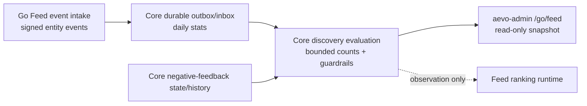

### Profile projection rebuild/delete graph

`DISCOVERY-004` ใช้ TraceDee/Supabase เป็นเจ้าของ projection source และให้
worker เรียก service-role RPC เท่านั้น. Browser, Go และ Admin ไม่ได้อ่านหรือ
แก้ projection tables โดยตรง; `DELETE` เป็น derived-state cleanup และไม่ลบ
canonical content หรือ append-only activity event history.

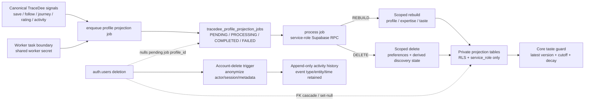

Operational contract:

- `TRACEDEE_PROFILE_PROJECTION_ENQUEUE` validates UUID, operation, reason,
  request key and request hash before calling the private RPC.
- `TRACEDEE_PROFILE_PROJECTION_PROCESS` is retryable; the database job owns
  idempotency, attempt count, stale-processing recovery and terminal status.
- Profile rebuild is scoped to one existing `auth.users` profile and never
  rebuilds another user's rows. Profile delete removes only preferences,
  derived scores, recommendation/evaluation rows, and actor-linked Feed
  impression/interaction rows.
- Account deletion anonymizes append-only activity rows instead of bypassing
  the immutable-event trigger. The raw actor/session/test metadata is removed;
  canonical event type/entity/time remain available for aggregate replay.
- The contract is connected-development verified; production scheduling,
  freshness health and source-level provenance remain separate gates.

## 9. FEED-007 projection และ hot-path graph

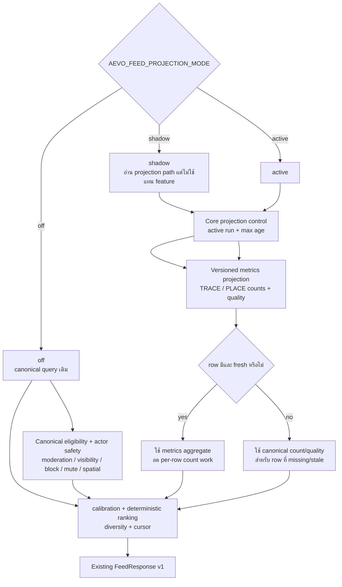

Projection lifecycle และ operational boundary:

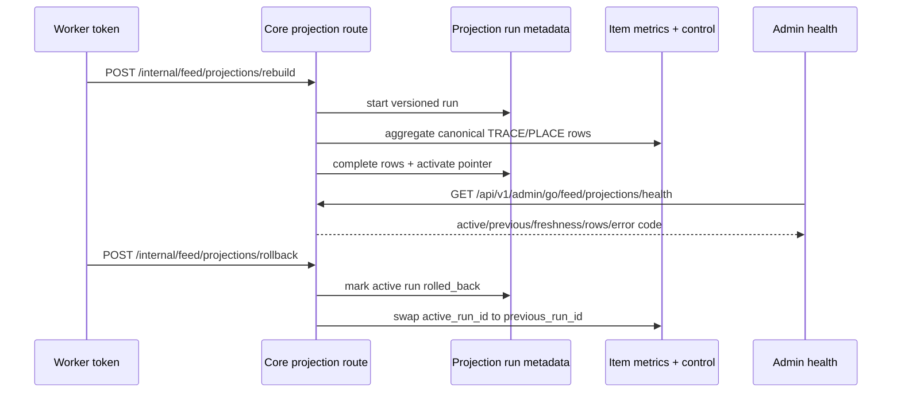

Projection tables are Core-owned, RLS-enabled, and not browser-readable. Canonical domain tables remain authoritative; disabling the backend mode or rolling back the pointer returns the Feed to the existing canonical path. See [`feed-serving-projection-v1.md`](feed-serving-projection-v1.md).

## 10. FEED-008 Go client transport graph

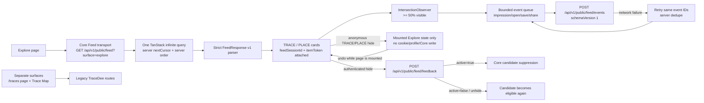

กติกาของ client slice:

- Live Explore ใช้ Core transport เดียว ไม่ interleave TRACE/PLACE และไม่คำนวณ rank ใน browser; ลำดับ, cursor, session และ item token มาจาก Core (demo mode ใช้ local fixtures)
- `/traces` และ Trace Map ยังใช้ legacy TraceDee routes เป็น compatibility boundary แยกต่างหาก เพราะ Core Feed v1 รองรับ `surface=explore` เท่านั้น
- impression ส่งหลัง card เห็นอย่างน้อย 50% ตาม contract; event metadata เป็น allowlist เท่านั้น
- Authenticated Go hide/unhide ใช้ Core `/api/v1/public/feed/feedback` ผ่าน signed item token, app session, CSRF และ idempotency; Core บันทึก durable state, ตัด TRACE/PLACE ออกจาก candidate query เมื่อ `active=true`, และคืนรายการได้เมื่อ `active=false`; live anonymous TRACE/PLACE hide/unhide ไม่เรียก Core และเป็น state เฉพาะ mounted Explore session เท่านั้น
- browser ไม่อ่าน projection/config tables และไม่รู้ actor/tenant/ranking/source ภายใน

## 12. FEED-009 Admin read-only control graph

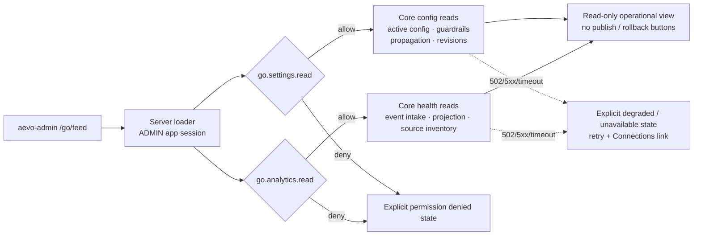

กติกาของ Admin slice:

- Loader ตรวจ `ADMIN` app-scoped session และ permission ฝั่ง server ทุกครั้ง; navigation เป็นเพียง UX ไม่ใช่ security boundary
- Config/guardrail/propagation/revision ใช้ `go.settings.read`; event/projection/source health ใช้ `go.analytics.read` แยกกัน
- Browser เรียกผ่าน Admin BFF/Core API เท่านั้น ไม่อ่าน Supabase หรือ projection tables โดยตรง
- สถานะ permission denied, unavailable และ degraded ต้องแสดงตรง ๆ พร้อม retry/Connections path; ห้ามแทนค่าด้วย sample health
- moderation และ destructive action ยังไม่อยู่ใน read slice; lifecycle mutation แยกอยู่ใน FEED-009-MUTATION และต้องผ่าน Core CSRF, idempotency, version conflict และ audit ทุกครั้ง

## 13. FEED-009 Admin mutation lifecycle graph

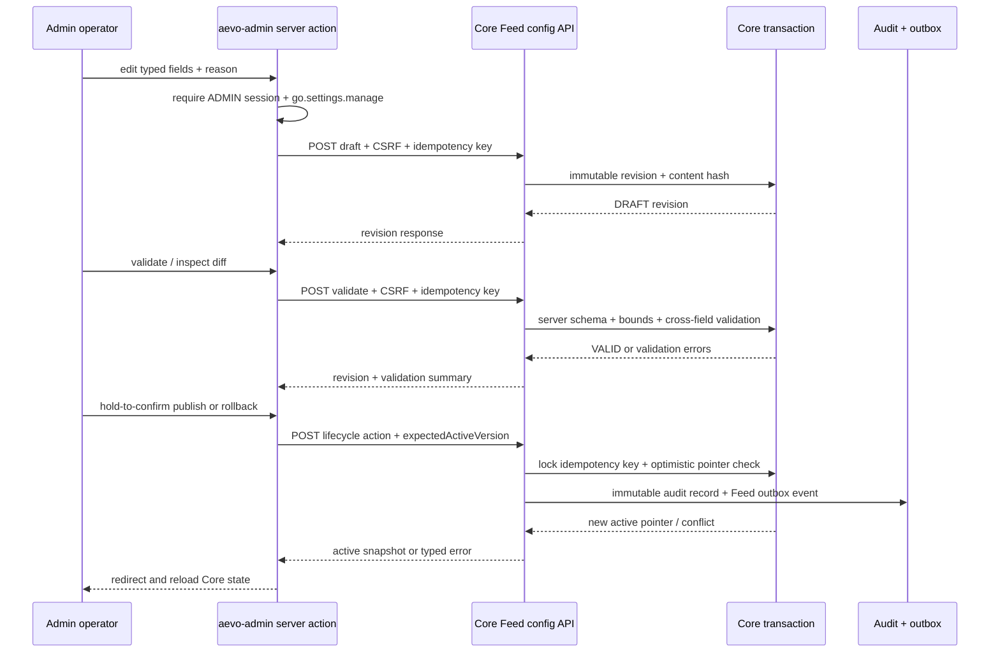

กติกาของ mutation slice:

- `aevo-admin` เป็น server-rendered BFF; browser ไม่ได้รับ service credential และไม่เขียนฐานข้อมูลโดยตรง
- ทุก action ตรวจ `ADMIN` app-scoped session และ `go.settings.manage` ซ้ำบน server; hidden form fields ไม่ใช่ authorization
- draft form ใช้ field ที่ allowlist แล้ว ไม่เปิด arbitrary JSON/infrastructure field editor; Core validator ยังคงเป็น authority สุดท้าย
- validate แสดง error/warning และ field-level diff เทียบกับ active revision; revision เดิมไม่ถูกแก้ไข
- publish/rollback ต้องมีเหตุผล, CSRF, idempotency key และ `expectedActiveVersion`; UI ใช้ hold-to-confirm สำหรับ pointer-changing action
- version conflict, idempotency conflict, CSRF failure และ Core unavailable แสดงเป็น error/retry state โดยไม่อ้างว่า mutation สำเร็จ

## 14. FEED-009 Admin moderation queue/action graph

```mermaid
sequenceDiagram
    participant Operator as Admin operator
    participant Admin as aevo-admin /go/feed/moderation
    participant Core as Core moderation API
    participant Queue as Queue RPC
    participant Guard as Expected-status wrapper
    participant Mutation as Existing moderation mutation
    participant Audit as Audit + activity + outbox

    Operator->>Admin: open queue + choose status filter
    Admin->>Admin: require ADMIN session + content.moderate
    Admin->>Core: GET queue + status + bounded cursor
    Core->>Queue: tracedee_list_moderation_queue
    Queue-->>Core: allowlisted reports + next cursor
    Core-->>Admin: typed queue response
    Admin-->>Operator: evidence/current allowlist only
    Operator->>Admin: choose action + reason
    Admin->>Admin: validate action/reason + generate idempotency key
    Admin->>Core: POST action + CSRF + idempotency + expected status
    Core->>Guard: lock report + replay exact request or reject stale status
    Guard->>Mutation: tracedee_moderate_report
    Mutation->>Audit: atomic audit + activity + outbox
    Audit-->>Core: action result / conflict / idempotent replay
    Core-->>Admin: typed success or safe error
    Admin-->>Operator: reload queue; high-impact action needs hold
```

กติกาของ moderation slice:

- Queue และ action ผ่าน Admin BFF/Core เท่านั้น; browser ไม่อ่าน Supabase และไม่ถือ service credential
- `content.moderate` ถูกตรวจทั้งใน server action และ Core; navigation/hidden fields ไม่ใช่ security boundary
- Queue ใช้ status allowlist, page size bounded และ keyset cursor ที่ผูกกับ status เพื่อไม่ใช้ offset pagination บน queue ที่เปลี่ยนระหว่าง review
- Action ต้องมี `reason`, CSRF, idempotency key และ `expectedReportStatus`; status ที่เปลี่ยนไปแล้วจะได้ typed conflict และไม่เขียนซ้ำ
- RPC wrapper ใช้ row lock, replay exact idempotency และเรียก mutation function เดิมเพื่อคง audit/activity/outbox transaction เดียวกัน
- Admin แสดงเฉพาะ evidence/current fields ที่ allowlist แล้ว; ไม่แสดง raw JSON, precise coordinates, ranking/debug fields หรือ internal actor/tenant data
- `LIMIT`, `REMOVE`, `RESTORE` ใช้ hold-to-confirm; `REVIEW` และ `DISMISS` ใช้ submit ปกติแต่ยังผ่าน Core guard ทุกครั้ง
- legacy Hub moderation route ยังเป็น compatibility boundary; Core migration `0034` ถูก apply เฉพาะ development และยังไม่ claim ว่าลบ route หรือเปิดใช้ moderation/media ใน production แล้ว

## FEED-015 Legacy Customer favorites reconciliation graph

กราฟนี้อธิบาย maintenance path สำหรับข้อมูลทดสอบ/ข้อมูล legacy เท่านั้น
ไม่ใช่ public Feed request และไม่ใช่การลบข้อมูลแบบกว้าง:

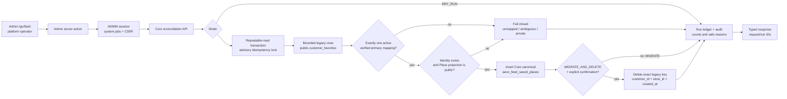

กติกาของ reconciliation slice:

- Core รับ actor จาก app-scoped Admin session เท่านั้น; browser ไม่อ่าน Supabase และไม่ส่ง `place_id` ที่เชื่อเองมาแทน mapping
- Mapping ใช้ `aevo_place_relationships` ที่เป็น `store` relationship และต้อง `active + verified + primary + non-revoked`; ห้ามเดาจากชื่อหรือ slug
- `DRY_RUN` จะไม่เขียน canonical save; `MIGRATE` เพิ่ม save ที่ผ่าน public projection gate; `MIGRATE_AND_DELETE` ลบเฉพาะ row ที่ migrate ได้และใช้ exact key ใน transaction เดียวกัน
- ทุก run จำกัด scope/limit, มี idempotency hash, reason, audit และ run ledger; key เดิมกับ request คนละเนื้อหาจะได้ conflict
- mutation เปิดอัตโนมัติเฉพาะ development/test/local; นอกนั้นต้องเปิด `AEVO_ALLOW_LEGACY_FAVORITE_RECONCILIATION=true` และ hard delete ต้องเปิด `AEVO_ALLOW_LEGACY_FAVORITE_HARD_DELETE=true` เพิ่ม

## 15. Current implementation boundary

| ส่วน | สถานะ | ความหมาย |
| --- | --- | --- |
| Legacy Customer favorites reconciliation | `BATCH-FEED-015` verified for controlled development/test maintenance | Core route + Admin panel รองรับ dry-run, migrate และ confirmed exact delete ผ่าน explicit store-to-Place mapping, idempotency, audit และ environment gates; Customer Gateway parity/ownership และ production cleanup ยังแยก gate |
| Config schema, validator, bounds, fallback | `FEED-002` verified | พร้อมให้ Core facade เรียกใช้; active config lifecycle และ connected development verification ผ่านแล้ว |
| Core-owned migrations `0010` + `0034` + `0035` + `0036` + Feed `0037` | applied/verified in development | `0010` owns Feed config lifecycle; `0034` owns the Core moderation adapter; `0035` owns authenticated negative feedback/idempotency; `0036` owns private append-only hide/unhide history; Feed `0037` owns the actor/time read index; production apply/rollout remains separate |
| Admin config routes | มีใน Core API | `aevo-admin` มี typed read + draft/validate/diff/publish/rollback lifecycle |
| Admin moderation routes | มีใน Core API | `aevo-admin` มี queue/evidence/action UI, status cursor, permission/CSRF/idempotency/expected-status guards และ safe hold-to-confirm states; connected DB/RPC และ legacy cleanup ยังแยก gate |
| Public Feed facade/session/cursor | `FEED-003` verified locally + endpoint smoke | authenticated database session integration และ deployed Edge/Core verification ยังรอ environment |
| TRACE/PLACE candidate generators | `FEED-004` verified | canonical eligibility and public boundary remain server-side |
| calibration/ranking/diversity selector | `FEED-005` verified | projection does not replace ranking authority |
| Feed serving metrics projection | `FEED-007` Core controlled slice | rebuild/rollback/health and bounded TRACE/PLACE reads verified in local PostgreSQL; client/production schedule remain separate |
| Aevo Go Core Feed adapter | `FEED-008` test client + connected local runtime | strict parser, one server-ordered infinite query, opaque token event batching, Explore legacy removal, concrete Core payload serialization, local Edge HTTP smoke, and Go browser rendering are verified; deployed-origin browser and production rollout remain separate |
| Authenticated Feed negative feedback | `DISCOVERY-006A` controlled connected slice | signed token/session binding, CSRF, idempotency replay/conflict, RLS-protected Core state, candidate suppression/restoration, private append-only reason/transition history, bounded authenticated history read route/Go panel, and connected tests are verified; anonymous live entity hide/unhide is session-local with a tested policy boundary; durable anonymous persistence, deployed browser smoke and production rollout remain separate |
| Aevo Admin Feed control boundary | `FEED-009-READ` + `FEED-009-MUTATION` + `FEED-009-MODERATION` | active config, health, typed draft/validation/diff, audited publish/rollback, moderation queue/evidence/actions, permission/CSRF/idempotency/version-status-conflict boundaries, and degraded states are verified; connected development RPC adapter is verified; FEED-010 hardening, media/evidence, deployed browser smoke, and production rollout remain separate |
| Discovery typed config boundary | `DISCOVERY-008` partial controlled slice | shared/Core/OpenAPI/Admin discovery policy is typed; old revisions receive safe defaults; taste decay and four inventory-backed module bounds/order are wired into private Core seams; connected config lifecycle and portfolio smoke pass; public evidence/media flags remain fail-closed and DB/RLS/media lifecycle is open |

เอกสารที่ควรอ่านต่อ: [`13-config-validation-and-experiments.md`](13-config-validation-and-experiments.md), [`12-admin-config-workflow.md`](12-admin-config-workflow.md), [`02-feed-architecture.md`](02-feed-architecture.md), และ [`19-phase-execution-and-verification.md`](19-phase-execution-and-verification.md)

## 16. Discovery direction graph (2026-09-27)

เอกสารฉบับนี้ยังคงเป็น graph ของ Feed config/control boundary เดิมและ
FEED-009 moderation history ไม่ถูกเขียนทับ. สำหรับ architecture ใหม่ที่
แยก Discovery Entity ออกจาก Community Evidence ให้อ่าน
[`22-personalization-architecture.md`](22-personalization-architecture.md)
และ roadmap/approval gate ที่
[`25-discovery-roadmap-and-verification.md`](25-discovery-roadmap-and-verification.md)

```text
explicit intent (query / area / vibe / map / time)
          + session preference
          + long-term taste
          + coarse geographic context
                         |
                         v
        Place/Trace candidate generators only
                         |
       eligibility: moderation + privacy + block/mute
                         |
      feature hydration + entity-specific calibration
                         |
            contextual score (OFF/SHADOW/LIVE)
                         |
        re-rank: seen / diversity / novelty / quotas
                         |
      module selector: FOR_YOU / NEAR_SELECTED_AREA /
        NEW_AND_USEFUL / COMMUNITY_FAVORITES
                         |
      public Place/Trace + bounded evidence/reason
                         |
         Go Explore: open / save / map / book / Trace
```

กฎสำคัญของ graph นี้คือ Review/Photo/Comment/Post/Creator ไม่ไหลเข้ามาเป็น
candidate อิสระโดยอัตโนมัติ แต่เป็น evidence/provenance ของ Place หรือ Trace;
ถ้า evidence หรือ booking dependency ใช้งานไม่ได้ Feed ต้องยัง fallback เป็น
discovery ที่ปลอดภัยและ deterministic ได้.
