# Feed events v1

Status: Core-controlled implementation verified on 2026-09-25. The public Go client and deployed Pub/Sub binding remain behind the FEED-008/FEED-012 rollout gates.

## Boundary

The event route is:

```text
POST /api/v1/public/feed/events
```

Core resolves the GO application session or the server-issued anonymous Feed cookie. The client may send only the signed `feedSessionId`/`itemToken` pair returned by the Feed response; it cannot choose an actor, tenant, source, config version, ranking version, or database target.

The batch envelope is bounded to 100 events. Metadata is an allowlisted object and never contains exact coordinates, raw ranking features, private preferences, or service credentials.

## Event semantics

| Event | Required condition | Item type |
| --- | --- | --- |
| `impression` | `visibleRatio >= 0.50` and `visibleDurationMs >= 1000` | TRACE or PLACE |
| `engaged_view` | `visibleRatio >= 0.50` and `visibleDurationMs >= 3000` | TRACE or PLACE |
| `open`, `click`, `save`, `share` | valid signed item token | TRACE or PLACE |
| `trace_start`, `trace_complete` | valid signed item token | TRACE |
| `place_open`, `booking_click` | valid signed item token | PLACE |

`occurredAt` may be up to five minutes in the future or seven days in the past for offline delivery. The client event ID is the idempotency key within the server-resolved principal binding. A same-payload retry is `DUPLICATE`; the same ID with a different payload is `REJECTED` with `EVENT_IDEMPOTENCY_CONFLICT`.

The response uses `202 Accepted` and returns one status per submitted event:

```json
{
  "accepted": 1,
  "duplicates": 0,
  "sampledOut": 0,
  "rejected": 0,
  "results": [{ "eventId": "client-event-1", "status": "ACCEPTED" }]
}
```

Sampling is deterministic per principal and event ID. Sampled events are retained as an idempotency record but do not create an outbox row.

## Processing graph

```mermaid
flowchart LR
    A[Web / PWA / Capacitor] --> B[POST Feed events batch]
    B --> C[Resolve GO session or anonymous cookie]
    C --> D[Verify item token + session + principal binding]
    D --> E[Validate semantics, thresholds, skew, metadata]
    E --> F{Deterministic sample}
    F -->|kept| G[Transactional intake row]
    F -->|sampled out| H[Idempotency row only]
    G --> I[Durable Feed outbox]
    I --> J[Pub/Sub / Worker delivery]
    J --> K[Core internal consumer claim]
    K --> L[Inbox dedupe]
    L --> M[Daily item stats projection]
    M --> N[Admin health: lag / failure / dead-letter]
```



Intake does not synchronously write ranking tables. The consumer uses `FOR UPDATE SKIP LOCKED`, an inbox key per consumer/principal/event, bounded retries, and a dead-letter status after five attempts. Replay moves only dead-letter rows back to `PENDING`; it does not duplicate already processed statistics.

## Storage and security

Core migration `0013_feed_event_pipeline.sql` owns:

- `aevo_feed_event_intake` — immutable validated payload and version binding;
- `aevo_feed_event_outbox` — durable asynchronous delivery state;
- `aevo_feed_event_inbox` — consumer idempotency state;
- `aevo_feed_event_stats_daily` — bounded daily item/event counters.

All four tables have RLS enabled and no browser/public grants or policies. Core sets transaction-local `aevo.app_code`, `aevo.user_id`, and the hashed Feed principal binding. The service role and database URL remain backend-only.

The background worker accepts only authenticated `FEED_EVENT_ACCEPTED` delivery messages and forwards them to `/internal/feed/events/consume` using the separate `AEVO_FEED_EVENT_WORKER_TOKEN`. It does not acknowledge delivery when Core is unavailable.

## Compatibility and rollout

The existing TraceDee activity/outbox path remains a compatibility sink. This batch does not replay historical TraceDee rows and does not switch the Go client to the new route. Historical replay requires a separately measured cutoff and source mapping review. High-volume impression reporting remains disabled until the deployed worker/Pub/Sub binding, coverage dashboard, retention job, and rollback runbook are reviewed under FEED-012.
