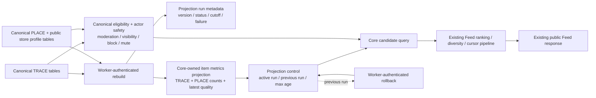
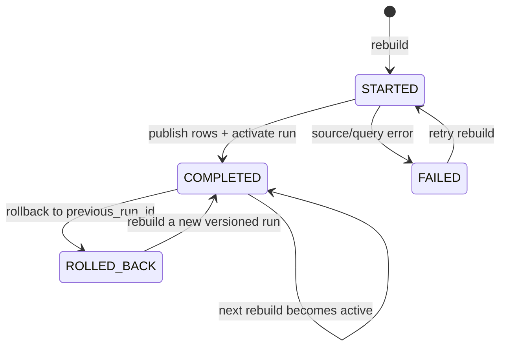

# Feed serving metrics projection v1

สถานะ: `FEED-007` Core controlled slice, 2026-09-25

เอกสารนี้อธิบาย projection สำหรับลดงานนับแบบ per-row ใน TRACE/PLACE candidate query โดย canonical TraceDee/public-discovery tables ยังเป็น source of truth และยังเป็นตัวตัดสิน eligibility, moderation, visibility, block/mute และ public store boundary

## Config boundary

ค่าต่อไปนี้เป็น backend/deployment configuration ไม่ใช่ FeedRuntimeConfig ที่ Admin publish ได้:

| ค่า | ค่าเริ่มต้น | ความหมาย |
| --- | --- | --- |
| `AEVO_FEED_PROJECTION_MODE` | `off` | `off` ใช้ canonical query เดิม, `shadow` อ่าน projection เพื่อเตรียมสังเกตการณ์แต่ไม่ใช้ค่าแทน, `active` ใช้ metrics ที่ fresh |
| `AEVO_DATABASE_URL` | required | private Core Npgsql connection; browser และ Supabase client ห้ามอ่าน projection โดยตรง |
| `AEVO_FEED_EVENT_WORKER_TOKEN` | required สำหรับ internal route | token สำหรับ worker เรียก rebuild/rollback; ไม่อยู่ใน public contract |
| `aevo_feed_projection_control.max_age_seconds` | `300` | freshness bound ของ active run; ควบคุมใน Core database และไม่รับจาก request |

การเปลี่ยน `AEVO_FEED_PROJECTION_MODE` ต้องทำผ่าน deployment/config boundary และเริ่มจาก `off` หรือ `shadow`; ไม่ใช้ query parameter, browser flag หรือ client route เป็น kill switch

## Feed flow graph

ใน `active` mode ค่า count/quality ใช้จาก projection เมื่อมี active row และยัง fresh ตาม `max_age_seconds`; ถ้า row หายหรือ stale query จะ fallback ไป canonical calculation ของ item นั้น เพื่อให้ migration นี้ additive และ rollback ได้โดยไม่ย้าย authority ไปไว้ที่ read model

## Projection lifecycle

ตาราง `aevo_feed_projection_runs` เก็บ version, source cutoff, row counters และ failure metadata; `aevo_feed_projection_control` เปลี่ยน active/previous pointer แบบ transaction เดียว; rows ของแต่ละ run อยู่ใน `aevo_feed_item_metrics_projection` และถูกลบพร้อม run ผ่าน foreign key cascade

## Operational routes

- `POST /internal/feed/projections/rebuild` — worker token เท่านั้น; สร้าง versioned run และ activate เมื่อสำเร็จ
- `POST /internal/feed/projections/rollback` — worker token เท่านั้น; ย้อนกลับไป `previous_run_id` ถ้ามี
- `GET /api/v1/admin/go/feed/projections/health` — Admin app session + `go.analytics.read`; แสดง active/previous run, freshness, row count และ error code

ไม่มีการเปลี่ยน `GET /api/v1/public/feed`, ไม่มี Go client adoption, ไม่มี Edge/Hub route switch และไม่มี Supabase compatibility migration ใน batch นี้

## Security and tenant boundary

- Projection tables อยู่ภายใต้ Core migration owner และเปิด RLS; revoke public table privileges
- Core เป็น caller เดียวของ private Npgsql adapter; browser roles ไม่มี table grant หรือ service credential
- Projection เก็บ aggregate ของ public Feed candidates เท่านั้น; tenant/private eligibility ยังคง resolve จาก canonical joins ก่อน ranking/hydration
- ค่า error ที่ส่งออกเป็น allowlisted code; raw database detail ไม่ออกทาง operational response

## Verification target

`FeedServingProjectionIntegrationTests` ตรวจ migration schema/RLS/index, rebuild สอง run, active/previous pointer, rollback, stale-read health, indexed `EXPLAIN`, TRACE และ PLACE concurrent candidate reads และ bounded connection/query pressure ใน local PostgreSQL
