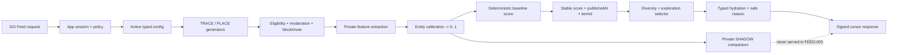

# Feed phase notes and verification ledger

Status: FEED-000 through FEED-007 controlled batches recorded; the FEED-008 Aevo Go test-client slice, the FEED-008 legacy Explore dead-code cleanup, FEED-009-READ Admin read boundary, FEED-009-MUTATION typed config lifecycle, and FEED-009-MODERATION controlled queue/action slice are also verified for their controlled gates. Discovery contract/request, safety-contract, private taste-guard, profile projection lifecycle, module/UI, typed-config, explicit-intent Core, contextual re-ranking, connected moderation-adapter, connected high-confidence UGC text policy, authenticated negative-feedback, authenticated unhide/restoration, anonymous session-local behavior, private history-read, read-only outcome/guardrail-evaluation, private media quarantine/cleanup, source-health, canonical four-module contract cleanup, generator-degraded module state, hydration-time suppression rechecks, concrete Feed payload serialization, connected Core-to-Edge-to-Go browser smoke, Feed production-secret wiring, standalone Admin runtime, canonical Go Saved/Profile projection slices, and the canonical Map/Search `savedOnly` boundary are recorded as controlled follow-ups. Core development-database migration, Supabase development profile rebuild/delete RPCs and account-delete anonymization, authenticated session, RLS, active-config, real TRACE/PLACE candidate generation, ranking, calibration, diversity, exploration, cursor stability, the Core Feed event intake/consumer pipeline, the Core serving-metrics projection slice, the Core-only Go Explore client, the Admin config lifecycle authority, the Core moderation adapter, authenticated hide/unhide suppression/restoration, hydration-time negative-feedback safety, bounded authenticated history reads, bounded Admin discovery evaluation, removal of unreferenced Explore legacy code, replacement of the old `/traces` list feed with a canonical Explore redirect, and the Core-owned canonical Place save list/save/unsave path are verified for their controlled gates. The `/traces/:traceSlug` detail route and Trace Map read adapter remain intact. No production route switch, deployed Pub/Sub binding, production worker schedule, public media/evidence enablement, authenticated deployed browser smoke, or production rollout has been executed.

ARCHITECTURE REVIEW REVISION

This is the running handoff log for the controlled FEED-000 → FEED-001 → FEED-002 → FEED-003 → FEED-003A → FEED-004 → FEED-005 → FEED-006 → FEED-007 → FEED-008 → FEED-009-READ → FEED-009-MUTATION → FEED-009-MODERATION sequence. One row is updated after each implementation prompt or integration gate. Do not mark a batch `VERIFIED` until the applicable repository checks and acceptance evidence are attached.

## Current ledger

| Batch | Phase | Status | Repositories changed | Verification evidence | Gate |
| --- | --- | --- | --- | --- | --- |
| `BATCH-FEED-000-ADR` | Ownership ADR | VERIFIED FOR CONTROLLED IMPLEMENTATION | Root Feed docs only | ADR amendment and project-owner authorization recorded; docs self-check passed | FEED-001 unblocked for controlled implementation |
| `BATCH-FEED-001-CONTRACT` | Contract boundary | VERIFIED FOR CONTROLLED IMPLEMENTATION | `aevo-contracts`, `aevo-core-api`, `aevo-edge-gateway`, root Feed docs | Contract, Core build, Edge tests/build, compatibility and safety scans passed | FEED-002/003 may start one batch at a time |
| `BATCH-FEED-002-CONFIG` | Config control plane | VERIFIED | `aevo-core-api`, `aevo-contracts` | Original implementation checks plus BATCH-FEED-003A migration apply/verify, real PostgreSQL lifecycle, outbox, rollback, and concurrency evidence | Core config authority is database-backed; later propagation consumers remain separate |
| `BATCH-FEED-003-FACADE` | Core facade/session | VERIFIED | `aevo-core-api`, `aevo-contracts` | Original facade checks plus BATCH-FEED-003A authenticated GO, anonymous, cross-app isolation, real-config HTTP smoke, and cursor/version evidence | FEED-004 may start only as a separate prompt |
| `BATCH-FEED-003A` | Database migration and authenticated integration verification | VERIFIED | `aevo-core-api` and root Feed ledger/plan | Migration `0010` applied and verified; 3 database integration tests pass; full Core suite 18/18; real-config HTTP smoke, override matrix, RLS role boundary, outbox, publish/rollback, and secret scan pass | `FEED-004 TRACE + PLACE` candidate generation is unblocked for a separate batch |
| `BATCH-FEED-004` | TRACE + PLACE candidate generation and server-side mixed composition | VERIFIED | `aevo-core-api` and root Feed docs | Core build passes; unit suite 28/28; real PostgreSQL generator/hydration/safety tests 2/2; selected DB integration suite 5/5; migration verify reports 10 applied; HTTP mixed-feed/pagination/nearby/policy smoke passes | `FEED-005` ranking, entity calibration, diversity, and exploration is unblocked for a separate batch |
| `BATCH-FEED-005` | Versioned ranking, calibration, diversity, exploration, and safe explanations | VERIFIED | `aevo-core-api` and root Feed docs | Core build passes; unit suite 50/50; real PostgreSQL canonical/ranking tests 3/3; selected DB integration suite 6/6; migration verify reports 10 applied; HTTP mixed-feed/pagination/policy smoke passes with overlap 0 | `FEED-006` events and `FEED-007` query-plan/load work remain separate |
| `BATCH-FEED-006` | Versioned Feed event intake, durable outbox/inbox, consumer, and bounded stats | VERIFIED FOR CORE CONTROLLED PIPELINE | `aevo-core-api`, `aevo-contracts`, `aevo-background-worker`, root Feed docs | Core build; unit 81/81; targeted real PostgreSQL event test 1/1 within selected DB suite 7/7; contract checks 36 tests; worker checks 7 tests; HTTP event smoke accepted/duplicate/rejected and consumer processed 1 | Client route switch, deployed Pub/Sub binding, historical replay, coverage dashboard, and FEED-012 rollout remain separate |
| `BATCH-FEED-007` | Core serving metrics projection, hot-path count reduction, rebuild/rollback, and bounded load evidence | VERIFIED FOR CORE CONTROLLED SLICE | `aevo-core-api` and root Feed docs | Core build 0 warnings/0 errors; full Core suite 97/97; projection PostgreSQL integration 1/1; migration verify 20 applied; RLS transaction-context check passed; indexed `EXPLAIN`; concurrent TRACE/PLACE candidate reads passed | Client route switch, production worker schedule, deployed rollout, and broader SLO/load campaign remain separate |
| `BATCH-FEED-008` | Aevo Go unified Feed client adapter and event transport | VERIFIED FOR TEST CLIENT SLICE | `aevo-go` and root Feed docs | `bun run typecheck` passed; `bun run test` passed 30 files/102 tests; `bun run build` passed; Core transport, cursor, opaque token, event batch, retry, and legacy-removal checks passed | Core is now the only Explore transport; `/traces` and Trace Map legacy compatibility, production route switch, browser backend smoke, dismissal mutation, and rollout remain separate |
| `BATCH-FEED-008-LEGACY-CLEANUP` | Remove unreferenced legacy Explore implementation | VERIFIED FOR CONTROLLED GO SOURCE CLEANUP | `aevo-go` and root Feed docs | `LegacyExplorePage`, its local `SearchField`, `getDiscovery` import, and unused `TraceDeePreview` import are absent; router still maps the index route to `ExplorePage -> DiscoveryExplorePage`; `bun run typecheck`, `bun run test` (44 files/157 tests), and `bun run build` passed | `/traces` and Trace Map compatibility flows, legacy Hub moderation/data cleanup, production route switch, authenticated browser smoke, and rollout remain separate |
| `BATCH-FEED-008-TRACES-REDIRECT` | Retire the legacy TraceDee list feed entry | VERIFIED FOR CONTROLLED GO SOURCE CLEANUP | `aevo-go` and root Feed docs | `/traces` redirects to `/?tab=for_you&category=trace`; the unreferenced `TraceDeeFeedPage` and its list-only styles are removed; route regression 2/2, source scan, `bun run typecheck`, `bun run test` (45 files/161 tests), and `bun run build` passed | `/traces/:traceSlug`, Trace Map read compatibility, detail/action APIs, production origin switch, authenticated browser smoke, and data cleanup remain separate |
| `BATCH-FEED-008-CONNECTED-RUNTIME` | Concrete public Feed payload and local Core-to-Edge-to-Go runtime | VERIFIED FOR CONNECTED LOCAL RUNTIME SMOKE | `aevo-core-api`, `aevo-go`, root launcher, and root Feed docs | Core JSON now serializes concrete TRACE/PLACE fields through the interface boundary; Core serialization regression 2/2, Core full suite 166/166, Edge HTTP 200 with hydrated fields and signed tokens, Go browser rendered 8 live items plus the module shelf, and `/traces` redirected to `/?tab=for_you&category=trace`; Go full suite 45 files/161 tests and build passed | Production origin switch, deployed authenticated browser evidence, SLO/load campaign, public media/evidence owner, and rollout remain separate |
| `BATCH-FEED-012-INFRA-SECRETS` | Core/Feed production secrets and readiness guard | VERIFIED FOR INFRASTRUCTURE + RUNTIME CONFIG CONTRACT | `aevo-infrastructure`, `aevo-core-api`, `aevo-background-worker`, Core/Worker env examples, and root Feed docs | Nonprod/prod Terraform creates and injects `AEVO_CORE_API_SERVICE_SECRET` and `AEVO_FEED_CURSOR_SECRET` into Core plus `AEVO_FEED_EVENT_WORKER_TOKEN` into Core + Background Worker; Core/Worker production-like readiness fails closed for missing or weak Feed wiring; Core 171/171 and Worker 18/18 tests pass; infrastructure manifest/migration ownership checks, `terraform fmt -check`, and `terraform validate` for both environments pass | Secret values must be provisioned/rotated by the deployment owner; no Terraform apply, Cloud Run deploy, production origin switch, or production browser smoke was executed |
| `BATCH-FEED-012-LOAD-HARNESS` | Bounded Feed runtime/load verification harness | VERIFIED FOR CONTROLLED LOCAL RUNTIME EVIDENCE | Root scripts, Core/Edge local runtime, and Feed docs | The reusable harness validates the typed public envelope, TRACE/PLACE identity uniqueness, module references, private-field absence, bounded concurrency, error rate, and p50/p95/max latency; harness tests pass 4/4; two local Core→Edge runs of 20 requests at concurrency 4 returned 20/20 HTTP 200, 0% errors, 60 hydrated items, cold/warm p95 2,830/1,686 ms, and one degraded response per run | This is local connected evidence only; it is not a production SLO/load/canary result, and the degraded response/cold-start behavior remains an operational follow-up |
| `BATCH-FEED-012-CORE-MUTATION-REGRESSION` | Connected Place mutation/read and public Feed safety regression closure | VERIFIED FOR CONTROLLED DEVELOPMENT DATABASE EVIDENCE | `aevo-core-api` and Map/Feed verification docs | Reader-lifecycle fix, mixed multi-place metadata handling, exact mutation-fixture cleanup, replay retry timestamp binding, and allowlisted `placeReference.sourceVersion` safety boundary; full Core connected suite 172/172, Place mutation 2/2, Feed canonical source 6/6 | Canonical Place deletion remains soft-delete with immutable revision history; no production legacy cleanup, deployed route switch, or rollout is claimed |
| `BATCH-FEED-013-CANONICAL-PLACE-SAVE` | Core-owned authenticated canonical Place save projection | VERIFIED FOR CONTROLLED DEVELOPMENT DATABASE + GO CLIENT SLICE | `aevo-core-api`, `aevo-go`, `aevo-contracts`, `aevo-edge-gateway`, and Feed docs | Migration `0040_feed_saved_places.sql`; Core list/save/unsave routes, CSRF, GO app session, rate limit, public-projection gate, RLS, idempotency replay/conflict, exact reversibility, and non-public rejection; Go Explore saved-state hydration, Saved-page canonical list/detail/remove UI, and canonical Profile saved count; Edge forwards POST/DELETE and allows browser DELETE preflight; connected Core test 1/1 and full suite 175/175; Go full suite 45 files/162 tests, typecheck/build; Edge 8 tests/typecheck/dry-run; shared contracts 56 tests/230 expectations | This is an interaction projection, not Customer favorites source of truth; target-environment migration, deployed authenticated browser evidence, parity/ownership decision, and production route rollout remain open |
| `BATCH-FEED-014-CANONICAL-SAVED-FILTER` | Core-authoritative canonical Map/Search `Saved only` filter | VERIFIED FOR CONTROLLED DEVELOPMENT DATABASE + CLIENT CONTRACT SLICE | `aevo-core-api`, `aevo-go`, `aevo-contracts`, and Feed/Map docs | Typed `savedOnly` query contract; Core resolves the GO session and saved canonical Place IDs, parameterizes the projection filter, binds saved Search cursors to the principal, rate-limits personalized reads, and sends `no-store`; the read service fails closed without Core-resolved filter state; unauthenticated Map/Search `savedOnly=true` smoke returns typed 401; public Map remains cacheable; connected Place mutation/read test proves matching and non-matching saved filters; Core full suite 176/176 | Authenticated deployed browser smoke, target-environment migration, Customer favorites parity/source ownership, and production route rollout remain open |
| `BATCH-FEED-009-READ` | Aevo Admin Feed read-only control plane | VERIFIED FOR CONTROLLED READ SLICE | `aevo-admin`, `aevo-contracts`, and root Feed docs | Contracts `bun run check` passed; OpenAPI 75 paths/48 Hub routes; Admin `bun run check` passed; active config, guardrails, propagation, revisions, event health, projection health, permission, and degraded-state boundaries are represented | Publish/validate/rollback mutations, moderation queue/actions, production origin switch, browser backend smoke, and rollout remain separate |
| `BATCH-FEED-009-MUTATION` | Aevo Admin Feed typed config lifecycle | VERIFIED FOR CONTROLLED MUTATION SLICE | `aevo-admin` and root Feed docs | Admin typecheck/build passed; contracts 76 paths/49 Hub routes and 36 tests passed; Core build passed; Core suite 105 tests passed; local Admin `/go/feed` SSR smoke and `/health` returned 200; database lifecycle tests were not activated because `AEVO_DATABASE_URL` is absent | Moderation queue/actions, production origin switch, deployed worker, browser authenticated smoke, and rollout remain separate |
| `BATCH-FEED-009-MODERATION` | Aevo Admin Feed moderation queue and actions | VERIFIED FOR CONTROLLED MODERATION SLICE | `aevo-admin`, `aevo-core-api`, `aevo-contracts`, `aevo-hub` migration, and root Feed docs | Contracts 79 paths/50 Hub routes and 36 tests passed; Admin typecheck/client/SSR build passed; Core build passed; Core suite 108 tests passed including cursor tests; migration security/static checks passed; local BFF/browser moderation smoke uses an explicit stub and verifies safe evidence rendering, permission boundary, hold-to-confirm UI, CSRF, and idempotency headers | Connected DB/RPC apply and authenticated production-origin/browser smoke remain external; FEED-010 hardening and legacy cleanup are separate |
| `BATCH-FEED-009-ADMIN-RUNTIME` | Canonical standalone Feed/Admin runtime and local launcher | VERIFIED FOR CONNECTED LOCAL RUNTIME SMOKE | Root launcher/scripts, `aevo-hub`, `aevo-admin`, and Feed docs | Canonical launcher starts Accounts `:8787`, Core `:5099`, Admin Edge `:4001`, and standalone Admin `:4335`; connected read-only Feed/Admin smoke passed API, SSR, and anonymous redirect checks; legacy active config without `discovery` now normalizes to a safe typed default; root and Hub launcher bundles passed | Production origin/deployed browser evidence, transitional workspace cleanup, media/evidence owner, and rollout remain separate |
| `BATCH-DISCOVERY-DIRECTION-AUDIT` | Discovery-first product direction and architecture reassessment | VERIFIED FOR DOCUMENTATION AUDIT | Root plan and `docs/feed-system/21–25` | Local polyrepo/source/migration/UI/phase audit completed; external primary research recorded; no production code, migration apply, dependency install, or data deletion | `DISCOVERY-001` is the next recommended implementation batch, pending product/data/privacy/security approvals; no batch was started |
| `BATCH-DISCOVERY-001-002` | Discovery contract and explicit request/session intent | VERIFIED FOR CONTROLLED CONTRACT/REQUEST SLICE | `aevo-contracts`, `aevo-core-api`, `aevo-go`, and root Feed docs; contract/request tests passed | Durable session/profile writes, booking fan-out, and connected DB evidence remain separate |
| `BATCH-DISCOVERY-003-SAFETY-CONTRACT` | Fail-closed UGC/media eligibility contract | VERIFIED FOR CONTRACT-ONLY SLICE | Shared/Core/Go safety contract tests passed; no storage/upload owner or media migration | Connected quarantine/moderation/media variants/appeals remain open |
| `BATCH-DISCOVERY-003-MODERATION-ADAPTER` | Core-owned moderation adapter and connected safety boundary | VERIFIED FOR CONTROLLED DEVELOPMENT-DATABASE SLICE | Core migration `0034_feed_moderation_adapter_boundary.sql` applied/verified as migration 37; connected RPC test passed atomic review, exact replay, and stale-version conflict; full Core suite 144/144; legacy-removal and RLS checks passed | Media/storage/variant owner, public evidence/media, deployed-origin/browser smoke, cache invalidation, appeals, and legacy cleanup remain open |
| `BATCH-DISCOVERY-003-UGC-TEXT-POLICY` | High-confidence no-NSFW text policy at Post/Comment writes | VERIFIED FOR CONNECTED DEVELOPMENT TEXT-POLICY SLICE | Supabase migrations `tracedee_ugc_text_policy` and `tracedee_ugc_text_policy_fail_closed` applied; policy cases, real create rejection/no-row, real edit rejection/no-change, service-role-only grants, installed-function checks, and visible-content scan passed | Keyword detection is not complete text moderation; media quarantine/approved variants, historical remediation, appeals, cache invalidation, deployed browser evidence, and production enablement remain open |
| `BATCH-DISCOVERY-003-CONTENT-LIFECYCLE` | Connected Post/Comment edit/delete lifecycle verification | VERIFIED FOR CONNECTED DEVELOPMENT TEST LIFECYCLE | Existing `tracedee_edit_content` and `tracedee_delete_content` RPCs were exercised against exact generated Post and Comment data; both edit paths persisted the new body, both delete paths set `REMOVED`/`deleted_at`/`deleted_by` and emitted delete events, exact Post/Comment/Thread rows were removed during cleanup, and immutable activity events remained retained | Production audit retention policy and broad legacy data cleanup remain separate |
| `BATCH-DISCOVERY-003-UGC-TEXT-REMEDIATION` | Bounded historical UGC text remediation | VERIFIED FOR CONNECTED DEVELOPMENT REMEDIATION SLICE | Supabase migration `tracedee_ugc_text_remediation` applied; service-role-only run table/RPC, advisory-lock serialization, zero-drift scan, synthetic explicit legacy row held in `UNDER_REVIEW`, exact test-row cleanup, and post-cleanup visible scan passed | Media quarantine/approved variants, complete multilingual/image/video moderation, appeals, cache invalidation, deployed browser evidence, and production scheduling remain open |
| `BATCH-DISCOVERY-003-MEDIA-QUARANTINE` | Private development media quarantine and cleanup boundary | VERIFIED FOR CONNECTED DEVELOPMENT MEDIA-LIFECYCLE SLICE | Supabase migrations `tracedee_media_quarantine_boundary` and `tracedee_media_cleanup_propagation` applied; private `tracedee-quarantine` bucket, RLS/service-role-only metadata table, source/path/MIME/size/hash validation, idempotent registration, optimistic `QUARANTINED` → `UNDER_REVIEW` → `APPROVED`/`REJECTED`/`DELETED` decisions, bounded cleanup plan, worker object-delete task unit tests, cleanup completion RPC, invalid approval rejection, exact test asset cleanup, and zero Storage objects afterward passed | Automated image/video scanning, production upload/API owner, signed approved-variant publication, appeals, cache invalidation, deployed browser evidence, and production scheduling remain open |
| `BATCH-DISCOVERY-004-FEATURE-GUARD` | Private taste projection guard | VERIFIED FOR CONTROLLED CORE PRIVATE FEATURE SLICE | Core feature/ranking/integration source tests and build passed; no public raw features | Async rebuild/delete, provenance, freshness health, and connected DB evidence remain open |
| `BATCH-DISCOVERY-004-PROFILE-LIFECYCLE` | Profile projection rebuild/delete and account-delete propagation | VERIFIED FOR CONTROLLED CONNECTED DEVELOPMENT SLICE | Supabase migrations `tracedee_profile_projection_lifecycle` and `tracedee_profile_deletion_propagation` applied; scoped rebuild/delete job RPCs, worker task boundary, projection counts, idempotent job processing, exact test-user cleanup, and auth deletion anonymization passed | Source provenance, freshness health, production worker schedule/observability, and deployed browser evidence remain separate |
| `BATCH-DISCOVERY-007-009-GO-UI` | Entity-first module shelf and live intent boundary | VERIFIED FOR CONTROLLED GO UI SLICE | Go typecheck/tests/build passed; live/demo boundary preserved; connected Core portfolio smoke now proves four non-empty shelves | Contribution routes and authenticated Go/Admin browser smoke remain open |
| `BATCH-DISCOVERY-008-CONFIG-SLICE` | Typed discovery configuration and Admin controls | VERIFIED FOR CONTROLLED TYPED CONFIG SLICE | Contracts/OpenAPI, Core, Admin typecheck/build, config tests, four-module portfolio wiring, and the typed source-health route/UI passed | Public evidence/media pipeline, availability quota policy, and authenticated connected Admin smoke remain open |
| `BATCH-DISCOVERY-006-INTENT-SEAM` | Explicit intent hierarchy and Trace category filtering | VERIFIED FOR CONTROLLED CORE INTENT SLICE | Core 137 tests, 0 warnings/0 errors build; Contracts 54 tests; Admin check; Go 150 tests/build; HTTP smoke passed | Contextual diversity/seen window is recorded in the follow-up batch; full Candidate V2, feedback, connected SQL proof, LIVE personalization, and legacy cleanup remain separate |
| `BATCH-DISCOVERY-006-CONTEXTUAL-RERANK` | Typed category/area/business caps and cursor seen suppression | VERIFIED FOR CONTROLLED CORE RE-RANKING SLICE | Core 143 tests/build; Contracts 54 tests; Admin check; Go 150 tests/build; HTTP smoke passed | Full Candidate V2, durable feedback/novelty/outcome evaluation, connected DB/RLS proof, LIVE personalization, and legacy cleanup remain separate |
| `BATCH-DISCOVERY-006-OUTCOME-EVENTS` | Typed discovery outcome event ingestion | VERIFIED FOR CONTROLLED CONNECTED DEVELOPMENT SLICE | Real PostgreSQL accepts `impression`, `open`, `place_open`, and `booking_click` for a signed PLACE item, consumes the durable outbox, and records one daily stat per outcome; full Core suite/build passed | Causal outcome evaluation, guardrail dashboards, anonymous semantics, LIVE personalization, and production rollout remain open |
| `BATCH-DISCOVERY-006-EVALUATION-SNAPSHOT` | Read-only discovery outcome and guardrail evaluation snapshot | VERIFIED FOR CONTROLLED CONNECTED DEVELOPMENT + ADMIN CONTRACT SLICE | Core route `/api/v1/admin/go/feed/discovery-evaluation?days=1..90` aggregates accepted counts plus active hides, hide transitions, and event dead-letters; response is explicitly `INGESTION_ONLY_NO_CAUSAL_ATTRIBUTION`; connected outcome test, Contracts OpenAPI/typecheck/tests, Core build, and Admin typecheck/build passed | Session-level attribution, deduplication/coverage policy, causal evaluation, LIVE/canary activation, authenticated Admin browser smoke, and production rollout remain open |
| `BATCH-DISCOVERY-006A-NEGATIVE-FEEDBACK` | Authenticated Core hide mutation and candidate suppression | VERIFIED FOR CONTROLLED CONNECTED DEVELOPMENT SLICE | Core migration `0035_feed_negative_feedback.sql` applied/verified as migration 39; exact replay/idempotency conflict, signed token/session binding, active TRACE suppression, and Core/Go contract tests passed; RLS schema check passed | Unhide/reason-management follow-up, anonymous persistence, profile delete/rebuild propagation, deployed browser evidence, production rollout, and legacy cleanup remain separate |
| `BATCH-DISCOVERY-006A-UNHIDE` | Authenticated Core unhide and candidate restoration | VERIFIED FOR CONTROLLED CONNECTED DEVELOPMENT SLICE | Existing `0035` state row uses `active=false` for unhide; connected test proves suppression is cleared and candidate returns; Contracts 54, Go 155, Core build/tests passed | Reason history UI, anonymous persistence, profile delete/rebuild propagation, deployed browser evidence, production rollout, and legacy cleanup remain separate |
| `BATCH-DISCOVERY-006A-HISTORY` | Append-only authenticated hide/unhide reason history | VERIFIED FOR CONTROLLED CONNECTED DEVELOPMENT SLICE | Core migration `0036_feed_negative_feedback_history.sql` applied/verified as migration 40; connected test proves hide reason and unhide transition are both retained under RLS and scoped cleanup; Core build passed | Profile propagation/rebuild, durable anonymous persistence, deployed browser evidence, production rollout, and legacy cleanup remain open |
| `BATCH-DISCOVERY-006A-ANONYMOUS-LOCAL` | Anonymous hide/unhide session-local boundary | VERIFIED FOR CONTROLLED GO UI SLICE | Live anonymous TRACE/PLACE hide/unhide never calls Core and keeps state only in the mounted Explore page; authenticated hide records `core` persistence at mutation time so an expired session cannot silently clear durable feedback; policy unit test, Go typecheck, full Vitest, and production build passed | Durable anonymous persistence, authenticated browser evidence, profile propagation/rebuild, production rollout, and legacy cleanup remain open |
| `BATCH-DISCOVERY-006A-HISTORY-READ` | Authenticated private feedback history read | VERIFIED FOR CONTROLLED CONNECTED DEVELOPMENT + GO UI SLICE | Core route `/api/v1/public/feed/feedback/history` returns only bounded actor-scoped entries; migration `0037_feed_negative_feedback_history_read_index.sql` applied/verified; connected hide/unhide/history test, OpenAPI/contracts, Go transport test, Go full suite/build passed | Durable anonymous persistence, profile propagation/rebuild, authenticated browser evidence, production rollout, and legacy cleanup remain open |
| `BATCH-DISCOVERY-007-CONNECTED-RUNTIME` | Connected Core entity-only module runtime | VERIFIED FOR CONTROLLED CONNECTED DEVELOPMENT SLICE | Real PostgreSQL fixture through Core facade proves TRACE candidate generation, deterministic ranking, hydration, signed item token, and `FOR_YOU` reference equality; Core build/full suite and targeted connected test passed | Four-module portfolio coverage is recorded separately; evidence/availability health, deployed/browser smoke, and production rollout remain open |
| `BATCH-DISCOVERY-007-MODULE-PORTFOLIO` | Inventory-backed discovery module portfolio | VERIFIED FOR CONTROLLED CONNECTED DEVELOPMENT + SOURCE/CONTRACT SLICE | Shared typed config, OpenAPI, Core validator, server selector, Admin order controls, targeted selector tests, and a connected canonical TRACE/PLACE fixture now support non-empty `FOR_YOU`, `NEAR_SELECTED_AREA`, `NEW_AND_USEFUL`, and area-scoped `COMMUNITY_FAVORITES`; Core reserves module minimums before filling the broad shelf and connected/unit assertions prove no entity repeats across emitted modules; unsupported IDs are rejected; full Core suite 159/159 passed | Availability quota policy, save/booking/journey projections, public evidence, deployed browser evidence, and production rollout remain open |
| `BATCH-DISCOVERY-007-MODULE-CONTRACT-CLEANUP` | Remove unsupported discovery module IDs from public contracts | VERIFIED FOR CONTROLLED CONTRACT/UI CLEANUP | Shared `discovery-modules` contract, Go Feed response schema, Go module labels, and OpenAPI now expose only the four Core-backed modules; contract tests reject `BOOKABLE_NOW`, `BECAUSE_YOU_SAVED`, and `CONTINUE_TRACE`; Contracts check passed, Go typecheck/tests passed (44 files/159 tests) | This removes stale contract/UI options only; booking/save/journey projections, availability quota policy, public evidence, deployed browser evidence, and production rollout remain open |
| `BATCH-DISCOVERY-007-SOURCE-HEALTH` | Canonical source availability and freshness health | VERIFIED FOR CONTROLLED CONNECTED DEVELOPMENT + ADMIN READ SLICE | Core source-health policy covers `HEALTHY`, `EMPTY`, `STALE`, and `UNAVAILABLE`; the read-only `/api/v1/admin/go/feed/sources/health` route is app-scoped to `go.analytics.read`; shared/OpenAPI/Admin types, policy tests, Core build, and connected canonical Feed/Admin runtime smoke passed | Dynamic availability quotas, booking/save/journey projections, public evidence, deployed browser evidence, and production rollout remain open |
| `BATCH-DISCOVERY-007-GRACEFUL-SHELVES` | Generator health propagation to server-owned modules | VERIFIED FOR CONTROLLED CORE SLICE | Failed/timeout generator telemetry now marks only affected modules `degraded`; disabled/empty/surface-not-supported outcomes remain deliberate non-outage states; selector and facade tests passed; no booking availability lookup is added to the Feed hot path | Availability quota policy and owning booking/save/journey projections remain separate |
| `BATCH-FEED-010-FACADE-SAFETY` | Public hydration and item-token safety boundary | VERIFIED FOR CONTROLLED CORE UNIT SLICE | Core facade rejects candidate/hydration type or identity mismatches, accepts only concrete TRACE/PLACE public contracts, and re-issues Core-signed item tokens at the response boundary; targeted facade/composition tests passed | Full moderation freshness/propagation, account-deletion coverage, deployed browser evidence, media/evidence owner, and production rollout remain open |
| `BATCH-FEED-010-HYDRATION-SAFETY` | Suppression and privacy re-check after hydration | VERIFIED FOR CONTROLLED CORE + CONNECTED DEVELOPMENT SLICE | Canonical TRACE, TraceDee PLACE, and store-profile hydration re-check active Core negative feedback for the bound actor; connected race regression bypasses candidate filtering and proves hidden TRACE/PLACE rows are not returned; selector/facade and connected safety tests passed | Moderation cache invalidation/freshness SLO, account-deletion propagation in every source, deployed browser evidence, appeals, and production rollout remain open |
| `BATCH-DISCOVERY-008-CONNECTED-LIFECYCLE` | Connected discovery-config persistence and rollback | VERIFIED FOR CONTROLLED CONNECTED DEVELOPMENT SLICE | Real PostgreSQL lifecycle proves typed discovery fields survive draft → validate → publish → runtime read → cursor binding → rollback; full Core suite/build passed | Public evidence/media pipeline, source health/quotas, authenticated Admin browser smoke, and production rollout remain open |

## Current documentation-run evidence

- Primary plan: `feed-implementation-plan.md` includes the batch protocol and links the controlled implementation prompts.
- Architecture documents: `docs/feed-system/00-current-state.md` through `18-open-questions.md`, plus `ADR-000-feed-data-ownership.md`.
- Execution documents: `19-phase-execution-and-verification.md` and the four prompt files under `prompts/`.
- Approval packet: `docs/feed-system/FEED-000-approval-request.md` is ready for named owner review; it is not an approval record.
- Production repositories: FEED-001 changed only the shared contract, Core contract/private seam, and Edge forwarding test. No Go, Admin, Hub runtime, infrastructure, migration, or dependency work was included. The workspace root is not itself a Git repository; nested-repository diff checks apply only when a nested repository is touched.
- Owner authorization: project-owner instruction `always approve` recorded on 2026-09-23 as a controlled-implementation amendment; independent production/environment review remains separate.
- Migration state: Core migration `0010_feed_config_control_plane.sql` was created under FEED-002, then applied and verified by BATCH-FEED-003A using the existing Core migrator. Core migrations `0034_feed_moderation_adapter_boundary.sql`, `0035_feed_negative_feedback.sql`, `0036_feed_negative_feedback_history.sql`, and `0037_feed_negative_feedback_history_read_index.sql` were subsequently applied only to the development database; the current Core migrator verifies 42 applied migrations (including the existing Hub `0037` migration); the historical Hub/Supabase migration remains a read-only reference and no Supabase CLI apply was used.
- FEED-003 state: Core owns `/api/v1/public/feed` with fixed GO app-session isolation, server-issued anonymous identity, bounded query normalization, policy/rate-limit errors, HMAC-signed session cursor primitives, database-backed active-config metadata, a safe empty typed page, and private candidate/hydration seams. The development HTTP smoke resolved `configVersion=1`, `rankingVersion=deterministic-v1`, and `degraded=false` from PostgreSQL without fabricating items.

## BATCH-FEED-000-ADR — preflight review

- Status: VERIFIED FOR CONTROLLED IMPLEMENTATION.
- Date/time and operator: 2026-09-23; Codex workspace review.
- Prompt: `docs/feed-system/prompts/FEED-000-ADR.md`.
- Parent decision/gate: None; FEED-000 is the first gate.
- Repositories touched: Root Feed documentation only. No nested production repository was edited.
- Pre-existing dirty/untracked work preserved: `aevo-core-api`, `aevo-contracts`, `aevo-infrastructure`, and `aevo-hub` already had dirty/untracked state during preflight; no cleanup/reset/stash was performed.
- Files/areas changed: Phase pack and ledger only.
- Files/areas deliberately not changed: application source, migrations, package manifests, Wrangler/Terraform runtime settings, secrets, routes, Admin UI, and Go UI.
- Implementation summary: Compared ADR-000 with the current authority documents. The proposed Feed migration owner is consistent with `aevo-core-api/docs/adr/0001-core-api-authority.md`, `aevo-core-api/db/migrations/README.md`, and `aevo-core-api/db/README.md`, which state that Core owns target migrations and Hub/Supabase migrations remain read-only compatibility input. `aevo-hub/docs/adr/0005-app-scoped-session-and-sso.md` and `aevo-hub/docs/adr/0010-admin-application-boundary.md` support the app-scoped session, separate Admin, server-side authorization, and no-browser-service-key constraints.
- Contract/schema/config versions: ADR-000 remains Proposed; no Feed schema version or migration ID was created.
- Commands run and result: `test -s` checks for the ADR/boundary docs passed; `rg` ownership/secrets/rollback/approval scan passed; migration file inventory was inspected; no repository-level diff check was applicable to the root because it is not a Git repository.
- Evidence links or log paths: `docs/feed-system/ADR-000-feed-data-ownership.md`; `aevo-core-api/docs/adr/0001-core-api-authority.md`; `aevo-core-api/db/migrations/README.md`; `aevo-core-api/db/README.md`; `aevo-hub/docs/adr/0005-app-scoped-session-and-sso.md`; `aevo-hub/docs/adr/0010-admin-application-boundary.md`.
- Security/tenant/RLS/secret review: Existing ADRs confirm app-scoped opaque sessions, server-side authorization, Core authority, and server-only Supabase service credentials. Feed-specific approval from the security owner is not recorded.
- Migration and rollback result: No migration or runtime state changed. The ADR rollback sequence remains configuration/route based and requires owner acceptance.
- Decisions and open risks: The project owner authorized controlled implementation for all five decision rows through the active-thread instruction `always approve`. No `CODEOWNERS`/`OWNERS` file was found; independent specialist/environment sign-off may still be required before production rollout.
- Follow-up items (separate batch IDs): Preserve the Core-only migration owner, private adapter boundary, and specialist review requirements; if the adapter/network boundary changes, amend ADR-000 before the next batch.
- Next gate: FEED-001 contract batch may start. No production migration is allowed until its own migration checks and environment approvals are satisfied.

## BATCH-FEED-001-CONTRACT — verified handoff

- Status: VERIFIED FOR CONTROLLED IMPLEMENTATION.
- Date/time and operator: 2026-09-23; Codex workspace implementation batch.
- Prompt: `docs/feed-system/prompts/FEED-001-contract.md`.
- Parent decision/gate: FEED-000 accepted for controlled implementation by the project-owner instruction `always approve`; security and migration controls remain mandatory.
- Repositories touched: `aevo-contracts`, `aevo-core-api`, `aevo-edge-gateway`, and root Feed documentation.
- Pre-existing dirty/untracked work preserved: Nested repositories were already dirty/untracked during preflight; no reset, clean, stash, or unrelated-file cleanup was performed.
- Files/areas changed: Shared Feed TypeScript contract/tests, OpenAPI v1 Feed path and schemas, OpenAPI required-path validator, Core Feed contract records, private `IFeedDataPort` boundary, Edge Feed forwarding test, and compatibility mapping documentation.
- Files/areas deliberately not changed: Feed database migrations, Supabase migrations, candidate generators, ranking, config persistence, event consumers, live Go route/client, Admin Feed UI, Hub gateway, infrastructure, secrets, and dependency manifests.
- Implementation summary: Published `@aevocado/contracts` Feed v1 types for TRACE/PLACE, source-neutral response fields, safe reason codes, coarse-location input, allowlisted event metadata, and later event envelope. Added `/api/v1/public/feed` to OpenAPI with anonymous-or-app-session security, bounded query parameters, response/error references, and no raw scores, exact coordinates, or source internals. Core now owns the matching C# contract and private server-side data seam; Edge test proves the route forwards to Core and does not authorize the end user.
- Contract/schema/config versions: Feed contract `v1`; event schema `1`; release `2026-09-23`; route `/api/v1/public/feed`.
- Commands run and result:
  - `cd aevo-contracts && bun run check` — PASS; OpenAPI validation, typecheck, and tests (`10` passing before build).
  - `cd aevo-contracts && bun run build` — PASS.
  - `cd aevo-contracts && bun test` — PASS; `12` tests, `0` failures after generated output was rebuilt.
  - `cd aevo-core-api && dotnet build src/Aevo.CoreApi/Aevo.CoreApi.csproj` — PASS; `0` warnings, `0` errors.
  - `cd aevo-edge-gateway && bun run typecheck && bun test && bun run build` — PASS; `5` tests, `0` failures; Wrangler preview dry-run passed.
  - FEED-001 safety scan for trailing whitespace, service-key patterns, raw ranking/source fields, and Feed/Universal migration filenames — PASS.
- Evidence links or log paths: `aevo-contracts/src/feed.ts`; `aevo-contracts/openapi/v1.json`; `aevo-core-api/src/Aevo.CoreApi/Contracts/FeedApiContracts.cs`; `aevo-core-api/src/Aevo.CoreApi/Data/FeedDataPort.cs`; `aevo-edge-gateway/test/index.test.ts`; `docs/feed-system/17-polyrepo-contracts-and-ownership.md`.
- Security/tenant/RLS/secret review: Browser remains untrusted; Edge only proves ingress; Core remains the future session/policy authority; service credentials and exact location are excluded; event metadata is allowlisted. No direct Supabase access was added.
- Migration and rollback result: No migration changed. Existing Go compatibility routes remain the rollback path because live Go adoption is FEED-008; the new contract is additive and unused by the current client.
- Decisions and open risks: Core handler/session/cursor implementation is intentionally deferred to FEED-003. The private adapter interface has no external implementation yet; candidate reads remain outside this batch. Independent production/environment review may supplement the project-owner controlled-implementation authorization.
- Follow-up items (separate batch IDs): FEED-002 config lifecycle and FEED-003 facade/session must consume this contract without adding a second data/config authority.
- Next gate: Start exactly one of the FEED-002 or FEED-003 prompts; baseline order is FEED-002 then FEED-003.

## BATCH-FEED-002-CONFIG — Core Feed configuration control plane

- Status: VERIFIED; database/environment follow-up closed by `BATCH-FEED-003A` on 2026-09-24.
- Date/time and operator: 2026-09-23; Codex workspace implementation batch.
- Prompt: `docs/feed-system/prompts/FEED-002-config.md`.
- Parent decision/gate: FEED-000 is accepted for controlled implementation by the project-owner instruction `always approve`; FEED-001 contract is verified. The authorization does not waive RLS, app-scoped authorization, CSRF, idempotency, migration, or production/environment controls.
- Repositories touched: `aevo-core-api`, `aevo-contracts`, and this root Feed phase note. No `aevo-hub`, Supabase migration, `aevo-go`, `aevo-admin`, worker, or infrastructure repository was changed.
- Pre-existing dirty/untracked work preserved: Nested repositories were already dirty/untracked during preflight; no reset, clean, stash, or unrelated-file cleanup was performed. The workspace root is not itself a Git repository.
- Files/areas changed:
  - Core migration `aevo-core-api/db/migrations/0010_feed_config_control_plane.sql`.
  - Core typed config contracts, strict validator, deterministic bucketing/fallback/compatibility helpers, Core data-store lifecycle methods, Admin routes, and focused test project under `aevo-core-api/src` and `aevo-core-api/tests`.
  - Shared TypeScript config/admin contracts, OpenAPI v1 paths/schemas, OpenAPI required-path validation, and Bun contract tests under `aevo-contracts`.
  - This phase note and the primary/root Feed plan status.
- Files/areas deliberately not changed: `aevo-hub/supabase/migrations`, existing TraceDee/domain tables, direct legacy flag writers, public Feed facade/cursor/session work, candidate generators, ranking selector, live Go route/client, Admin Feed screens, new queue/topic/secret, and infrastructure bindings.
- Implementation summary: Added one Core-owned immutable revision table with schema version/content hash, validation result table, a single `GO_PUBLIC_FEED` active pointer with optimistic `pointer_version`, structured idempotent audit events, propagation observations, and an existing-outbox publication event. The migration seeds revision `00000000-0000-0000-0000-000000000001` as the deterministic baseline; its database identity version will be the first Core revision when the migration is applied. Revisions are protected by an update/delete trigger. Publication and rollback change only the active pointer and preserve history. The singleton runtime service retains the last successfully resolved snapshot in process, then falls back to the deterministic baseline if the database or pointer is unavailable.
- Typed config and safety behavior: Runtime fields cover source enablement/budgets/minimums, ranking mode/weights/version/freshness, diversity/source ratio/exploration, coarse geo radius, rollout/variants/salt, page/cache bounds, safety/kill switch, and analytics sampling/retention. `JsonUnmappedMemberHandling.Disallow`, explicit cross-field validation, bounded identifiers, and recursive infrastructure-field rejection prevent SQL/table/RPC/credential/provider/worker-control fields. Kill switch forces deterministic ranking and clears rollout at runtime. Stable SHA-256 bucketing uses experiment ID + server-resolved stable key + salt and persists no per-user assignments.
- Admin/API behavior: Added GET active config/revisions/guardrails/propagation and POST draft/validate/publish/rollback routes. Every route uses the existing `ADMIN` app-scoped session, platform permission (`go.settings.read`/`go.settings.manage`), CSRF checks on mutations, reason bounds, idempotency header/body, and optimistic active-version checks. No browser or Admin code receives a Supabase service credential.
- Compatibility behavior: `aevo_go_feature_flags` is read only for `mixed_feed` and `taste_ranking_v1` mismatch telemetry. The legacy Admin mutation route now rejects those Feed keys with `FEED_CONFIG_USE_LIFECYCLE`; unrelated pre-existing Go flags remain outside this batch. The response reports whether legacy flags match the Core runtime config and marks that telemetry read-only; Core config remains the only Feed authority.
- Contract/schema/config versions: Shared Feed config schema `1`; Core validator `feed-config-v1`; scope `GO_PUBLIC_FEED`; deterministic ranking baseline `deterministic-v1`; Core migration `0010_feed_config_control_plane.sql`; public Feed contract remains `v1`/event schema `1`.
- Commands run and result:
  - `cd aevo-core-api && dotnet build src/Aevo.CoreApi/Aevo.CoreApi.csproj` — PASS; 0 warnings, 0 errors.
  - `cd aevo-core-api && dotnet build src/Aevo.CoreApi.Migrator/Aevo.CoreApi.Migrator.csproj` — PASS; 0 warnings, 0 errors.
  - `cd aevo-core-api && dotnet test tests/Aevo.CoreApi.Tests/Aevo.CoreApi.Tests.csproj` — PASS; 8 tests, 0 failures. Covers baseline schema, unknown infrastructure field rejection, bounds/cross-field rules, kill switch, LKG/baseline fallback, stable bucketing, legacy mismatch telemetry, and unavailable-DB fallback.
  - `cd aevo-core-api && dotnet run --project src/Aevo.CoreApi.Migrator/Aevo.CoreApi.Migrator.csproj -- --dry-run` — PASS; migration inventory/checksum printed through `0010_feed_config_control_plane.sql` with checksum `d2542087e52ded4d088764e335b760285f37070799f7821866c098d414cf316a`.
  - `cd aevo-core-api && dotnet run --project src/Aevo.CoreApi.Migrator/Aevo.CoreApi.Migrator.csproj -- --verify` — FOLLOW-UP/BLOCKED; exact failure was `AEVO_DATABASE_URL is required to apply Core API migrations`. No migration was applied and no database state was claimed.
  - `cd aevo-contracts && bun run build` — PASS.
  - `cd aevo-contracts && bun run check` — PASS; OpenAPI validation, strict TypeScript check, and 16 Bun tests with 0 failures.
  - `python3 -m json.tool aevo-contracts/openapi/v1.json` — PASS.
  - `git diff --check` was run in both touched nested repositories; because their relevant files are untracked in the pre-existing workspace state, an explicit trailing-whitespace scan was also run over every touched file — PASS.
- Evidence links or log paths: `aevo-core-api/db/migrations/0010_feed_config_control_plane.sql`; `aevo-core-api/src/Aevo.CoreApi/Feed/FeedConfigValidator.cs`; `aevo-core-api/src/Aevo.CoreApi/Feed/FeedConfigService.cs`; `aevo-core-api/src/Aevo.CoreApi/Data/FeedConfigDataStore.cs`; `aevo-contracts/src/feed-config.ts`; `aevo-contracts/openapi/v1.json`; this phase note. The migration dry-run output is reproduced above; no external log was needed.
- Security/tenant/RLS/secret review: New tables enable RLS with platform read/write policies. Core Admin access remains app-scoped and platform-RBAC separated from organization permissions; the actor is resolved from the server session, never from request JSON. Mutations require CSRF and idempotency; idempotency operations use a transaction advisory lock plus a unique audit key. Config validation rejects infrastructure controls and public contracts contain no raw score, exact location, service key, or private source fields. Existing Supabase/TraceDee flag stores are not written.
- Migration and rollback result: FEED-000 approval and the Core migration owner were recorded before creating the migration. At the time of FEED-002, the additive/rerunnable migration had only passed dry-run because no database URL was configured; BATCH-FEED-003A later applied and verified it through the same advisory-lock/checksum runner. Runtime rollback is an atomic active-pointer change to a previously validated immutable revision and emits a separate outbox/audit event; it never deletes history.
- Decisions and open risks: `aevo-admin` is intentionally not changed until FEED-009; the Core routes and shared contract are ready for a server-side client. The Feed facade subsequently consumed `FeedConfigService.GetRuntimeSnapshotAsync`; BATCH-FEED-003A closed the database publish/rollback, CSRF/session, RLS, outbox, and active-config follow-ups. Managed runtime secrets and propagation consumers remain deployment concerns.
- Follow-up items (separate batch IDs): Closed by BATCH-FEED-003A: apply/verify `0010`, add database-backed lifecycle/RLS tests, and prove the Core facade consumes the active database version. Do not add a Supabase Feed config migration or legacy flag writer.
- Next gate: BATCH-FEED-003A records the completed environment gate. FEED-004 may start only as a separate batch after this note is accepted; ranking, events, Go UI adoption, and rollout remain separate.

## BATCH-FEED-003-FACADE — Core Feed facade, session, and cursor boundary

- Status: VERIFIED; database/authentication follow-up closed by `BATCH-FEED-003A` on 2026-09-24.
- Date/time and operator: 2026-09-23; Codex workspace implementation batch.
- Prompt: `docs/feed-system/prompts/FEED-003-facade-session.md`.
- Parent decision/gate: FEED-000 controlled-implementation authorization, FEED-001 contract verification, and FEED-002 config batch recorded. The project-owner instruction `always approve` does not waive app-scoped authorization, cursor signing, migration, or production/environment controls.
- Repositories touched: `aevo-core-api` and `aevo-contracts`; `aevo-edge-gateway` was not changed because its FEED-001 forwarding boundary already existed and was re-verified. No `aevo-go`, `aevo-admin`, `aevo-hub`, Supabase migration, or infrastructure repository was changed.
- Pre-existing dirty/untracked work preserved: Nested repositories were already dirty/untracked during preflight; no reset, clean, stash, or unrelated-file cleanup was performed. The workspace root is not itself a Git repository.
- Files/areas changed:
  - Core Feed API contract constants, `GET /api/v1/public/feed` route, request normalization, GO/anonymous principal resolution, policy/rate limiter, config snapshot orchestration, session context, cursor signer, stable candidate ordering helper, and empty data-port implementation.
  - Core focused tests in `tests/Aevo.CoreApi.Tests/FeedFacadeTests.cs`.
  - OpenAPI Feed response matrix now documents the `403` policy-denied response.
- Files/areas deliberately not changed: TRACE/PLACE candidate queries, ranking/calibration/diversity selection, Feed event intake, materialized-session tables, live Go routes/UI, Admin screens, Hub APIs, Supabase migrations, and infrastructure resources.
- Implementation summary: Added one server-owned public route that always resolves the GO cookie specifically; an ADMIN/HUB cookie cannot become a GO identity. A missing GO cookie receives a random HttpOnly `aevo_go_anonymous` identity, while an invalid/expired GO cookie fails through the existing session boundary rather than silently becoming an authenticated principal. The route rejects client actor/tenant/source/rank/config override query fields and headers, normalizes only the versioned request fields, returns `Cache-Control: no-store`, and reports the existing request ID.
- Session/cursor behavior: `FeedSessionContext` contains `feedSessionId`, normalized surface/tab/query/area/coarse location/page size, fixed `startedAt` and `candidateCutoffAt`, `rankingEpoch`, `configVersion`, `rankingVersion`, `policyVersion`, stable `experimentSeed`, request fingerprint excluding the cursor, and short expiry. The HMAC cursor binds application, principal/session scope, surface/tab/filter fingerprint, config/ranking/policy versions, page size, cutoff, seed, and expiry. Tamper, malformed, wrong principal, wrong app/surface/filter/config, page-size changes, and expiry all return `FEED_CURSOR_INVALID`.
- Empty-page behavior: FEED-003 does not fabricate content. It returns a typed v1 page with zero items, `nextCursor: null`, deterministic ranking metadata, `degraded=true` when Core uses the last-known-good/baseline path, and no raw source, score, SQL, exact location, or private moderation fields. `IFeedDataPort` now exposes private candidate and public hydration seams; `EmptyFeedDataPort` is the explicit FEED-003 implementation until FEED-004.
- Policy and limits: `following` is denied to anonymous principals with `FEED_POLICY_DENIED`; `limit` is bounded to `1..50`; request fields and coarse location are bounded/allow-listed; a bounded in-process fixed-window limiter returns `429 RATE_LIMITED` plus rate headers. The limiter is an initial process-local guard, not the final distributed production limiter.
- Contract/schema/config versions: Feed contract `v1`; event schema `1`; Core config schema `1`; cursor `feed-cursor-v1`; policy `feed-policy-v1`; route `/api/v1/public/feed`; no new database migration.
- Commands run and result:
  - `cd aevo-core-api && dotnet build src/Aevo.CoreApi/Aevo.CoreApi.csproj` — PASS; 0 warnings, 0 errors.
  - `cd aevo-core-api && dotnet test tests/Aevo.CoreApi.Tests/Aevo.CoreApi.Tests.csproj` — PASS; 15 tests, 0 failures. Covers normalization/fingerprint, anonymous/authenticated isolation, app-cookie isolation, policy, cursor tamper/context/expiry/malformed/page-size, deterministic seed/order under insertion, fallback empty page, and configured rate limiting.
  - `cd aevo-contracts && bun run check` — PASS; OpenAPI validation, strict TypeScript check, and 16 Bun tests with 0 failures.
  - `cd aevo-contracts && python3 -m json.tool openapi/v1.json` — PASS.
  - `cd aevo-edge-gateway && bun run typecheck && bun test && bun run build` — PASS; 5 tests, 0 failures; Worker dry-run passed. Existing FEED forwarding test proves Edge does not make the authorization decision.
  - Local smoke: `dotnet run --project src/Aevo.CoreApi/Aevo.CoreApi.csproj` with a redacted local `AEVO_SESSION_SECRET`, then `GET /api/v1/public/feed?surface=explore&limit=24` — `200`, empty typed page, `Set-Cookie: aevo_go_anonymous`, `Cache-Control: no-store`, rate-limit headers, and request ID; anonymous `tab=following` — `403 FEED_POLICY_DENIED`; malformed cursor — `400 FEED_CURSOR_INVALID`; `organizationId` override — `400 INVALID_FEED_REQUEST`.
  - `git diff --check` ran in all three relevant nested repositories; because the workspace files are largely untracked pre-existing state, an explicit trailing-whitespace scan over every touched file also passed.
- Evidence links or log paths: `aevo-core-api/src/Aevo.CoreApi/Program.cs`; `aevo-core-api/src/Aevo.CoreApi/Feed/FeedSession.cs`; `aevo-core-api/src/Aevo.CoreApi/Feed/FeedCursorSigner.cs`; `aevo-core-api/src/Aevo.CoreApi/Feed/FeedRequestNormalizer.cs`; `aevo-core-api/src/Aevo.CoreApi/Feed/FeedFacadeService.cs`; `aevo-core-api/src/Aevo.CoreApi/Data/FeedDataPort.cs`; `aevo-core-api/tests/Aevo.CoreApi.Tests/FeedFacadeTests.cs`; `aevo-contracts/openapi/v1.json`; `aevo-edge-gateway/test/index.test.ts`.
- Security/tenant/RLS/secret review: Browser actor, tenant, source, rank, SQL, config version, and exact location are not trusted. Authenticated identity is loaded from the GO app-scoped HttpOnly cookie and Core session store; anonymous identity is a server-issued HttpOnly cookie with no privileges. Cursor contents contain hashes and version metadata only and are HMAC-signed with `AEVO_FEED_CURSOR_SECRET` or the existing `AEVO_SESSION_SECRET`; no service key or raw identity is exposed. Feed responses are no-store and Edge remains an ingress/HMAC boundary, not an authorization authority.
- Migration and rollback result: No FEED-003 migration was created. BATCH-FEED-003A applied and verified the existing FEED-002 migration `0010_feed_config_control_plane.sql`; the original FEED-003 smoke remains a historical deterministic-baseline check, while the later real-config smoke is recorded below. No production route/client switch was claimed.
- Decisions and open risks: Empty-page serving and private seams are intentional until FEED-004. The process-local limiter must be replaced or backed by a distributed enforcement/observability mechanism before production launch. BATCH-FEED-003A closed the local database-backed GO session, real active config version, RLS, cursor-version, and migration apply/verify follow-ups; deployed Edge/Core smoke remains a staging item.
- Follow-up items (separate batch IDs): Keep managed non-production/production cursor/session secrets at the required length, replace the process-local limiter before launch, and run deployed Edge → Core smoke when that environment is available. Start `BATCH-FEED-004` for TRACE/PLACE candidates only as a separate prompt; keep FEED-005 ranking/diversity, FEED-006 events, FEED-008 Go adoption, and FEED-010 launch gates separate.
- Next gate: `BATCH-FEED-003A` closes the database/authentication gate. FEED-004 candidate generation and private composition may start as a separate prompt. Do not add ranking, event intake, Go UI adoption, or production rollout to the next batch.

## BATCH-FEED-003A — Database migration and authenticated integration verification

- Status: VERIFIED.
- Date/time and operator: 2026-09-24 09:33 +07; Codex workspace implementation batch.
- Prompt: User-provided BATCH-FEED-003A database migration and authenticated integration verification instructions.
- Parent decision/gate: FEED-000 controlled-implementation authorization, FEED-001 contract verification, and FEED-002/003 implementation notes. The project-owner instruction `always approve` did not waive migration, RLS, app-scoped authorization, secret isolation, or rollback controls.
- Environment classification: `development` from the Core local environment file; database host, URL, credentials, and user identity intentionally omitted. The Core database connection role is an owner/bypass-RLS server authority; the available `authenticated` browser-equivalent role was tested separately.
- Repositories touched: `aevo-core-api` and root Feed documentation (`docs/feed-system/phase-notes.md`, `feed-implementation-plan.md`). `aevo-contracts` and `aevo-edge-gateway` were re-verified but not changed in this batch.
- Pre-existing dirty/untracked work preserved: All nested repositories were already broadly untracked/dirty; no reset, clean, stash, checkout, or unrelated-file cleanup was performed. Temporary test processes/files were removed after use.
- Files/areas changed: Core draft idempotency conflict guard in `src/Aevo.CoreApi/Data/FeedConfigDataStore.cs`; database-backed integration coverage in `tests/Aevo.CoreApi.Tests/FeedDatabaseIntegrationTests.cs`; this phase note and the primary Feed plan status/handoff. Migration `0010` was applied through the existing migrator and was not edited in this batch.
- Migration state before: Migrator pre-verify reported 9 applied Core migrations; dry-run listed `0010_feed_config_control_plane.sql` with checksum `d2542087e52ded4d088764e335b760285f37070799f7821866c098d414cf316a` as the pending file.
- Migration apply result: PASS; existing migrator applied only `0010_feed_config_control_plane.sql`.
- Migration verify result: PASS; existing migrator reported 10 applied Core API migrations.
- Migration checksum: `0010_feed_config_control_plane.sql` SHA-256 `d2542087e52ded4d088764e335b760285f37070799f7821866c098d414cf316a`.
- Database-backed Feed config test result: PASS; real PostgreSQL schema inspection confirmed five Core Feed control-plane tables, RLS enabled, immutable revision trigger, seeded deterministic baseline, active `GO_PUBLIC_FEED` pointer, validation records, propagation table, and existing outbox table. Lifecycle test covered draft → validate → publish → active resolution → rollback, immutable history, pointer version, stale pointer conflict, duplicate/conflicting idempotency, audit rows, and outbox rows. The final active version returned to the original known-good version.
- Authenticated GO session result: PASS; existing auth-backed `public.user_profiles` identity was used through Core session issuance, then resolved from the database with `app_code=GO`, organization/store scope, expiry, and CSRF hash. The HTTP Core path issued a real GO HttpOnly session and `following` returned `200` with database `configVersion=1`, deterministic ranking metadata, and `degraded=false`.
- Anonymous session result: PASS; missing GO cookie issued the server-owned `aevo_go_anonymous` HttpOnly cookie. Anonymous `following` returned `403 FEED_POLICY_DENIED`.
- Cross-app cookie isolation result: PASS; ADMIN-only and HUB-only cookies did not authenticate as GO, each remained subject to anonymous `following` policy. Tampered GO cookie returned `401 AUTHENTICATION_REQUIRED`; expired and cross-application session bindings passed database integration checks.
- Tenant/actor override protection result: PASS; 10 query-field cases and 10 header-field cases all returned typed `400 INVALID_FEED_REQUEST` for actor, tenant, source, ranking, config, and SQL-like/internal override attempts.
- RLS/privilege result: PASS with explicit role evidence; all expected Feed policies were present, Feed tables had RLS enabled, the Core service role performed the authorized lifecycle as owner/bypass-RLS, and the `authenticated` browser-equivalent role saw zero Feed revisions and was rejected on mutation inside a rolled-back transaction. This is policy/role evidence, not a claim that the browser role is the Core service authority.
- Publish/rollback result: PASS; active pointer changed to a harmless bounded test revision, runtime resolved that revision, audit/outbox evidence was written, then rollback restored the original active revision without deleting the test revision/history.
- Idempotency/concurrency result: PASS; duplicate draft/publish/rollback requests did not duplicate logical state, conflicting idempotency keys returned typed conflicts, stale `active_version` returned a typed version conflict, and concurrent publish attempts produced exactly one winner and one version conflict.
- Outbox persistence result: PASS; `FEED_CONFIG_PUBLISHED` and `FEED_CONFIG_ROLLED_BACK` rows were written in the same committed lifecycle transactions. No consumer, worker, topic, or infrastructure resource was added.
- Cursor with real config result: PASS; a cursor built from the database-resolved active snapshot bound `configVersion` and `rankingVersion`, resumed with the same runtime, and was rejected as `FEED_CURSOR_INVALID` after the test config version changed/rolled back.
- Feed real-config smoke result: PASS; Core HTTP returned an empty typed page without fabricated items, `configVersion=1`, `rankingVersion=deterministic-v1`, and `degraded=false` for anonymous and authenticated GO requests. A temporary process-only `AEVO_FEED_CURSOR_SECRET` was supplied because the local development session secret is shorter than the cursor signer minimum; no secret was persisted or documented.
- Secret-leak scan result: PASS; migration/test/server diagnostics were redacted, no database URL, password, session secret, cursor secret, service key, raw connection string, or private ranking/debug state appeared in changed source, phase notes, Feed responses, or captured logs.
- Commands run and exit status:
  - `cd aevo-core-api && dotnet run --project src/Aevo.CoreApi.Migrator/Aevo.CoreApi.Migrator.csproj -- --dry-run` — PASS (0).
  - `cd aevo-core-api && dotnet run --project src/Aevo.CoreApi.Migrator/Aevo.CoreApi.Migrator.csproj` — PASS (0); applied `0010`.
  - `cd aevo-core-api && dotnet run --project src/Aevo.CoreApi.Migrator/Aevo.CoreApi.Migrator.csproj -- --verify` — PASS (0); 10 applied.
  - `cd aevo-core-api && dotnet test tests/Aevo.CoreApi.Tests/Aevo.CoreApi.Tests.csproj --no-restore --nologo --filter FullyQualifiedName~FeedDatabaseIntegrationTests` — PASS (0); 3/3 database integration tests.
  - `cd aevo-core-api && dotnet build src/Aevo.CoreApi/Aevo.CoreApi.csproj --nologo` and `cd aevo-core-api && dotnet test tests/Aevo.CoreApi.Tests/Aevo.CoreApi.Tests.csproj --no-restore --nologo` — PASS (0); 0 warnings/errors and 18/18 tests.
  - `cd aevo-contracts && bun run check` — PASS (0); OpenAPI/typecheck/16 tests.
  - `cd aevo-edge-gateway && bun run test && bun run typecheck && bun run build` — PASS (0); 5 tests and Worker dry-run.
  - Core HTTP real-config smoke and override matrix — PASS (0); anonymous/authenticated/cookie-isolation/error cases recorded above.
  - An initial migrator invocation from the workspace root returned exit 134 because CLI path discovery requires the Core working directory; the documented Core-working-directory command above passed and no database mutation occurred in the failed invocation.
- Files changed: `aevo-core-api/src/Aevo.CoreApi/Data/FeedConfigDataStore.cs`; `aevo-core-api/tests/Aevo.CoreApi.Tests/FeedDatabaseIntegrationTests.cs`; `docs/feed-system/phase-notes.md`; `feed-implementation-plan.md`.
- Open risks/blockers: Managed environments must provide a sufficiently long dedicated `AEVO_FEED_CURSOR_SECRET`; only local/development environments retain the session-secret fallback. The local `.env` value does not meet the 32-byte cursor minimum. The process-local rate limiter and deployed Edge → Core E2E remain pre-launch/staging work. These are outside this database/authentication gate and do not alter the verified development active config.
- Rollback/environment cleanup result: PASS; final `GO_PUBLIC_FEED` active version equals the original version; test sessions were revoked/expired, no customer route/client was switched, temporary server/helper processes were terminated, and immutable test revision/audit/outbox history was intentionally retained rather than deleted.
- Next gate: `BATCH-FEED-003A VERIFIED.` `FEED-004 TRACE + PLACE candidate generation is unblocked for a separate batch.` Stop here; do not start FEED-004 in this invocation.

## BATCH-FEED-004 — TRACE + PLACE candidate generation and server-side mixed composition

- Status: VERIFIED.
- Date/time and operator: 2026-09-24; Codex workspace implementation batch.
- Prompt: User-provided BATCH-FEED-004 TRACE + PLACE candidate-generation and server-side mixed-composition instructions.
- Parent decision/gate: BATCH-FEED-003A is verified. The project-owner instruction `always approve` did not waive app-scoped authorization, RLS, migration ownership, secret isolation, or rollback controls.
- Repositories touched: `aevo-core-api` and root Feed documentation (`docs/feed-system/phase-notes.md`, `feed-implementation-plan.md`). No `aevo-go`, `aevo-admin`, `aevo-hub`, `aevo-contracts`, `aevo-edge-gateway`, worker, infrastructure, or Supabase migration repository was changed.
- Pre-existing dirty/untracked work preserved: Nested repositories were already broadly untracked/dirty; no reset, clean, stash, checkout, or unrelated-file cleanup was performed. Temporary smoke files/processes were not retained.
- Files/areas changed:
  - Server-only canonical adapter in `aevo-core-api/src/Aevo.CoreApi/Data/FeedCanonicalDataStore.cs`.
  - Independent TRACE/PLACE generators and bounded orchestration in `aevo-core-api/src/Aevo.CoreApi/Data/FeedCandidateGenerators.cs`.
  - Candidate/hydration telemetry seam in `Data/FeedDataPort.cs`, signed item/order anchors in `Feed/FeedCursorSigner.cs` and `Feed/FeedSession.cs`, and real candidate/hydration serving in `Feed/FeedFacadeService.cs` and `Program.cs`.
  - Focused composition tests and real PostgreSQL integration tests in `tests/Aevo.CoreApi.Tests/FeedCompositionTests.cs` and `FeedCanonicalDataIntegrationTests.cs`.
- Files/areas deliberately not changed: FEED-005 weighted ranking/calibration/diversity/exploration, FEED-006 event intake, FEED-008 Go route/client switch, FEED-009 Admin UI, POST/TRACER/creator/collection sources, new migrations/projections, Edge routing, Hub Gateway, infrastructure, and browser composition.
- Implementation summary:
  - TRACE reads use `public.tracedee_traces` joined to active `public.user_profiles`, with `PUBLISHED`/`PUBLIC`, `VISIBLE`/`LIMITED` moderation, fixed session cutoff, bounded search/area, following via `tracedee_tracer_follows`, and actor-specific block/mute suppression. The existing TraceDee discovery RPC was not used for public output because its raw ranking/reason/tracking fields do not enforce the current moderation/safety boundary.
  - PLACE reads use a typed union of visible `public.tracedee_places` and the explicit public `customer_store_profiles` projection joined to active `stores`/`organizations`. Canonical identity is `store:{storeId}` when a store relation exists, otherwise `place:{placeId}`; the public store projection wins duplicate identity before composition.
  - Source budgets are consumed from the session config and capped server-side at TRACE `96`, PLACE `72`, total `160`. Disabled/zero-budget/unsupported sources do not query the database. Each generator has an independent cancellation timeout controlled by process-only `AEVO_FEED_GENERATOR_TIMEOUT_MS`, clamped to `50..2000ms` with a `1500ms` default; one failure or timeout returns the other source's candidates and marks the page degraded internally/publicly only as the typed `degraded` flag.
  - V1 composition is server-owned: fixed candidate cutoff, canonical dedupe, deterministic order by published time/entity type/stable key/entity ID, typed batch hydration, and a signed ordering anchor in the next cursor. Content inserted after session start is excluded from the old session; hydrated safety is rechecked immediately before output.
  - Public hydration emits only the existing TRACE/PLACE allowlist and HMAC item tokens. It omits raw scores, source/moderation/relationship state, SQL, exact coordinates, creator email, and non-HTTP(S) image URLs. PLACE hydration is batched for TraceDee places and public store profiles; TRACE stop/save/follow counts are read internally only to select allowlisted reason codes.
  - Nearby uses the existing PostGIS `geography(point,4326)` and GiST-backed state through server-side geohash decoding and bounded `ST_DWithin`; when no valid geohash is available, the existing coarse area is the only fallback. No new spatial column or migration was introduced.
- Contract/schema/config versions: Feed contract `v1`; cursor `feed-cursor-v1`; policy `feed-policy-v1`; config schema `1`; serving ranking remains `deterministic-v1`; no new migration.
- Commands run and result:
  - `cd aevo-core-api && dotnet build src/Aevo.CoreApi/Aevo.CoreApi.csproj --nologo` — PASS; 0 warnings, 0 errors.
  - `cd aevo-core-api && dotnet test tests/Aevo.CoreApi.Tests/Aevo.CoreApi.Tests.csproj --no-restore --nologo` — PASS; 28 tests, 0 failures.
  - With the development environment loaded, `dotnet test ... --filter FullyQualifiedName~FeedCanonicalDataIntegrationTests` — PASS; 2/2 real PostgreSQL tests. These cover active TRACE/PLACE reads, private/moderated/block/mute/inactive exclusions, canonical store-profile dedupe, typed hydration/public-field snapshot, stale moderation recheck, disabled source behavior, server-decoded geohash, and PostGIS nearby filtering.
  - With the development environment loaded, `dotnet test ... --filter 'FullyQualifiedName~FeedDatabaseIntegrationTests|FullyQualifiedName~FeedCanonicalDataIntegrationTests'` — PASS; 5/5 selected database integration tests.
  - With the development environment loaded, `dotnet run --project src/Aevo.CoreApi.Migrator/Aevo.CoreApi.Migrator.csproj -- --verify` — PASS; `Verified 10 applied Core API migration(s).` No new migration was created or applied for FEED-004.
  - HTTP smoke used only a process-only cursor secret: `GET /api/v1/public/feed?surface=explore&tab=for_you&limit=10` returned `200`, `degraded=false`, `configVersion=1`, `rankingVersion=deterministic-v1`, six mixed TRACE/PLACE items; page-one/page-two at `limit=3` returned `200/200`, three items each, `overlapCount=0`; nearby returned `200` with PLACE items; anonymous `following` returned `403`. No cursor/session secret was persisted or included in documentation.
  - The final cold-start run used the bounded `1500ms` default and returned the real mixed result; FEED-007 still owns broader latency/load/index tuning.
- Evidence links or log paths: `aevo-core-api/src/Aevo.CoreApi/Data/FeedCanonicalDataStore.cs`; `aevo-core-api/src/Aevo.CoreApi/Data/FeedCandidateGenerators.cs`; `aevo-core-api/src/Aevo.CoreApi/Feed/FeedSession.cs`; `aevo-core-api/src/Aevo.CoreApi/Feed/FeedFacadeService.cs`; `aevo-core-api/tests/Aevo.CoreApi.Tests/FeedCompositionTests.cs`; `aevo-core-api/tests/Aevo.CoreApi.Tests/FeedCanonicalDataIntegrationTests.cs`; this phase note. Large command output was not persisted.
- Security/tenant/RLS/secret review: Core is the only caller of the private Npgsql adapter; no browser Supabase client/service key or Hub public gateway was added. Eligibility is server-enforced against canonical moderation, active identity, store/org status, public projection, following, block, and mute state. The response contract has no raw ranking/source/moderation/exact-location fields; database and cursor secrets were kept process-only and redacted from notes/log summaries.
- Migration and rollback result: No schema migration, extension, projection, route switch, or client change was made. Source or whole-feed enablement can be disabled through the existing Core config boundary; the prior typed empty/degraded behavior remains the safe fallback. Test fixtures were random, committed before reads, and removed in `finally`; migration verification remained at 10 applied Core migrations.
- Decisions and open risks: FEED-004 intentionally uses direct typed reads instead of the raw-score TraceDee discovery RPC. Query-plan/load/index tuning for wildcard search, cold connection startup, and larger public store-profile volume remains FEED-007 work. The local dev projection currently has limited public store-profile rows; fixture evidence proves the active projection path. Deployed Edge → Core smoke and replacement of the pre-existing process-local rate limiter remain later launch work. No FEED-005 behavior was activated.
- Follow-up items (separate batch IDs): FEED-007 should capture `EXPLAIN`/load evidence and tune the bounded timeout/index path; FEED-005 may add ranking, entity calibration, diversity, and exploration only in its own batch; FEED-006, FEED-008, FEED-009, and FEED-010 remain separate.
- Next gate: `BATCH-FEED-004 VERIFIED.` `FEED-005 ranking, entity calibration, diversity, and exploration is unblocked for a separate batch.` Stop here; do not start FEED-005 in this invocation.

## BATCH-FEED-005 — versioned ranking, calibration, diversity, exploration, and safe explanations

- Status: VERIFIED.
- Date/time and operator: 2026-09-24; Codex workspace implementation batch.
- Prompt: Continue the verified FEED implementation with the FEED-005 ranking, calibration, diversity, exploration, SHADOW, safe-reason, and implementation-note requirements in the Feed plan.
- Parent decision/gate: BATCH-FEED-004 is verified. The project-owner instruction `always approve` did not waive app-scoped authorization, RLS, migration ownership, secret isolation, query-plan review, or rollback controls.
- Repositories touched: `aevo-core-api` and root Feed documentation (`docs/feed-system/phase-notes.md`, `feed-implementation-plan.md`). No client, Edge, Hub Gateway, Admin UI, contract, worker, infrastructure, or Supabase migration repository was changed.
- Pre-existing dirty/untracked work preserved: Nested repositories were already broadly untracked/dirty; no reset, clean, stash, checkout, or unrelated-file cleanup was performed. Temporary smoke cookie/process artifacts were not retained as repository files.
- Files/areas changed:
  - Private feature inputs and canonical TRACE/PLACE projection reads in `aevo-core-api/src/Aevo.CoreApi/Data/FeedDataPort.cs` and `Data/FeedCanonicalDataStore.cs`.
  - Server ranking and selector pipeline in `Data/FeedRankingPipeline.cs`, invoked by `Feed/FeedFacadeService.cs`.
  - Millisecond-stable ranked cursor anchors and session cutoff precision in `Feed/FeedSession.cs`.
  - Allowlisted public reason mapping in `Data/FeedCandidateGenerators.cs`.
  - Ranking/selector/cursor precision regression tests and real PostgreSQL quality/taste projection tests in `tests/Aevo.CoreApi.Tests`.
- Files/areas deliberately not changed: New migrations/projections, raw TraceDee ranking RPC output, browser composition, public contract shapes, FEED-006 event intake, durable event consumers, Go route/client switch, Admin UI, ML/vector ranking, POST/TRACER/creator/collection sources, and Edge/Hub/infrastructure routing.
- Implementation summary:
  - TRACE and PLACE generators now attach private feature inputs from existing canonical quality/taste/interaction data, relationship signals, bounded popularity/penalty counts, geography/area match, creator/lineage identity, and exploration eligibility. These fields remain inside Core and are never hydrated into the public item contract.
  - `FeedRankingPipeline` calibrates raw values into bounded common features, applies typed active-config weights, freshness decay, neutral defaults, confidence attenuation, bounded popularity/penalty terms, and a deterministic baseline score. Authenticated `SHADOW`/`LIVE` modes may compute a private comparison score, but the served `RankingScore` always remains deterministic; kill switch forces the same baseline and removes the shadow score.
  - `FeedDiversitySelector` runs before pagination and preserves base ranking order. It applies configured source minimums/ratios, consecutive type limits, creator concentration, canonical-place dedupe safety, Trace lineage caps, and exploration quota when the pool can satisfy them; it relaxes only when strict caps would make the page artificially short.
  - Public explanations use only the existing allowlist (`FOLLOWING_TRACER`, `POPULAR`, `NEW_TRACE`, `NEARBY_PLACE`, `POPULAR_PLACE`, with `TASTE_MATCH` accepted only as a pre-existing safe contract value). Raw feature vectors, weights, source names, and debug reason parameters remain server-only.
  - Ranked cursor anchors now include the bounded ranking score. New sessions normalize `StartedAt`/`CandidateCutoffAt` to cursor millisecond precision, preventing sub-millisecond freshness drift from reordering equal candidates between page one and page two. The HTTP pagination smoke returned three items on both pages with zero overlap.

Implementation graph:



- Contract/schema/config versions: Feed contract `v1`; cursor `feed-cursor-v1`; policy `feed-policy-v1`; config schema `1`; active serving ranking remains `deterministic-v1`; no new migration or public schema was created.
- Commands run and result:
  - `cd aevo-core-api && dotnet build src/Aevo.CoreApi/Aevo.CoreApi.csproj --nologo` — PASS; 0 warnings, 0 errors.
  - `cd aevo-core-api && dotnet test tests/Aevo.CoreApi.Tests/Aevo.CoreApi.Tests.csproj --no-restore --nologo` — PASS; 50 tests, 0 failures. Covers deterministic ties, bounded calibration, SHADOW no-serve, kill switch, source/creator/lineage diversity, exploration quota, reason allowlist, ranked cursor anchors, and millisecond cursor precision.
  - With the development environment loaded, `dotnet test ... --filter 'FullyQualifiedName~FeedCanonicalDataIntegrationTests'` — PASS; 3/3 real PostgreSQL tests, including quality/taste projection ranking and public-field isolation.
  - With the development environment loaded, `dotnet test ... --filter 'FullyQualifiedName~FeedDatabaseIntegrationTests|FullyQualifiedName~FeedCanonicalDataIntegrationTests'` — PASS; 6/6 selected database integration tests.
  - With the development environment loaded, `dotnet run --project src/Aevo.CoreApi.Migrator/Aevo.CoreApi.Migrator.csproj -- --verify` — PASS; `Verified 10 applied Core API migration(s).` No new migration was created or applied for FEED-005.
  - HTTP smoke used only a process-only cursor secret: cold mixed Feed returned `200`, `degraded=false`, `configVersion=1`, `rankingVersion=deterministic-v1`, and six TRACE/PLACE items; `limit=3` page-one/page-two returned `200/200`, three items each, mixed types, and `overlap=0`; anonymous `following` returned `403`. No cursor/session secret was persisted or included in documentation.
  - Supabase/Postgres guidance was reviewed for batch loading, cursor pagination, composite/partial indexes, foreign-key indexes, and `EXPLAIN`; no new schema was introduced, and broader plan/load/index tuning remains FEED-007.
- Evidence links or log paths: `aevo-core-api/src/Aevo.CoreApi/Data/FeedDataPort.cs`; `aevo-core-api/src/Aevo.CoreApi/Data/FeedCanonicalDataStore.cs`; `aevo-core-api/src/Aevo.CoreApi/Data/FeedRankingPipeline.cs`; `aevo-core-api/src/Aevo.CoreApi/Feed/FeedSession.cs`; `aevo-core-api/src/Aevo.CoreApi/Feed/FeedFacadeService.cs`; `aevo-core-api/tests/Aevo.CoreApi.Tests/FeedRankingTests.cs`; `aevo-core-api/tests/Aevo.CoreApi.Tests/FeedCanonicalDataIntegrationTests.cs`; this phase note. Large command output was not persisted.
- Security/tenant/RLS/secret review: Feature extraction stays behind the Core-only Npgsql adapter and uses the bound Feed session actor. No browser Supabase client/service key, exact location, source field, raw score, feature vector, or private reason parameter crosses the public response. Existing moderation, active-identity, public-store, block/mute, and app-scoped authorization checks remain in force.
- Migration and rollback result: No schema migration, extension, projection, route switch, or client change was made. Existing typed config kill switch and source enablement remain the rollback path: deterministic serving continues and optional personalized comparison is suppressed. Test fixtures used random IDs and were removed in `finally` blocks.
- Decisions and open risks: FEED-005 intentionally keeps deterministic serving even when runtime mode is `SHADOW` or `LIVE`; a future LIVE transition needs explicit guardrails and Admin publication. The new feature reads are bounded but still depend on canonical count/taste lookups; FEED-007 owns `EXPLAIN`, projection, index, and load evidence before broad traffic. Durable evaluation/event delivery remains separate from the synchronous Feed response and belongs with FEED-006/analytics wiring.
- Follow-up items (separate batch IDs): FEED-006 event intake/consumer and protected durable evaluation; FEED-007 query-plan/load/projection tuning; FEED-008 Go adoption; FEED-009 Admin Feed controls; FEED-010 launch gates remain separate.
- Next gate: `BATCH-FEED-005 VERIFIED.` FEED-006 and FEED-007 may proceed as separate controlled batches; no live route switch was made.

## BATCH-FEED-006 — versioned event intake, durable consumer, and bounded measurement

- Status: VERIFIED FOR CORE CONTROLLED PIPELINE.
- Date/time and operator: 2026-09-25; Codex workspace implementation batch.
- Prompt: User instruction `implement ต่อ` continuing from the verified FEED-005 state; FEED-006 was selected from the approved Feed task sequence.
- Parent decision/gate: FEED-001 public contract and FEED-003 session/item-token semantics are verified. Core remains the named migration owner under ADR-000.
- Repositories touched: `aevo-core-api`, `aevo-contracts`, `aevo-background-worker`, and root Feed documentation.
- Pre-existing dirty/untracked work preserved: nested repositories were already dirty/untracked; no reset, checkout, stash, or broad cleanup was performed. Existing Core migrations `0013_control_plane_migration_authority.sql` and `0014_application_assignment_projection.sql` were preserved.
- Files/areas changed: Feed event contract and OpenAPI route, signed item-token metadata/expiry verification, Core validator/service, Core migration `0013_feed_event_pipeline.sql`, intake/outbox/inbox/stats persistence, worker-authenticated consume/replay/retention endpoints, Admin event health endpoint, background-worker Pub/Sub forwarding, tests, and [Feed events v1](feed-events-v1.md).
- Files/areas deliberately not changed: `aevo-go` client route adoption, Edge production routing, historical TraceDee outbox replay, Supabase/Hub migrations, infrastructure Pub/Sub deployment, exact-location fields, ML/vector ranking, and Admin UI screens.
- Implementation summary: `POST /api/v1/public/feed/events` accepts a bounded batch and returns `202`. Core resolves GO or anonymous identity, verifies the signed item token against the feed session/principal/expiry, enforces event semantics and timestamp skew, applies deterministic sampling, and persists idempotency before asynchronous processing. A Core worker endpoint claims pending outbox rows with `SKIP LOCKED`; an inbox key prevents replay double-counting; daily item/event counters provide a bounded projection; health exposes pending/processing/failed/dead-letter and 24-hour accepted/processed counts. Dead-letter replay and retention paths are worker-authenticated.
- Contract/schema/config versions: Feed contract `v1`; event schema `1`; item token remains `feed-item-v1` with session expiry/config/ranking/variant binding; migration `0013_feed_event_pipeline.sql`; consumer version `feed-events-v1`; impression threshold `50%/1s`; engaged-view threshold `50%/3s`; timestamp window `-7 days/+5 minutes`; batch maximum `100`.
- Commands run and result:
  - `dotnet build src/Aevo.CoreApi/Aevo.CoreApi.csproj --nologo --no-restore` — PASS; 0 warnings, 0 errors.
  - `dotnet test tests/Aevo.CoreApi.Tests/Aevo.CoreApi.Tests.csproj --no-restore --nologo` — PASS; 81/81 unit/focused tests.
  - With the development environment loaded, targeted event integration — PASS; real PostgreSQL schema/RLS plus intake, duplicate, conflicting payload, consumer, health, and stats assertions.
  - `dotnet run --project src/Aevo.CoreApi.Migrator/Aevo.CoreApi.Migrator.csproj -- --dry-run` — PASS; migration checksum includes `0013_feed_event_pipeline.sql`.
  - `dotnet run --project src/Aevo.CoreApi.Migrator/Aevo.CoreApi.Migrator.csproj` and `-- --verify` — PASS; `Verified 15 applied Core API migration(s).` Core migration ledger remains consistent.
  - `aevo-contracts` `bun run check` — PASS; OpenAPI validation, typecheck, and 36 tests.
  - `aevo-background-worker` `bun run typecheck && bun test` — PASS; forwarding/auth/health suite.
  - HTTP smoke on an isolated local Core port — Feed GET `200`; event intake `202 ACCEPTED`; retry `202 DUPLICATE`; invalid threshold `202 REJECTED/EVENT_METADATA_INVALID`; worker-authenticated consume `200` with one processed event.
- Evidence links or log paths: `aevo-core-api/src/Aevo.CoreApi/Feed/FeedEventValidator.cs`; `aevo-core-api/src/Aevo.CoreApi/Feed/FeedEventService.cs`; `aevo-core-api/src/Aevo.CoreApi/Data/CoreDataStore.FeedEvents.cs`; `aevo-core-api/db/migrations/0013_feed_event_pipeline.sql`; `aevo-core-api/tests/Aevo.CoreApi.Tests/FeedEventTests.cs`; `aevo-core-api/tests/Aevo.CoreApi.Tests/FeedDatabaseIntegrationTests.cs`; `aevo-contracts/src/feed.ts`; `aevo-background-worker/src/index.ts`; `docs/feed-system/feed-events-v1.md`.
- Security/tenant/RLS/secret review: Events are bound to the server-resolved GO app session or anonymous principal and signed item token. Intake/outbox/inbox/stats tables have RLS enabled and no public/browser grants. Metadata is allowlisted and bounded; exact location, raw ranking values, feature vectors, private preferences, and service credentials do not enter the public event contract. The worker uses a separate backend-only token and does not acknowledge a delivery when Core is unavailable.
- Migration and rollback result: Migration is additive and Core-owned. Missing event tables cause the route/consumer to fail closed with a database-unavailable response; the existing activity route and Go client remain available as compatibility rollback. Retention deletes only expired processed/dead-letter event rows; daily aggregate retention is a separate policy decision.
- Decisions and open risks: Historical TraceDee outbox replay is not silently inferred; the compatibility cutoff and source mapping remain to be measured. The current health surface provides lag/failure/dead-letter and accepted/processed counts, but production coverage dashboards and deployed Pub/Sub/Cloud Tasks bindings are still launch work. High-volume impressions must remain disabled until those gates pass.
- Follow-up items (separate batch IDs): FEED-007 query-plan/projection/load evidence; FEED-008 Go client event transport and route adoption; FEED-009 Admin analytics UI; FEED-010 suppression/privacy hardening; FEED-012 deployed worker, coverage, observability, and rollout runbook.
- Next gate: `BATCH-FEED-006 VERIFIED FOR CORE CONTROLLED PIPELINE.` Stop before client or production infrastructure cutover.

## BATCH-FEED-007 — Core serving metrics projection and bounded query load

- Status: VERIFIED FOR CORE CONTROLLED SLICE.
- Date/time and operator: 2026-09-25; Codex workspace implementation batch.
- Prompt: User instruction `implement ต่อ` continuing from the verified FEED-006 state; the next approved Feed batch was selected without starting client adoption or production-route migration.
- Parent decision/gate: FEED-000 data ownership and Core migration authority remain in force. Canonical TraceDee/public-discovery tables remain authoritative; the new read model is additive and Core-owned.
- Repositories touched: `aevo-core-api` and root Feed documentation only. `aevo-go`, Edge, Hub runtime, Supabase compatibility migrations, infrastructure, and production worker scheduling were not changed.
- Files/areas changed: Core migration `0019_feed_serving_projection.sql`; `FeedServingProjection` rebuild/health/rollback adapter; projection-aware TRACE/PLACE candidate query paths; worker-authenticated rebuild/rollback routes; Admin projection health route; test assembly visibility; PostgreSQL integration coverage; `feed-serving-projection-v1.md` and configuration/runtime graph updates.
- Projection/config contract: `AEVO_FEED_PROJECTION_MODE=off` is the default. `shadow` reads the projection path without changing served feature values. `active` uses fresh projection counts/latest quality and falls back per item to canonical work when the row is missing/stale. `max_age_seconds` defaults to 300 seconds in the Core control row. These are backend/deployment controls, not browser or FeedRuntimeConfig fields.
- Data model: `aevo_feed_projection_runs` records version, source cutoff, status, counters, completion, and safe failure code; `aevo_feed_projection_control` stores active/previous run pointers and freshness bound; `aevo_feed_item_metrics_projection` stores TRACE/PLACE aggregate counts and normalized quality values. All three tables have RLS enabled and public privileges revoked.
- Hot-path boundary: global save/follow/completion/open/share counts and latest quality can come from the projection. Canonical publication/moderation/visibility, creator active state, block/mute, public store/org status, query/area/spatial filtering, dedupe, hydration, ranking, diversity, and cursor behavior remain in the existing Core path.
- Operational routes: `POST /internal/feed/projections/rebuild` and `POST /internal/feed/projections/rollback` require the existing worker token. `GET /api/v1/admin/go/feed/projections/health` requires an Admin app session with `go.analytics.read`. No public Feed route or Go client route was changed.
- Commands run and result:
  - `dotnet build src/Aevo.CoreApi/Aevo.CoreApi.csproj --no-restore` — PASS; 0 warnings, 0 errors.
  - `dotnet build tests/Aevo.CoreApi.Tests/Aevo.CoreApi.Tests.csproj --no-restore` — PASS; 0 warnings, 0 errors.
  - `dotnet test tests/Aevo.CoreApi.Tests/Aevo.CoreApi.Tests.csproj --no-build --filter 'FullyQualifiedName~FeedServingProjectionIntegrationTests'` — PASS; 1/1 real PostgreSQL integration test.
  - `dotnet test tests/Aevo.CoreApi.Tests/Aevo.CoreApi.Tests.csproj --no-build` — PASS; 97/97.
  - `dotnet run --project src/Aevo.CoreApi.Migrator/Aevo.CoreApi.Migrator.csproj` — PASS; applied `0019_feed_serving_projection.sql` through the Core migration owner.
  - `dotnet run --project src/Aevo.CoreApi.Migrator/Aevo.CoreApi.Migrator.csproj -- --verify` — PASS; 20 applied Core migrations verified.
  - `dotnet run --project src/Aevo.CoreApi.Migrator/Aevo.CoreApi.Migrator.csproj -- --rls-check` — PASS; transaction-local tenant settings and assignment isolation check passed with a temporary non-bypass probe role.
- Evidence: the integration test verifies projection schema/RLS/indexes, two versioned rebuilds, active/previous pointers, rollback, stale-read health, an indexed `EXPLAIN`, and eight concurrent TRACE plus eight concurrent PLACE candidate reads within a bounded local test window.
- Security/tenant/RLS/secret review: projection tables are backend-only; no browser Supabase client, service key, public table grant, tenant-private field, raw ranking value, or exact location was added. Operational responses return allowlisted status/error codes rather than raw database details.
- Migration and rollback result: migration is additive and Core-owned. `off` preserves the prior canonical path; stale/missing projection rows fall back per item; pointer rollback restores the previous completed run. A production rebuild schedule and broad SLO campaign remain unbound follow-up work.
- Follow-up items (separate batch IDs): FEED-008 Go route/client adoption, FEED-009 Admin UI, FEED-010 suppression/privacy hardening, and FEED-012 deployed worker/coverage/observability/rollout. Shadow comparison telemetry and production traffic profiles require a separate operational gate.
- Next gate: `BATCH-FEED-007 VERIFIED FOR CORE CONTROLLED SLICE.` Stop before client or production infrastructure cutover.

## BATCH-FEED-008 — Aevo Go unified Feed client adapter and event transport

- Status: VERIFIED FOR TEST CLIENT SLICE.
- Date/time and operator: 2026-09-25; Codex workspace implementation batch.
- Prompt: User instruction `implement ต่อ และสามารถ migrate/edit/delete ข้อมูลได้ทั้งหมด เพราะอยู่ในขั้นตอน test`; continued the verified FEED-007 state in the test-client boundary.
- Parent decision/gate: FEED-001 public contract, FEED-003 session/item-token semantics, FEED-006 event intake, and FEED-007 Core serving projection are verified. Test-stage data mutation authority was available; no broad destructive data operation was needed for this client slice.
- Repositories touched: `aevo-go` and root Feed documentation. `aevo-contracts` already contained the authoritative Feed v1 TypeScript contract and OpenAPI routes; no duplicate contract edit was required.
- Pre-existing dirty/untracked work preserved: the nested `aevo-go` repository was already broadly untracked; no reset, checkout, stash, clean, or unrelated-file cleanup was performed. No production or non-test data was deleted.
- Files/areas changed: strict Core Feed response/event schemas; Core Explore transport and docs; retired legacy Explore adapter and `VITE_FEED_API_MODE` flag; Core Feed item-to-card adapter; one Core infinite query with server cursor/order; queued/batched Feed event transport; server-token/session metadata on discovery items; Core and retry tests.
- Files/areas deliberately not changed: Trace detail/action route contracts; separate `/traces` and Trace Map legacy compatibility flows; Edge production route configuration; Core migrations; Admin UI; Supabase/browser data access; dismissal mutation contract; historical event replay.
- Implementation summary: Live Explore always calls `GET /api/v1/public/feed?surface=explore...` and flattens server pages without browser interleaving/ranking; demo mode remains local fixtures. `feedSessionId` and opaque `itemToken` remain attached to cards. Impressions use the existing 50% IntersectionObserver threshold; open/place-open/save/share events are queued and posted to `/api/v1/public/feed/events` in bounded batches. Network failures requeue the same event IDs for server-side deduplication. Core v1 has no dismissal event, so hide remains session-local instead of fabricating an event.
- Contract/schema/config versions: Feed response v1; event schema `1`; no Explore Feed mode flag; Core route remains `/api/v1/public/feed`; event route remains `/api/v1/public/feed/events`.
- Commands run and result:
  - `cd aevo-go && bun run typecheck` — PASS.
  - `cd aevo-go && bun run test` — PASS; 30 files, 102 tests.
  - `cd aevo-go && bun run build` — PASS; Vite client and worker build completed; only existing bundle-size and dependency annotation warnings were reported.
  - `cd aevo-go && bun test --run` — intentionally not used as acceptance evidence; Bun's direct runner bypasses `vitest.config.ts` and failed alias resolution before executing tests. The configured `bun run test` command passed.
- Evidence links or log paths: `aevo-go/src/contracts/feed.ts`; `aevo-go/src/lib/feed-api.ts`; `aevo-go/src/lib/feed-events.ts`; `aevo-go/src/features/discovery/feed-adapter.ts`; `aevo-go/src/features/discovery/explore-page.tsx`; `aevo-go/src/contracts/feed.test.ts`; `aevo-go/src/lib/feed-api.test.ts`; `aevo-go/src/lib/feed-events.test.ts`; `aevo-go/README.md`.
- Security/tenant/RLS/secret review: the browser sends only Core-issued session/item tokens and allowlisted event metadata; it does not send actor, tenant, source, ranking, SQL, exact location, or service credentials. Mutations continue through server-owned detail/action routes with existing idempotency and CSRF handling. No Supabase client or service key was added.
- Migration and rollback result: no database migration or destructive data operation was required. The Explore legacy adapter, flag, and browser-side TraceDee/discovery interleave were removed; Core projection and server routes remain unchanged. Detail/action routes and the separate `/traces` and Trace Map compatibility flows remain the rollback boundary. Test data may be edited/removed under the authorized test environment, but this batch did not require it.
- Decisions and open risks: Core is now the only Explore transport; test-environment authenticated/anonymous route smoke and Web/PWA/Capacitor browser smoke remain separate. Core v1 does not yet expose a dismissal mutation, so hide cannot be server-persisted in this slice. Core Feed contract currently accepts only surface/tab/query/area/coarse location/cursor/limit; `openNow`, budget, and vibe are not silently reimplemented in the client.
- Follow-up items (separate batch IDs): FEED-008B test-environment HTTP/browser smoke and Core-only client evaluation; FEED-009 Admin Feed UI; FEED-010 suppression/privacy hardening including dismissal mutation; FEED-012 deployed worker/coverage/observability/rollout.
- Next gate: `BATCH-FEED-008 VERIFIED FOR TEST CLIENT SLICE.` Stop before production route enablement or broad data cleanup.

## BATCH-FEED-009-READ — Aevo Admin Feed read-only control plane

- Status: VERIFIED FOR CONTROLLED READ SLICE.
- Date/time and operator: 2026-09-25; Codex workspace implementation batch.
- Prompt: User instruction `implement ต่อ`; continued from the verified Core-only Explore client and selected the next FEED-009 read boundary without enabling mutations or production rollout.
- Parent decision/gate: FEED-001 public contract, FEED-002 config contract, FEED-006 event intake, FEED-007 serving projection, and FEED-008 Core-only Explore client are verified. The Core Admin Feed read endpoints already existed; projection health was added to the shared contract/OpenAPI before Admin consumption.
- Repositories touched: `aevo-admin`, `aevo-contracts`, and root Feed documentation. `aevo-core-api` runtime endpoints were not changed in this slice.
- Pre-existing dirty/untracked work preserved: nested repositories were already broadly untracked; no reset, checkout, stash, clean, or unrelated-file cleanup was performed. No production or non-test data was deleted.
- Files/areas changed: `aevo-admin` `/go/feed` route, Feed navigation and dashboard link, read-only responsive control panels, permission/degraded/offline states, `aevo-contracts` projection-health type and read-route list, OpenAPI projection-health path/schema/response, and contract validation requirements.
- Files/areas deliberately not changed: Feed draft/validate/publish/rollback actions; moderation queue/actions; Core runtime authorization; database migrations; direct Supabase/browser data access; production origin or deployment configuration; destructive data operations.
- Implementation summary: the server-rendered Admin loader verifies the ADMIN app session and independently gates `go.settings.read` for config/guardrails/propagation/revisions and `go.analytics.read` for event/projection health. All data reads use the typed Admin API client through Core; the browser receives no service credential or database access. The UI renders active source/version, ranking/rollout metadata, guardrails, propagation runtimes, recent immutable revisions, event backlog, projection freshness, permission-denied states, and Core unavailable/degraded states. Lifecycle mutation buttons are intentionally absent.
- Contract/schema/config versions: Feed config schema `1`; validator `feed-config-v1`; projection `feed-item-metrics-v1`; OpenAPI now includes `/api/v1/admin/go/feed/projections/health` and `FeedProjectionHealth`; no new database migration.
- Commands run and result:
  - `cd aevo-contracts && bun run check` — PASS; OpenAPI 75 paths/48 Hub routes; 36 tests.
  - `cd aevo-contracts && bun run build` — PASS; shared declarations rebuilt for Admin consumption.
  - `cd aevo-admin && bun run check` — PASS; React Router typecheck and client/SSR build completed.
- Security/tenant/RLS/secret review: route loaders use `requireAdminAccess`, platform permission checks, app-scoped Admin API cookies, and Core authorization. No direct database/Supabase access, service role, raw SQL, or mutation endpoint was added to the browser. Read-only fallbacks are explicit and do not fabricate health values.
- Migration and rollback result: no database migration or data mutation was required. Rollback is removing the `/go/feed` route/navigation and reverting the contract/OpenAPI addition; Core Feed runtime remains unchanged.
- Decisions and open risks: typed read health is now available to Admin, but mutation lifecycle still requires dedicated CSRF/idempotency/version-conflict/audit tests. Browser HTTP/auth smoke and deployment-origin verification remain environment follow-ups.
- Follow-up items (separate batch IDs): FEED-009-MUTATION lifecycle actions, FEED-009-MODERATION queue/actions, FEED-008B test-environment HTTP/browser smoke, FEED-010 suppression/privacy hardening, and FEED-012 deployed worker/coverage/observability/rollout.
- Next gate: `BATCH-FEED-009-READ VERIFIED FOR CONTROLLED READ SLICE.` Stop before enabling Feed publish/rollback or moderation actions.

## BATCH-FEED-009-MUTATION — Aevo Admin Feed typed config lifecycle

- Status: VERIFIED FOR CONTROLLED MUTATION SLICE.
- Date/time and operator: 2026-09-26; Codex workspace implementation batch.
- Prompt: User instruction `implement ต่อ จนเสร็จ แล้วทดสอบต่อ`; continued from FEED-009-READ and implemented the next Feed lifecycle boundary.
- Parent decision/gate: FEED-009-READ read boundary, FEED-002 typed config contract, and existing Core draft/validate/publish/rollback handlers with server-side CSRF, idempotency, optimistic active-version checks, immutable audit, and outbox behavior.
- Repositories touched: `aevo-admin` and root Feed documentation. `aevo-contracts` and `aevo-core-api` were verified; no runtime contract or Core endpoint change was needed in this slice.
- Pre-existing dirty/untracked work preserved: nested repositories were already broadly untracked; no reset, checkout, stash, clean, or unrelated-file cleanup was performed. No production or non-test data was deleted.
- Files/areas changed: `/go/feed` server action, typed config editor, revision selection, field-level diff, server validation action, publish/rollback actions, hold-to-confirm controls, permission/error/success states, and responsive lifecycle CSS; plan, graph, and ledger documentation.
- Files/areas deliberately not changed: moderation queue/actions; Core Feed authorization/handlers; database migrations; direct Supabase/browser data access; legacy flag writes; production origin/deployment configuration; production rollout.
- Implementation summary: Admin keeps Core as the source of truth. The form allowlists runtime fields, preserves immutable rollout variants, requires an audit reason, and posts through the server API client with CSRF and an idempotency key. Validate reloads the revision response; field-level diff compares the selected revision with active config. Publish and rollback require a 900ms keyboard/pointer hold, expected active version, and a reason; Core returns typed conflict/error responses and the loader reloads canonical state after success.
- Contract/schema/config versions: Feed config schema `1`; validator `feed-config-v1`; mutation routes remain `/api/v1/admin/go/feed/config/drafts`, `/validate`, `/publish`, and `/rollback`; no new database migration.
- Commands run and result:
  - `cd aevo-admin && bun run check` — PASS; React Router typecheck and client/SSR build completed; `go-feed` bundle emitted.
  - `cd aevo-contracts && bun run check` — PASS; OpenAPI 76 paths/49 Hub routes; 36 tests.
  - `cd aevo-core-api && dotnet build src/Aevo.CoreApi/Aevo.CoreApi.csproj --no-restore` — PASS; 0 warnings, 0 errors.
  - `cd aevo-core-api && dotnet test tests/Aevo.CoreApi.Tests/Aevo.CoreApi.Tests.csproj --no-restore` — PASS; 105 tests.
  - Local Admin SSR smoke: `GET /go/feed` returned 200 with explicit read-only/Core-unavailable copy; `GET /health` returned `{"status":"ok","service":"aevo-admin"}`.
- Evidence links or log paths: `aevo-admin/apps/admin/app/routes/go-feed.tsx`; `aevo-admin/apps/admin/app/app.css`; `aevo-core-api/src/Aevo.CoreApi/Program.cs`; `aevo-core-api/src/Aevo.CoreApi/Feed/FeedConfigService.cs`; `aevo-core-api/tests/Aevo.CoreApi.Tests/FeedDatabaseIntegrationTests.cs`; `docs/feed-system/20-config-and-feed-flow-graphs.md`.
- Security/tenant/RLS/secret review: Admin action repeats app-scoped access and `go.settings.manage`; CSRF is derived from the server-side Admin cookie, idempotency is sent in header and body, expected active version is required for pointer changes, and Core owns audit/outbox/RLS transactions. No browser service credential, raw SQL, Supabase access, or private ranking/debug field was added. Publish/rollback use accessible hold-to-confirm and no native browser dialogs.
- Migration and rollback result: no migration or data mutation was executed by this workspace batch. A failed or stale lifecycle action leaves the immutable revision/history unchanged; UI rollback is an audited Core pointer publication. Removing the mutation UI/action wiring is the Admin rollback boundary.
- Decisions and open risks: local Core unit/build evidence is complete. Real PostgreSQL lifecycle execution is not re-run in this environment because `AEVO_DATABASE_URL` is absent; the database-backed tests are conditionally skipped by the existing test guard. Authenticated browser smoke against a connected Core deployment remains open.
- Follow-up items (separate batch IDs): FEED-009-MODERATION queue/actions, FEED-008B authenticated HTTP/browser smoke, FEED-010 suppression/privacy hardening, FEED-012 deployed worker/coverage/observability/rollout, and production origin switch.
- Next gate: `BATCH-FEED-009-MUTATION VERIFIED FOR CONTROLLED MUTATION SLICE.` Do not call production Feed lifecycle or moderation rollout complete until connected-DB/authenticated browser evidence is collected.

## BATCH-FEED-009-MODERATION — Aevo Admin Feed moderation queue and actions

- Status: VERIFIED FOR CONTROLLED MODERATION SLICE.
- Date/time and operator: 2026-09-26; Codex workspace implementation batch.
- Prompt: User instruction `implement ต่อ จนเสร็จ แล้วทดสอบต่อ`; continued from the verified typed config lifecycle and implemented the next moderation queue/action boundary.
- Parent decision/gate: FEED-009-READ Admin boundary, FEED-009-MUTATION server-action pattern, FEED-010 safety requirements, and the existing TraceDee moderation queue/action functions.
- Repositories touched: `aevo-admin`, `aevo-core-api`, `aevo-contracts`, `aevo-hub` migration owner, and root Feed documentation.
- Pre-existing dirty/untracked work preserved: nested repositories were already broadly untracked; no reset, checkout, stash, clean, or unrelated-file cleanup was performed. No production or non-test data was deleted.
- Files/areas changed: Core moderation contracts, keyset cursor adapter, typed queue/action routes, service-role-only expected-status wrapper migration, shared TypeScript/OpenAPI paths and schemas, Admin `/go/feed/moderation` route/navigation, allowlisted evidence rendering, safe action forms, high-impact hold-to-confirm controls, responsive CSS, and Feed graphs/ledger.
- Files/areas deliberately not changed: public Feed serving eligibility/hydration behavior, direct browser Supabase access, service credentials, production origin/deployment configuration, the existing legacy Hub moderation route, and FEED-010 suppression/privacy cleanup.
- Implementation summary: the Admin BFF requires an app-scoped ADMIN session and `content.moderate`; Core repeats authorization and CSRF checks. Queue reads use a bounded status filter and status-scoped keyset cursor. Actions require an allowlisted action, a reason, idempotency, and the expected report status; the Core adapter maps stale status to a typed 409. The Supabase wrapper locks the report row, replays exact idempotency, rejects stale status, and delegates to the existing atomic moderation/audit/activity/outbox function. Admin renders only allowlisted evidence/current fields and never exposes precise location or raw internal snapshots.
- Contract/schema/config versions: moderation routes are `/api/v1/admin/go/feed/moderation` and `/api/v1/admin/go/feed/moderation/{reportId}/actions`; shared OpenAPI now reports 78 API paths and 49 Hub routes; no public Feed response schema was changed.
- Commands run and result:
  - `cd aevo-contracts && bun run check` — PASS; OpenAPI 79 paths/50 Hub routes; 36 tests and 132 expectation calls.
  - `cd aevo-contracts && bun run build` — PASS; declarations rebuilt for Admin consumption.
  - `cd aevo-admin && bun run check` — PASS; React Router typecheck and client/SSR production build completed.
  - `cd aevo-core-api && dotnet build src/Aevo.CoreApi/Aevo.CoreApi.csproj --no-restore` — PASS; 0 warnings, 0 errors.
  - `cd aevo-core-api && dotnet test tests/Aevo.CoreApi.Tests/Aevo.CoreApi.Tests.csproj --no-restore` — PASS; 108 tests.
  - Migration static checks — PASS; `security invoker`, service-role-only execute grant, public/anon/authenticated execute revokes, row lock, and expected-status conflict guard are present.
  - Local Admin BFF/browser smoke — PASS with an explicit local Core stub; queue renders safely, high-impact actions require hold-to-confirm, and action requests carry CSRF and idempotency headers.
- Evidence links or log paths: `aevo-core-api/src/Aevo.CoreApi/Contracts/FeedModerationContracts.cs`; `aevo-core-api/src/Aevo.CoreApi/Data/CoreDataStore.FeedModeration.cs`; `aevo-core-api/tests/Aevo.CoreApi.Tests/FeedModerationCursorTests.cs`; `aevo-admin/apps/admin/app/routes/go-feed-moderation.tsx`; `aevo-hub/supabase/migrations/20260926110000_tracedee_moderation_core_boundary.sql`; `docs/feed-system/20-config-and-feed-flow-graphs.md`.
- Security/tenant/RLS/secret review: Admin and Core enforce app-scoped session plus platform permission; action requests require CSRF and idempotency; the SQL wrapper is invoker-secure, service-role-only, and delegates to the existing transactional moderation path. No browser database client, service key, raw snapshot, precise location, actor override, or organization-scoped permission shortcut was added.
- Migration and rollback result: the migration file was added but not applied because this workspace has no `AEVO_DATABASE_URL` and no Supabase CLI. No data mutation or legacy deletion was executed. Rollback is removing the Admin route/contract and migration before apply, or reverting the migration through the named Supabase owner after a controlled apply.
- Decisions and open risks: local source/build/unit evidence is complete for this controlled slice. Connected PostgreSQL/RPC behavior, real RLS, audit/outbox replay, authenticated browser smoke against a deployed Core origin, and the legacy route cleanup remain open. The old Hub moderation route is intentionally retained as a compatibility boundary and is not claimed as removed.
- Follow-up items (separate batch IDs): FEED-010 suppression/privacy hardening and deletion propagation, FEED-008B authenticated HTTP/browser smoke, FEED-012 deployed worker/coverage/observability/rollout, production origin switch, and the explicitly authorized test-environment legacy cleanup.
- Next gate: `BATCH-FEED-009-MODERATION VERIFIED FOR CONTROLLED MODERATION SLICE.` Do not call production moderation, migration apply, or legacy deletion complete until the connected test environment provides DB/RPC and authenticated browser evidence.

## BATCH-DISCOVERY-DIRECTION-AUDIT — discovery-first product direction and architecture reassessment

- Status: VERIFIED FOR DOCUMENTATION AUDIT.
- Date/time and operator: 2026-09-26; Codex workspace architecture audit.
- Prompt: Principal Product Architect brief to audit current Feed state, reassess the discovery/personalization/UGC architecture, update the implementation plan, and stop before the next implementation phase.
- Parent decision/gate: Existing FEED-000 through FEED-009-MODERATION history and the explicit instruction not to implement the next Feed phase in this audit.
- Repositories inspected: `aevo-go`, `aevo-core-api`, `aevo-contracts`, `aevo-admin`, `aevo-hub`, `aevo-play`, `aevo-pos`, `aevo-background-worker`, `aevo-edge-gateway`, `aevo-infrastructure`, and root Feed docs.
- Pre-existing dirty/untracked work preserved: nested repositories were broadly dirty/untracked; no reset, checkout, stash, clean, unrelated-file cleanup, or legacy data deletion was performed.
- Files/areas changed: `feed-implementation-plan.md`; `docs/feed-system/21-discovery-direction.md`; `22-personalization-architecture.md`; `23-community-evidence-and-ugc.md`; `24-discovery-ui-and-admin.md`; `25-discovery-roadmap-and-verification.md`; this audit ledger entry.
- Files/areas deliberately not changed: production application code, Core runtime, Go UI, Admin runtime, Supabase/Core migration files, dependency manifests, deployment configuration, database state, public route switch, and legacy data.
- Audit conclusion: Core live public Feed is TRACE/PLACE-only with server-side generation/ranking/diversity/hydration/cursor and typed event intake. POST/TRACER remain client/demo or contextual community surfaces in the inspected paths. The revised boundary treats Place/Trace as candidates and reviews/photos/comments/posts/creator identity as evidence/provenance unless a future canonical contract proves otherwise.
- FEED-009-MODERATION truth boundary: controlled local source/build/unit/static/stubbed-BFF evidence remains valid; connected DB/RPC/RLS, authenticated deployed browser, suppression/cache propagation, appeals, media moderation, and legacy cleanup remain open. The added `20260926110000_tracedee_moderation_core_boundary.sql` was not applied in this environment.
- External research: official Google recommendation-system material and official Google Maps UGC policy were used as pattern/policy references and are linked in `docs/feed-system/21-discovery-direction.md`; they do not override Aevo product/security/legal decisions.
- Commands/evidence: repository/source/migration/UI inspection and documentation checks were completed during this audit. No production test suite was rerun because no runtime implementation was changed; the prior FEED-009 command evidence remains in the historical section above.
- Security/tenant/RLS/secret review: the revised documents preserve Core as public Feed authority, Admin as privileged control plane, app-scoped/platform permissions, RLS/service-key isolation, coarse-location boundaries, fail-closed unknown moderation/media, and no browser ranking/config secrets.
- Migration and rollback result: no migration was created, applied, rolled back, or deleted; documentation rollback is reverting only the new audit sections/files. No legacy route/data cleanup was executed.
- Decisions and open risks: product owner must approve discovery entity/evidence boundary, no-NSFW policy, Place review/media/verification owners, privacy/retention, event outcomes, migration owner, and legacy UI de-emphasis before `DISCOVERY-001`.
- Follow-up items (separate batch IDs): `DISCOVERY-001` contract hardening, then the dependency sequence in `docs/feed-system/25-discovery-roadmap-and-verification.md`; FEED-010/012 connected safety/rollout gates remain separate.
- Next gate: stop. Do not start `DISCOVERY-001` or any Feed implementation until the user explicitly approves the revised scope and required owners/decisions.

## BATCH-DISCOVERY-001-002 — discovery contract and explicit request/session intent

- Status: VERIFIED FOR CONTROLLED LOCAL IMPLEMENTATION.
- Date/time and operator: 2026-09-26; Codex workspace implementation follow-up.
- Prompt: Explicit user instruction `implement ต่อจนเสร็จ` after the completed direction audit, with the standing `always approve` controlled-test authorization.
- Parent decision/gate: The prior direction audit is historical documentation-only evidence. This separate follow-up was authorized after it and preserves Core authority, app-scoped boundaries, migration ownership, and the no-deletion test boundary.
- Repositories touched: `aevo-contracts`, `aevo-core-api`, and `aevo-go`.
- Pre-existing dirty/untracked work preserved: nested repositories were already broadly dirty/untracked; no reset, checkout, stash, clean, unrelated-file cleanup, migration apply, or legacy data deletion was performed. A narrow variable rename in the existing untracked Core `Program.cs` was required to clear a pre-existing C# scope compile error and did not change behavior.
- Files/areas changed: shared `src/discovery.ts` and tests; Core `DiscoveryContracts.cs`, Feed request/intent contract, request normalizer, signed session fingerprint/context, candidate eligibility guard, Trace/Place intent filters, and tests; Go discovery Zod contracts, legacy-event mapping, entity-only adapter type/test, Feed transport intent fields/test, and Explore query-key/request propagation.
- Files/areas deliberately not changed: database schema/migrations, Supabase/RLS state, media storage/upload/moderation, public evidence hydration, Feed event route names/collection, LIVE personalization, Admin runtime/config UI, Edge routing, booking/availability calls, and legacy Post/Tracer data or routes.
- Implementation summary: `DISCOVERY-001` freezes TRACE/PLACE as first-class candidates; defines safe reason/evidence types; classifies signals by confidence; separates outcome/guardrail/operational metric families; maps legacy Feed events conservatively; rejects POST/TRACER at the Core serving boundary; and adds negative contract tests. `DISCOVERY-002` accepts bounded URL-owned `vibe/category/date/party` context, validates it server-side, binds it into the signed cursor fingerprint, forwards it from Go, filters safe Trace/Place candidate queries for canonical vibe/category facets, and leaves date/party request-local without fabricating availability.
- Contract/schema/config versions: Discovery contract `v1`; existing Feed route/event contract remains `v1`/schema `1`; no migration or public response version switch.
- Commands run and result:
  - `cd aevo-contracts && bun run check` — PASS; OpenAPI validation, typecheck, and 45 tests.
  - `cd aevo-go && bun run typecheck && bun run test -- src/contracts/discovery.test.ts src/contracts/feed.test.ts src/lib/feed-api.test.ts src/features/discovery/feed-adapter.test.ts` — PASS; typecheck and 10 targeted tests.
  - `cd aevo-core-api && dotnet test tests/Aevo.CoreApi.Tests/Aevo.CoreApi.Tests.csproj --no-restore --filter 'FullyQualifiedName~FeedCompositionTests|FullyQualifiedName~FeedFacadeTests|FullyQualifiedName~DiscoveryContractTests'` — PASS; 24 tests.
  - `cd aevo-core-api && dotnet test tests/Aevo.CoreApi.Tests/Aevo.CoreApi.Tests.csproj --no-restore` — PASS; 118 tests.
  - `git diff --check` — PASS for the newly edited contract/Core/doc surfaces; pre-existing Go whitespace warnings remain outside this batch (`src/components/spotlight-search.tsx`, `src/styles/index.css`) and were not rewritten.
- Evidence links or log paths: `aevo-contracts/src/discovery.ts`; `aevo-core-api/src/Aevo.CoreApi/Contracts/DiscoveryContracts.cs`; `aevo-core-api/src/Aevo.CoreApi/Feed/FeedRequestNormalizer.cs`; `aevo-core-api/src/Aevo.CoreApi/Feed/FeedSession.cs`; `aevo-core-api/src/Aevo.CoreApi/Feed/FeedFacadeService.cs`; `aevo-core-api/src/Aevo.CoreApi/Data/FeedCanonicalDataStore.cs`; `aevo-go/src/contracts/discovery.ts`; `aevo-go/src/features/discovery/feed-adapter.ts`; `docs/feed-system/25-discovery-roadmap-and-verification.md`.
- Security/tenant/RLS/secret review: Core remains the public authority; request intent is bounded and cursor-bound; only coarse location remains in the existing contract; no browser secret, exact location retention, private affinity/raw score, moderation snapshot, or booking detail was added. Entity eligibility fails closed for non-TRACE/PLACE candidates.
- Migration and rollback result: no migration was created or applied. Rollback is reverting the additive contract/context code; existing Feed v1 route/event behavior remains available. `date/party` can be ignored by older servers only if the caller does not send them; current Core validates them and binds them to the cursor.
- Decisions and open risks: `vibe` aliases are deliberately bounded to the current Explore taxonomy and the SQL facet mapping is deterministic, not a long-term taxonomy authority. Date/party are context-only until a canonical availability projection exists. Connected DB query-plan/HTTP/browser evidence remains open.
- Follow-up items (separate batch IDs): `DISCOVERY-003` UGC/media/evidence safety with a named storage/moderation owner; then `DISCOVERY-004` projections, `DISCOVERY-005` candidate V2, `DISCOVERY-006` contextual ranking, and `DISCOVERY-007` modules/public evidence. FEED-009 connected moderation and FEED-012 deployment gates remain separate.
- Next gate: `DISCOVERY-001` and the controlled `DISCOVERY-002` slice are complete locally. Do not claim production personalization or begin media/public evidence work until the `DISCOVERY-003` owner/RLS/asset boundary is explicit.

## BATCH-DISCOVERY-003-SAFETY-CONTRACT — fail-closed UGC/media eligibility contract

- Status: VERIFIED FOR CONTRACT-ONLY SLICE; CONNECTED PIPELINE NOT STARTED.
- Date/time and operator: 2026-09-26; Codex workspace implementation follow-up.
- Prompt: Continue the authorized Discovery implementation while preserving the explicit no-NSFW direction and avoiding an unowned storage or migration decision.
- Parent decision/gate: `DISCOVERY-001` contract boundary and the Core/Admin security boundary remain authoritative. This slice does not claim FEED-009-MODERATION environment completion.
- Repositories touched: `aevo-contracts`, `aevo-core-api`, and `aevo-go`.
- Files/areas changed: shared/Core/Go UGC status, kind, safety reason, and public-eligibility contracts plus tests.
- Files/areas deliberately not changed: upload endpoints, object storage, public variants, automated classifiers, appeals, cache invalidation, moderation RPCs, migrations, public evidence hydration, Admin UI, and legacy data.
- Implementation summary: UGC/media is public only when the kind is allowlisted, status is `APPROVED`, a public variant exists, and no safety reason is present. `PRIVATE`, `QUARANTINED`, `NEEDS_REVIEW`, `REJECTED`, `REMOVED`, unknown kinds, explicit/adult content, and moderation-unavailable state fail closed. No NSFW toggle or bypass exists.
- Contract/schema/config versions: Discovery safety contract is additive under Discovery `v1`; no Feed route/schema or database version changed.
- Commands run and result:
  - `cd aevo-contracts && bun run check` — PASS; OpenAPI validation, typecheck, and 48 tests.
  - `cd aevo-go && bun run typecheck && bun run test -- src/contracts/discovery.test.ts src/contracts/discovery-safety.test.ts src/contracts/feed.test.ts src/lib/feed-api.test.ts src/features/discovery/feed-adapter.test.ts` — PASS; typecheck and 12 targeted tests.
  - `cd aevo-core-api && dotnet test tests/Aevo.CoreApi.Tests/Aevo.CoreApi.Tests.csproj --no-restore --filter 'FullyQualifiedName~DiscoveryContractTests|FullyQualifiedName~DiscoverySafetyContractTests|FullyQualifiedName~FeedFacadeTests|FullyQualifiedName~FeedCompositionTests'` — PASS; 26 tests.
- Evidence links or log paths: `aevo-contracts/src/discovery-safety.ts`; `aevo-core-api/src/Aevo.CoreApi/Contracts/DiscoverySafetyContracts.cs`; `aevo-go/src/contracts/discovery-safety.ts`; associated `*safety.test.*` files; `docs/feed-system/23-community-evidence-and-ugc.md`.
- Security/tenant/RLS/secret review: fail-closed state is explicit; no public URL, service credential, raw moderation evidence, exact location, or private profile value is represented. The contract alone does not replace server-side moderation or RLS.
- Migration and rollback result: no migration or data mutation. Reverting the additive contract files restores the previous behavior; no existing content is deleted or reclassified.
- Decisions and open risks: a canonical storage/media owner, classifier/appeal policy, deletion/cache propagation, and connected RLS/RPC evidence are still required before this becomes a runtime UGC pipeline. The current safe Feed still serves only canonical TRACE/PLACE entities.
- Follow-up items (separate batch IDs): connected `DISCOVERY-003` pipeline, then `DISCOVERY-004` feature projections. Keep FEED-009 connected moderation and FEED-012 rollout gates separate.
- Next gate: do not expose public UGC/media or claim NSFW enforcement complete until the connected owner/pipeline and fail-closed integration evidence exist.

## BATCH-DISCOVERY-003-MODERATION-ADAPTER — Core-owned connected moderation boundary

- Status: VERIFIED FOR CONTROLLED DEVELOPMENT-DATABASE SLICE; FULL DISCOVERY-003 OPEN.
- Date/time and operator: 2026-09-26; Codex workspace implementation follow-up.
- Prompt: Continue the authorized Feed implementation through the connected moderation/RLS gate and test it.
- Parent decision/gate: The Discovery safety contract, FEED-009 moderation boundary, Core migration ownership, and app-scoped security rules remain authoritative. This batch does not enable public UGC/media or LIVE personalization.
- Repositories touched: `aevo-core-api` and root Feed documentation.
- Pre-existing dirty/untracked work preserved: nested repositories were already broadly dirty/untracked; no reset, checkout, stash, clean, or unrelated-file cleanup was performed. Only the development database migration was applied through the existing Core migrator, and the integration test rolls its fixture transaction back.
- Files/areas changed: Core migration `0034_feed_moderation_adapter_boundary.sql`, connected moderation-boundary integration test, Core migration README, and Discovery/Feed status records.
- Files/areas deliberately not changed: media storage/upload/quarantine/scanning, public variants, public evidence hydration, appeals, cache invalidation worker, generic Post/Tracer candidates, production route/origin, and legacy data.
- Implementation summary: TraceDee/Supabase remains the canonical moderation domain during transition; Core now owns the server-to-server optimistic adapter boundary. The adapter validates the expected report status, returns exact idempotent replays before the status check, delegates the atomic moderation RPC, and preserves service-role-only execution. The connected test also proves duplicate reports collapse to one report, soft REMOVE/RESTORE changes canonical moderation state, and stale hydration cannot re-serve content. Current TRACE/PLACE candidate and hydration queries exclude private, under-review, removed, blocked, muted, inactive, and stale moderation state; public media/evidence remains disabled.
- Contract/schema/config versions: Core migration history advanced from 36 to 37 with `0034_feed_moderation_adapter_boundary.sql`; existing Discovery safety v1 and Feed v1 contracts remain unchanged; no public response field or media URL was added.
- Commands run and result:
  - `cd aevo-core-api && set -a; source .env; set +a; dotnet run --project src/Aevo.CoreApi.Migrator --` — PASS; applied only `0034_feed_moderation_adapter_boundary.sql` to `AEVO_ENVIRONMENT=development`.
  - `cd aevo-core-api && dotnet test tests/Aevo.CoreApi.Tests/Aevo.CoreApi.Tests.csproj --no-restore --nologo --filter 'FullyQualifiedName~FeedModerationBoundaryIntegrationTests'` — PASS; connected RPC test 1/1.
  - `cd aevo-core-api && dotnet test tests/Aevo.CoreApi.Tests/Aevo.CoreApi.Tests.csproj --no-restore --nologo` — PASS; connected full Core suite 144/144.
  - `cd aevo-core-api && set -a; source .env; set +a; dotnet run --project src/Aevo.CoreApi.Migrator -- --verify` — PASS; 37 migrations.
  - `cd aevo-core-api && set -a; source .env; set +a; dotnet run --project src/Aevo.CoreApi.Migrator -- --legacy-removal-check` — PASS; retired Hub compatibility relations/functions absent.
  - `cd aevo-core-api && set -a; source .env; set +a; dotnet run --project src/Aevo.CoreApi.Migrator -- --rls-check` — PASS; tenant context isolation and rollback check passed with a temporary non-bypass probe role.
- Evidence links or log paths: `aevo-core-api/db/migrations/0034_feed_moderation_adapter_boundary.sql`; `aevo-core-api/tests/Aevo.CoreApi.Tests/FeedModerationBoundaryIntegrationTests.cs`; `aevo-core-api/src/Aevo.CoreApi/Data/CoreDataStore.FeedModeration.cs`.
- Security/tenant/RLS/secret review: the adapter is service-role-only at the database function boundary and is called by Core only; browser/Supabase credentials are not exposed. The test used a transaction rollback, no production data, no public media URL, and no raw moderation snapshot in the Feed response. RLS transaction context and retired compatibility checks passed.
- Migration and rollback result: additive, rerunnable Core migration applied only to development. Rollback is disabling the moderation action route/adapter use and retaining the canonical moderation function; no content, report, audit, or legacy data was deleted.
- Decisions and open risks: moderation owner is now explicit as the transitional TraceDee/Supabase domain with Core as adapter owner. The canonical media/storage/variant owner remains unresolved; therefore public evidence/media, upload/quarantine/appeal lifecycle, invalidation propagation, and authenticated deployed/browser evidence remain open.
- Follow-up items (separate batch IDs): name the media/storage/variant owner; implement only its approved private-to-public lifecycle; complete FEED-010 suppression/privacy/account-deletion propagation; then run authenticated Core/Admin/Go browser smoke before any production rollout or cleanup.
- Next gate: keep the safe deterministic TRACE/PLACE baseline and public evidence/media flags disabled. Do not delete legacy data until dependency/parity/export/rollback evidence and a separate cleanup approval exist.

## BATCH-DISCOVERY-007-MODULE-CONTRACT — additive entity-first module response

- Status: VERIFIED FOR CONTROLLED LOCAL CONTRACT/SERVING SLICE.
- Date/time and operator: 2026-09-26; Codex workspace implementation follow-up.
- Prompt: Continue the authorized Discovery implementation by exposing the first server-owned module boundary without changing the existing flat Feed consumer contract.
- Parent decision/gate: Discovery contract and safety boundaries are in place; module output remains additive and does not authorize availability fan-out or UGC hydration.
- Repositories touched: `aevo-contracts`, `aevo-core-api`, and `aevo-go`.
- Files/areas changed: Discovery module IDs/item references, optional Feed response `modules`, Core `DiscoveryModuleSelector`, Go response schema, and contract/selector tests.
- Files/areas deliberately not changed: module-specific candidate generators, booking/availability APIs, evidence hydration, Admin module controls, UI rendering switch, migrations, and legacy social data.
- Implementation summary: Core now emits an additive `FOR_YOU` module containing only server-issued TRACE/PLACE item references and a safe reason for explicit vibe/category/area context. The existing ordered `items` array remains canonical compatibility data; POST/TRACER cannot become module items.
- Contract/schema/config versions: Discovery module contract `v1` under the existing Feed v1 response; `modules` is optional for old clients; no database or route version change.
- Commands run and result:
  - `cd aevo-contracts && bun run build && bun run test -- src/discovery.test.ts src/discovery-safety.test.ts src/discovery-modules.test.ts src/feed.test.ts` — PASS; 10 tests.
  - `cd aevo-go && bun run build && bun run test --run` — PASS; production build completed with existing dependency/chunk warnings; 40 test files and 142 tests passed.
  - `cd aevo-core-api && dotnet test tests/Aevo.CoreApi.Tests/Aevo.CoreApi.Tests.csproj --no-restore` — PASS; 124 tests.
  - Local Core HTTP smoke with a cursor secret and no database — PASS; `GET /api/v1/public/feed?surface=explore&vibe=art&category=cafe&date=2026-09-26&party=2&limit=8` returned `200` with `degraded:true`, empty safe `items`, and additive `modules:[]`; unsupported `vibe=unknown-vibe` returned `400 INVALID_FEED_REQUEST`.
- Evidence links or log paths: `aevo-core-api/src/Aevo.CoreApi/Feed/DiscoveryModuleSelector.cs`; `aevo-core-api/src/Aevo.CoreApi/Contracts/FeedApiContracts.cs`; `aevo-go/src/contracts/feed.ts`; `aevo-contracts/src/discovery-modules.ts`.
- Security/tenant/RLS/secret review: module refs carry opaque item tokens only; no raw score, private affinity, precise location, moderation state, or booking details are emitted. Core still owns ordering and eligibility.
- Migration and rollback result: additive response field only; rollback is disabling/removing module emission while the flat `items` response remains available. No data mutation or deletion.
- Decisions and open risks: a single `FOR_YOU` module is intentionally a compatibility bridge, not the final shelf portfolio. Additional modules require source budgets, evidence/availability health, module quotas, and Admin config ownership.
- Follow-up items (separate batch IDs): `DISCOVERY-005` candidate source portfolio, `DISCOVERY-006` contextual rank/re-rank, then full `DISCOVERY-007` module selector/evidence hydration and `DISCOVERY-009` Go UI adoption.
- Next gate: keep Go UI on the flat compatibility array until public module rendering and responsive/degraded-state tests are explicitly implemented.

## BATCH-DISCOVERY-007-009-GO-UI — module shelf and live intent boundary

- Status: VERIFIED FOR CONTROLLED LOCAL UI SLICE; CONNECTED MODULE PORTFOLIO NOT STARTED.
- Date/time and operator: 2026-09-26; Codex workspace implementation follow-up.
- Prompt: Continue the authorized Discovery implementation and test the next safe Feed/UI boundary.
- Parent decision/gate: The additive Core `modules` response remains optional; TRACE/PLACE are the only live Discovery candidates, and demo Post/Tracer fixtures remain compatibility-only.
- Repositories touched: `aevo-go`, root Feed documentation.
- Pre-existing dirty/untracked work preserved: nested repositories were already broadly dirty/untracked; no reset, checkout, stash, clean, migration apply, or legacy data deletion was performed.
- Files/areas changed: Go Feed module schema/types, token-matching adapter, module shelf, module fallback partitioning, live discovery-intent prompt, live sidebar creator-panel boundary, responsive styles, and UI/adapter tests.
- Files/areas deliberately not changed: Core ranking/generator behavior, UGC/media mutations, booking fan-out, Admin config, direct Supabase/browser data access, public evidence hydration, legacy demo fixtures, and legacy data/routes.
- Implementation summary: Go accepts optional server-owned module refs, resolves them only when item type/id/token match the already hydrated entity, dedupes claimed entities across modules, and renders the shelf while leaving ungrouped items in the flat fallback. Live mode no longer opens the demo generic Post/Trace composer; it displays request-local intent and deterministic fallback state. Trending Tracers remains available only for the explicit demo fixture path, while live creator provenance stays on entity cards.
- Contract/schema/config versions: Existing Feed v1 response with optional `modules`; Discovery module contract `v1`; no route or database version change.
- Commands run and result:
  - `cd aevo-go && bun run typecheck` — PASS.
  - `cd aevo-go && bun run test --run src/features/discovery/discovery-intent-prompt.test.tsx src/features/discovery/discovery-modules.test.tsx src/features/discovery/feed-adapter.test.ts` — PASS; 5 tests after the UI/module additions.
  - `cd aevo-go && bun run test --run` — PASS; 42 test files and 146 tests.
  - `cd aevo-go && bun run build` — PASS; existing Zod annotation and chunk-size warnings only.
  - `cd aevo-contracts && bun run check` — PASS; OpenAPI validation, typecheck, and 52 tests.
  - `cd aevo-core-api && dotnet test tests/Aevo.CoreApi.Tests/Aevo.CoreApi.Tests.csproj --no-restore` — PASS; 124 tests.
  - Browser runtime smoke: demo Explore rendered the preserved demo interaction path on `http://localhost:4325/`; live Explore against local Core `http://127.0.0.1:5197` rendered the intent prompt with area/vibe/category/date/party labels and no generic composer; Core returned safe empty/degraded inventory without a database.
- Evidence links or log paths: `aevo-go/src/features/discovery/discovery-modules.tsx`; `aevo-go/src/features/discovery/discovery-intent-prompt.tsx`; `aevo-go/src/features/discovery/feed-adapter.ts`; `aevo-go/src/features/discovery/explore-page.tsx`; `aevo-go/src/features/discovery/explore-sidebars.tsx`.
- Security/tenant/RLS/secret review: module rendering never trusts client item identity without the server token; the UI exposes no raw score, private affinity, exact location, moderation state, or booking claim. Live contribution mutation remains disabled until a server-authoritative content contract exists.
- Migration and rollback result: no migration, data mutation, or deletion. Rollback is disabling the optional module field/rendering and restoring the existing flat compatibility path; demo fixture behavior remains intact.
- Decisions and open risks: local UI behavior is verified, but the local Core no-DB smoke cannot prove a non-empty module response. Full module portfolio/quota/evidence/availability health and authenticated connected browser evidence remain open. The connected `DISCOVERY-003` media/moderation owner gate is still unresolved.
- Follow-up items (separate batch IDs): connected `DISCOVERY-003`, `DISCOVERY-004` projections, `DISCOVERY-008` Admin controls, and authenticated connected `DISCOVERY-009` contribution/detail smoke.
- Next gate: do not claim Discovery UGC safety, full shelves, or production UI rollout complete until connected storage/moderation/RLS and Core-origin evidence exists.

## BATCH-DISCOVERY-007-CONNECTED-RUNTIME — Core facade and module reference smoke

- Status: VERIFIED FOR CONTROLLED CONNECTED DEVELOPMENT SLICE.
- Date/time and operator: 2026-09-26; Codex workspace implementation follow-up.
- Prompt: Continue the authorized Discovery implementation by proving the first server-owned module against the real canonical database path.
- Parent decision/gate: `DISCOVERY-007` remains an additive entity-only module boundary. The flat Feed array remains the compatibility surface; this batch does not authorize public evidence/media, availability fan-out, or LIVE personalization.
- Repositories touched: `aevo-core-api` and root Feed documentation.
- Files/areas changed: `tests/Aevo.CoreApi.Tests/FeedCanonicalDataIntegrationTests.cs`, plus the roadmap/phase ledger. No production schema or public route shape changed.
- Implementation summary: A connected fixture inserts one eligible TRACE, sends it through the real Core `FeedFacadeService` with `CanonicalFeedDataPort`, and verifies candidate generation, deterministic ranking, hydration, a signed `feed-item-v1` token, and the optional `FOR_YOU` module reference. The module reference must match the served entity type, ID, and token exactly; no client-supplied identity is used.
- Connected behavior: the test uses the supported 2-second candidate-generator timeout for the development pooler. A shorter 1-second probe reproduced a safe degraded/empty result under initial connection latency; the final connected gate passes with the supported ceiling and does not relax fail-closed behavior.
- Commands run and result:
  - `cd aevo-core-api && set -a; source .env; set +a; dotnet test tests/Aevo.CoreApi.Tests/Aevo.CoreApi.Tests.csproj --no-restore --nologo --filter FullyQualifiedName~ConnectedFacadeReturnsSignedEntityOnlyForYouModuleFromCanonicalSources` — PASS; targeted connected test 1/1.
  - `cd aevo-core-api && set -a; source .env; set +a; dotnet test tests/Aevo.CoreApi.Tests/Aevo.CoreApi.Tests.csproj --no-restore --nologo` — PASS; full Core suite 146/146, including connected development fixtures.
  - `cd aevo-core-api && dotnet build src/Aevo.CoreApi/Aevo.CoreApi.csproj --no-restore --nologo` — PASS; 0 warnings, 0 errors.
- Evidence links or log paths: `aevo-core-api/tests/Aevo.CoreApi.Tests/FeedCanonicalDataIntegrationTests.cs`; `aevo-core-api/src/Aevo.CoreApi/Feed/FeedFacadeService.cs`; `aevo-core-api/src/Aevo.CoreApi/Feed/DiscoveryModuleSelector.cs`; `aevo-core-api/src/Aevo.CoreApi/Data/FeedCandidateGenerators.cs`.
- Security/tenant/RLS/secret review: the fixture uses an existing active development user, the facade resolves the GO principal server-side, item/module tokens are signed by Core, and the response is checked only for public TRACE/module fields. No raw score, private affinity, exact location, moderation snapshot, or browser secret is exposed.
- Migration and rollback result: no migration, data mutation outside scoped fixture cleanup, or deletion of legacy data. Rollback is disabling optional module emission/rendering while retaining the flat entity-only Feed path.
- Decisions and open risks: this proves the current TRACE/PLACE source portfolio can feed the first module through the facade. The companion portfolio batch proves four bounded module shelves from scoped canonical fixtures, but does not prove dynamic source freshness/availability quotas, public evidence blocks, booking/availability health, authenticated deployed/browser behavior, or production readiness.
- Follow-up items (separate batch IDs): complete the named `DISCOVERY-003` media/evidence owner boundary, source health/quotas, and authenticated Go/Admin browser smoke without enabling public UGC/media prematurely.
- Next gate: keep `DISCOVERY-007` partial and keep public evidence/media flags disabled until the storage/variant owner and connected moderation/RLS lifecycle are approved and verified.

## BATCH-DISCOVERY-007-MODULE-PORTFOLIO — inventory-backed module portfolio

- Status: VERIFIED FOR CONTROLLED CONNECTED DEVELOPMENT + SOURCE/CONTRACT SLICE.
- Date/time and operator: 2026-09-27; Codex workspace implementation follow-up.
- Prompt: Continue the authorized Discovery implementation by expanding the entity-only module boundary only across source types already backed by the canonical TRACE/PLACE inventory.
- Parent decision/gate: The flat Feed `items` array remains the compatibility surface. This batch does not enable public evidence/media, generic Post candidates, booking availability, saved entities, journey continuation, or LIVE personalization.
- Repositories touched: `aevo-contracts`, `aevo-core-api`, `aevo-admin`, `aevo-go`, and root Feed documentation.
- Files/areas changed: shared module IDs and OpenAPI enum, Core validator/selector, Core portfolio tests, Admin numeric order controls and copy, and the roadmap/phase ledger. The default runtime order remains `FOR_YOU` for backward-compatible rollout.
- Implementation summary: Core now accepts and selects only four bounded modules: `FOR_YOU`, `NEAR_SELECTED_AREA`, `NEW_AND_USEFUL`, and area-scoped `COMMUNITY_FAVORITES`. Selection is limited to hydrated TRACE/PLACE items with server-issued signed tokens; minimum/maximum bounds and duplicate/unsupported IDs are validated before publish. The selector allocates disjoint minimum references before filling the broad `FOR_YOU` shelf, so Go's cross-module de-duplication does not erase narrower shelves. Admin can choose the order through the typed config form, while Go resolves the same entity-only references and preserves the flat fallback.
- Commands run and result:
  - `cd aevo-contracts && bun run check && bun run build` — PASS; 54 tests/224 expectations, OpenAPI validation and build passed.
  - `cd aevo-core-api && dotnet test tests/Aevo.CoreApi.Tests/Aevo.CoreApi.Tests.csproj --no-restore --nologo --filter 'FullyQualifiedName~DiscoveryModuleSelectorTests|FullyQualifiedName~FeedConfigValidatorTests'` — PASS; targeted 19 tests.
  - `cd aevo-core-api && set -a; source .env; set +a; dotnet test tests/Aevo.CoreApi.Tests/Aevo.CoreApi.Tests.csproj --no-restore --nologo --filter FullyQualifiedName~ConnectedCanonicalSourcesFillInventoryBackedModulePortfolio` — PASS; connected portfolio smoke 1/1 with disjoint module references.
  - `cd aevo-core-api && dotnet test tests/Aevo.CoreApi.Tests/Aevo.CoreApi.Tests.csproj --no-restore --nologo` — PASS; full Core suite 159/159.
  - `cd aevo-admin && bun run check` — PASS; Admin typecheck/build passed.
  - `cd aevo-go && bun run typecheck && bun run test && bun run build` — PASS; 44 files/159 tests and production build passed.
- Security/tenant/RLS/secret review: module order is still Core-validated and app-config scoped; module references carry signed Core tokens; no browser secret, private affinity, exact location, moderation field, public media URL, or client-supplied identity is exposed.
- Migration and rollback result: no schema migration or data mutation was required. The default order remains `FOR_YOU`; disabling modules or omitting newly supported IDs rolls back to the flat entity-only Feed path.
- Decisions and open risks: the connected development fixture proves a non-empty response for every supported module and verifies that every reference matches hydrated TRACE/PLACE data. Availability quotas and owning projections for booking/save/journey remain separate gates.
- Follow-up items (separate batch IDs): named media/evidence owner, availability quota policy, authenticated Go/Admin browser evidence, and production rollout.
- Next gate: keep public evidence/media and unsupported modules disabled until connected portfolio evidence and the remaining `DISCOVERY-003` storage/variant owner boundary are approved and verified.

## BATCH-DISCOVERY-007-SOURCE-HEALTH — canonical source availability and freshness

- Status: VERIFIED FOR CONTROLLED CONNECTED DEVELOPMENT + ADMIN READ SLICE.
- Date/time and operator: 2026-09-27; Codex workspace implementation follow-up.
- Prompt: Continue the authorized Discovery implementation by making canonical source availability and freshness observable without enabling new source types or public evidence.
- Parent decision/gate: Core remains the Feed serving authority; this batch is read-only and does not change candidate selection, public response fields, or module defaults.
- Repositories touched: `aevo-contracts`, `aevo-core-api`, `aevo-admin`, and root Feed documentation.
- Files/areas changed: `FeedSourceHealthPolicy`, canonical source-health query, Core Admin route, shared contract/OpenAPI response, Admin source-health table, connected runtime smoke, and policy tests.
- Implementation summary: Core checks eligible `tracedee-trace`, `tracedee-place`, and `store-profile` inventory in one bounded read. Each source is classified as `HEALTHY`, `EMPTY`, `STALE`, or `UNAVAILABLE`; the seven-day default freshness window is bounded to 60 seconds through 30 days and can be tightened with `AEVO_FEED_SOURCE_FRESHNESS_SECONDS`. The Admin route is app-scoped to `go.analytics.read` and reports counts/timestamps only, never row content, precise location, or private scoring fields.
- Commands run and result:
  - `cd aevo-contracts && bun run check` — PASS; 54 tests/217 expectations and OpenAPI validation passed.
  - `cd aevo-core-api && dotnet test tests/Aevo.CoreApi.Tests/Aevo.CoreApi.Tests.csproj --no-restore --nologo --filter 'FullyQualifiedName~FeedSourceHealthPolicyTests|FullyQualifiedName~FeedCompositionTests|FullyQualifiedName~FeedFacadeTests'` — PASS; 26 targeted tests.
  - `cd aevo-core-api && dotnet build src/Aevo.CoreApi/Aevo.CoreApi.csproj --no-restore --nologo` — PASS; 0 warnings, 0 errors.
  - `cd aevo-admin && bun run check` — PASS; typecheck/build passed.
  - `bun run scripts/check-feed-admin-runtime.ts` with the canonical local launcher — PASS; source-health API payload, Admin SSR, permission/session, and anonymous redirect checks passed.
- Security/tenant/RLS/secret review: the route requires the Admin app session and `go.analytics.read`; Core reads through its server-only database adapter; response fields are aggregate counts/timestamps/statuses only; no browser database credential or service key is introduced.
- Migration and rollback result: no schema migration, data mutation, or deletion. Rollback is removing the Admin source-health read or treating the source as unavailable; the Feed serving default remains the existing deterministic TRACE/PLACE path.
- Decisions and open risks: this is observability, not a dynamic availability quota policy. It does not create booking/save/journey projections, public evidence, or LIVE source activation. A source with no eligible inventory is explicitly `EMPTY`, not silently fabricated or treated as an error.
- Follow-up items (separate batch IDs): availability quota policy, named media/evidence owner, authenticated deployed browser evidence, and production rollout.
- Next gate: keep public evidence/media and unsupported modules disabled until the storage/variant owner and the remaining connected deployment evidence are approved and verified.

## BATCH-DISCOVERY-007-GRACEFUL-SHELVES — generator health propagation

- Status: VERIFIED FOR CONTROLLED CORE SLICE.
- Date/time and operator: 2026-09-27; Codex workspace implementation follow-up.
- Prompt: Continue the authorized Discovery implementation by making bounded generator failure visible at the affected server-owned shelf without adding booking fan-out to the Feed hot path.
- Parent decision/gate: `TRACE` and `PLACE` remain the only first-class Feed candidates. Generator `disabled`, `empty`, and `surface-not-supported` states are deliberate configuration/inventory outcomes; only `failed` and `timeout` are outage signals for module degradation.
- Repositories touched: `aevo-core-api` and root Feed documentation.
- Files/areas changed: `DiscoveryModuleSelector`, `FeedFacadeService`, selector/facade tests, and the discovery graph/ledger.
- Implementation summary: `FeedGeneratorTelemetry` now crosses the private candidate-page seam into module selection. `NEW_AND_USEFUL` depends on `trace-v1`; the broad `FOR_YOU`, `NEAR_SELECTED_AREA`, and `COMMUNITY_FAVORITES` shelves treat either TRACE or PLACE generator failure/timeout as degraded while retaining safe items from the remaining source. Empty/unfillable shelves are still omitted. No per-card booking/availability read is performed and no unavailable module is fabricated.
- Commands run and result:
  - `cd aevo-core-api && dotnet test tests/Aevo.CoreApi.Tests/Aevo.CoreApi.Tests.csproj --no-restore --nologo --filter 'FullyQualifiedName~DiscoveryModuleSelectorTests|FullyQualifiedName~FeedFacadeTests'` — PASS; 15 targeted tests.
  - `cd aevo-core-api && dotnet build src/Aevo.CoreApi/Aevo.CoreApi.csproj --no-restore --nologo` — PASS; 0 warnings, 0 errors.
  - `cd aevo-core-api && set -a; source .env; set +a; dotnet test tests/Aevo.CoreApi.Tests/Aevo.CoreApi.Tests.csproj --no-restore --nologo` — PASS; full connected Core suite 159/159.
- Security/tenant/RLS/secret review: telemetry is private source metadata; only a bounded boolean `Degraded` reaches the typed module contract. Generator names, failure codes, scores, source rows, and infrastructure details remain outside the public response.
- Migration and rollback result: no migration, data mutation, or deletion. Rollback is disabling module emission or returning the flat safe response; the generator fallback remains server-owned.
- Decisions and open risks: this is generator availability signaling, not the unresolved booking availability quota policy or a source freshness SLO. Dynamic availability, save/booking/journey projections, public evidence, deployed browser evidence, and production rollout remain separate.
- Next gate: retain the four TRACE/PLACE shelves and fail-closed availability/media behavior until their owning projections and deployment evidence are connected.

## BATCH-FEED-010-HYDRATION-SAFETY — suppression re-check after hydration

- Status: VERIFIED FOR CONTROLLED CORE + CONNECTED DEVELOPMENT SLICE.
- Date/time and operator: 2026-09-27; Codex workspace implementation follow-up.
- Prompt: Continue the authorized Feed implementation by closing the race between candidate selection and public hydration for authenticated negative feedback.
- Parent decision/gate: Core remains the only public Feed authority; hydration must re-apply actor-bound eligibility and never trust a stale candidate page.
- Repositories touched: `aevo-core-api` and root Feed documentation.
- Files/areas changed: canonical TRACE hydration, TraceDee PLACE hydration, store-profile hydration, generator orchestration, and connected canonical safety tests.
- Implementation summary: hydration now passes the bound actor into all canonical PLACE paths and re-checks active Core `GO` negative feedback for TRACE IDs, TraceDee PLACE IDs/canonical store IDs, and store-profile IDs. The existing moderation/public/status checks remain in place. A connected regression inserts active feedback, confirms normal candidate reads suppress both entities, then bypasses candidate filtering with manually supplied candidates and proves hydration returns neither item.
- Commands run and result:
  - `cd aevo-core-api && set -a; source .env; set +a; dotnet test tests/Aevo.CoreApi.Tests/Aevo.CoreApi.Tests.csproj --no-restore --nologo --filter 'FullyQualifiedName~FeedCanonicalDataIntegrationTests.HydrationRechecksActiveNegativeFeedbackForTraceAndPlace'` — PASS; connected regression 1/1.
  - `cd aevo-core-api && dotnet build src/Aevo.CoreApi/Aevo.CoreApi.csproj --no-restore --nologo` — PASS; 0 warnings, 0 errors.
  - `cd aevo-core-api && set -a; source .env; set +a; dotnet test tests/Aevo.CoreApi.Tests/Aevo.CoreApi.Tests.csproj --no-restore --nologo` — PASS; full connected Core suite 159/159.
- Security/tenant/RLS/secret review: actor identity comes from the signed Core session, not candidate/browser input; feedback remains Core-owned and RLS-protected; no reason, token hash, exact location, or moderation field is serialized into public items.
- Migration and rollback result: no migration, data mutation, or legacy deletion. Rollback is disabling the affected generator or keeping the safe empty/degraded response; candidate suppression remains the earlier Core state boundary.
- Decisions and open risks: this closes the hydration-time feedback race for current TRACE/PLACE sources. Moderation cache invalidation/freshness bound, account deletion propagation across every canonical source, appeals, authenticated deployed browser evidence, and production rollout remain open.
- Next gate: keep public UGC/media disabled and continue the separate production FEED-010 safety/propagation gate.

## BATCH-DISCOVERY-007-MODULE-CONTRACT-CLEANUP — remove unsupported module identifiers

- Status: VERIFIED FOR CONTROLLED CONTRACT/UI CLEANUP.
- Date/time and operator: 2026-09-27; Codex workspace implementation follow-up.
- Prompt: Continue the authorized Feed implementation and remove stale public module identifiers that have no connected Core projection or availability owner.
- Parent decision/gate: The current runtime portfolio is limited to four TRACE/PLACE-backed modules. Unsupported saved, booking, and journey shelves must not remain parseable or selectable in client contracts.
- Repositories touched: `aevo-contracts`, `aevo-go`, and root Feed documentation.
- Files/areas changed: shared `discovery-modules` IDs, Go Feed response schema, Go module title map, OpenAPI `DiscoveryModule` enum, and contract tests.
- Implementation summary: `FOR_YOU`, `NEAR_SELECTED_AREA`, `NEW_AND_USEFUL`, and `COMMUNITY_FAVORITES` are now the only public module IDs. `BOOKABLE_NOW`, `BECAUSE_YOU_SAVED`, and `CONTINUE_TRACE` are rejected by the shared helper and Go response schema, and no longer appear in the Go module UI label map. This is contract/UI cleanup, not a claim that booking, saved-entity, or journey projections exist.
- Commands run and result:
  - `cd aevo-contracts && bun run check && bun run build` — PASS; OpenAPI validation, typecheck, build, 54 tests, and 224 expectations.
  - `cd aevo-go && bun run typecheck && bun run test` — PASS; 44 files and 159 tests.
- Security/tenant/rollback review: no data, schema, or route mutation; stale identifiers cannot make the client render an unbacked availability or saved/journey shelf. Rollback is restoring the additive enum entries only after their owning projection contracts are connected.
- Open boundary: availability quota policy, booking/save/journey projections, public evidence, authenticated deployed browser evidence, and production rollout remain open.

## BATCH-FEED-010-FACADE-SAFETY — public hydration and item-token boundary

- Status: VERIFIED FOR CONTROLLED CORE UNIT SLICE.
- Date/time and operator: 2026-09-27; Codex workspace implementation follow-up.
- Prompt: Continue the authorized Feed implementation by adding a final Core response boundary for candidate/hydration identity and public item-token safety.
- Parent decision/gate: TRACE and PLACE remain the only Feed candidate types; this batch does not enable Post/Tracer, public media, or LIVE personalization.
- Repositories touched: `aevo-core-api` and root Feed documentation.
- Files/areas changed: `FeedFacadeService`, Core composition tests, and the FEED-010 evidence ledger.
- Implementation summary: Before any item reaches the public response, Core matches the hydrated item to a server-selected candidate by entity type and ID, requires the concrete public TRACE/PLACE contract, drops mismatches and duplicates, and re-issues an item token with the Core signer using the current session/context and response position. The source adapter's token is not trusted as the final public token.
- Commands run and result:
  - `cd aevo-core-api && dotnet test tests/Aevo.CoreApi.Tests/Aevo.CoreApi.Tests.csproj --no-restore --nologo --filter 'FullyQualifiedName~FeedCompositionTests|FullyQualifiedName~FeedFacadeTests'` — PASS; 22 targeted tests.
  - `cd aevo-core-api && dotnet build src/Aevo.CoreApi/Aevo.CoreApi.csproj --no-restore --nologo` — PASS; 0 warnings, 0 errors.
- Security/tenant/RLS/secret review: token signing remains Core-owned; no candidate source, raw score, moderation state, private affinity, precise location, or browser secret enters the response; malformed or mismatched hydration fails closed.
- Migration and rollback result: no migration or data mutation. Rollback is disabling the affected generator or returning the safe empty/degraded response; the flat TRACE/PLACE compatibility response remains available.
- Decisions and open risks: this closes the response-boundary mismatch class only. It does not prove freshness of moderation policy, cache invalidation, account deletion across every source, public evidence/media lifecycle, or deployed browser behavior.
- Follow-up items (separate batch IDs): full FEED-010 suppression/privacy propagation, named media/evidence owner, authenticated deployed browser evidence, and production rollout.
- Next gate: retain deterministic TRACE/PLACE serving and fail-closed public evidence/media flags until the remaining safety and deployment evidence is verified.

## BATCH-DISCOVERY-004-FEATURE-GUARD — private taste projection guard

- Status: VERIFIED FOR CONTROLLED CORE PRIVATE FEATURE SLICE; FULL PROJECTION LIFECYCLE OPEN.
- Date/time and operator: 2026-09-26; Codex workspace implementation follow-up.
- Prompt: Continue the authorized Discovery implementation and test the next safe Core feature-projection boundary.
- Parent decision/gate: The existing FEED-005 Core ranking seam and the additive `DISCOVERY-001`/`DISCOVERY-002` contracts remain authoritative. This batch does not enable public LIVE personalization or create a new projection table.
- Repositories touched: `aevo-core-api` and root Feed documentation.
- Pre-existing dirty/untracked work preserved: nested repositories were already broadly dirty/untracked; no reset, checkout, stash, clean, migration apply, or legacy data deletion was performed.
- Files/areas changed: `FeedCandidateFeatureInput`, `FeedFeatureProjection`, Core TRACE/PLACE taste SQL, ranking calibration, feature-projection tests, and the Feed roadmap/implementation evidence.
- Files/areas deliberately not changed: public Feed response fields, browser contracts, migrations, async rebuild/delete worker, source-event provenance, UGC/media pipeline, Admin runtime/config, booking/availability fan-out, and legacy data.
- Implementation summary: Core now selects the newest `score_version` per matching taste dimension, ignores rows calculated after the session cutoff, carries aggregate evidence count/calculated-at metadata privately, requires minimum evidence, attenuates confidence until the evidence threshold is met, applies a 180-day half-life, and returns neutral for missing/future or older-than-365-day taste. Existing quality/entity projection fallback remains unchanged. Public hydration still contains no feature values.
- Contract/schema/config versions: Existing Feed v1 and Discovery v1; no route, public schema, config schema, or database migration changed.
- Commands run and result:
  - `cd aevo-core-api && dotnet test tests/Aevo.CoreApi.Tests/Aevo.CoreApi.Tests.csproj --no-restore --nologo` — PASS; 128 tests, 0 failures. Includes feature minimum-evidence/decay/future/stale/negative-bound tests, ranking regression, and the connected integration test source for latest taste version/private-field isolation (the environment returned before DB setup when no database is configured).
  - `cd aevo-core-api && dotnet build src/Aevo.CoreApi/Aevo.CoreApi.csproj --no-restore --nologo` — PASS; 0 warnings, 0 errors.
  - Targeted whitespace scan on changed Core files — PASS; the Core checkout is fully untracked in this workspace, so a Git diff check cannot serve as the source-of-truth diff gate.
- Evidence links or log paths: `aevo-core-api/src/Aevo.CoreApi/Data/FeedDataPort.cs`; `aevo-core-api/src/Aevo.CoreApi/Data/FeedCanonicalDataStore.cs`; `aevo-core-api/src/Aevo.CoreApi/Data/FeedRankingPipeline.cs`; `aevo-core-api/tests/Aevo.CoreApi.Tests/FeedFeatureProjectionTests.cs`; `aevo-core-api/tests/Aevo.CoreApi.Tests/FeedCanonicalDataIntegrationTests.cs`.
- Security/tenant/RLS/secret review: taste is resolved only for the bound Core actor and cutoff; no browser database client, service key, raw affinity, evidence count, calculated-at, exact location, or profile vector crosses the public response. The evidence count is a projection trust guard, not proof of a complete source-level provenance policy.
- Migration and rollback result: no migration, data mutation, or deletion. Rollback is disabling the private taste influence/read path and returning neutral affinity while deterministic quality/freshness/geography ranking remains available.
- Decisions and open risks: this closes only the pure/private feature guard. Full `DISCOVERY-004` still needs a named projection owner, qualified event inputs, async rebuild/delete behavior, profile/entity freshness health, and connected PostgreSQL/RLS evidence. No impression-only claim is made beyond the minimum projection evidence guard because the current table has no source-event provenance column in the inspected contract.
- Follow-up items (separate batch IDs): connected `DISCOVERY-003` UGC/media safety owner/pipeline; full `DISCOVERY-004` projection lifecycle; `DISCOVERY-008` Admin controls; authenticated connected `DISCOVERY-009` smoke; `DISCOVERY-010` shadow/canary rollout.
- Next gate: keep public serving deterministic and the UGC/media source disabled until the connected `DISCOVERY-003` owner/RLS/asset boundary is available; do not claim full profile lifecycle or LIVE personalization from this batch.

## BATCH-DISCOVERY-008-CONFIG-SLICE — typed discovery configuration and Admin controls

- Status: VERIFIED FOR CONTROLLED TYPED CONFIG SLICE; CONNECTED LIFECYCLE OPEN.
- Date/time and operator: 2026-09-26; Codex workspace implementation follow-up.
- Prompt: Continue the authorized Discovery implementation, expose the safe configuration seam, and test the connected boundaries that are available locally.
- Parent decision/gate: Existing Core-owned Feed config lifecycle, `DISCOVERY-001`/`002` intent contracts, `DISCOVERY-003` fail-closed safety contract, `DISCOVERY-004` private feature guard, and `DISCOVERY-007`/`009` controlled module/UI slices remain authoritative. This batch does not authorize public evidence/media or LIVE personalization.
- Repositories touched: `aevo-contracts`, `aevo-core-api`, `aevo-admin`, and root Feed documentation.
- Pre-existing dirty/untracked work preserved: nested repositories were already broadly dirty/untracked; no reset, checkout, stash, clean, unrelated-file cleanup, migration apply, or legacy data deletion was performed.
- Files/areas changed: shared Feed config types/defaults/tests, OpenAPI `FeedRuntimeConfig.discovery`, Core config records/default normalization/validation, private taste decay policy wiring, server-owned module bounds, Core config/module tests, Admin `/go/feed` discovery policy fields and fail-closed form behavior, and roadmap evidence.
- Files/areas deliberately not changed: database migrations or state, public Feed response fields, public evidence/media hydration, upload/quarantine/moderation/storage pipeline, async profile rebuild/delete worker, source-event provenance, availability fan-out, production rollout, and legacy data/routes.
- Implementation summary: `discovery` is optional in the shared/Core runtime document so pre-discovery revisions remain readable; Core fills safe defaults on deserialize/serialize. The Admin form exposes evidence/decay/module bounds but does not expose public evidence/media bypass toggles. Core rejects `publicEvidenceEnabled=true` and `publicMediaEnabled=true` with explicit pipeline-required validation errors. Configured taste policy is passed into the private Core projection guard, and configured module limits/order are passed into the server-owned selector.
- Contract/schema/config versions: Feed config schema `1`; validator `feed-config-v1`; Discovery contract `v1`; OpenAPI remains v1; no database migration or public route version change.
- Commands run and result:
  - `cd aevo-core-api && dotnet test tests/Aevo.CoreApi.Tests/Aevo.CoreApi.Tests.csproj --no-restore --nologo --filter 'FullyQualifiedName~FeedConfigValidatorTests|FullyQualifiedName~DiscoveryModuleSelectorTests|FullyQualifiedName~FeedFeatureProjectionTests|FullyQualifiedName~FeedRankingTests'` — PASS; 27 tests.
  - `cd aevo-core-api && dotnet test tests/Aevo.CoreApi.Tests/Aevo.CoreApi.Tests.csproj --no-restore --nologo` — PASS; 132 tests, 0 failures.
  - `cd aevo-core-api && dotnet build src/Aevo.CoreApi/Aevo.CoreApi.csproj --no-restore --nologo` — PASS; 0 warnings, 0 errors.
  - `cd aevo-contracts && bun run check` — PASS; OpenAPI validation, typecheck, and 54 tests.
  - `cd aevo-admin && bun run check` — PASS; typecheck and production client/SSR build.
  - `cd aevo-go && bun run typecheck && bun run test --run && bun run build` — PASS; 150 tests and production build; existing Zod annotation/chunk-size warnings only.
  - Local Core HTTP smoke on `127.0.0.1:5198` with cursor secret and no database — PASS; category request returned `200` with `degraded:true`, empty safe inventory and `modules:[]`; unsupported vibe returned `400 INVALID_FEED_REQUEST`.
  - Local Core HTTP smoke with a cursor secret and no database — PASS; valid `/api/v1/public/feed` returned `200` with `degraded:true`, empty safe inventory and `modules:[]`; unsupported vibe returned `400 INVALID_FEED_REQUEST`.
- Evidence links or log paths: `aevo-contracts/src/feed-config.ts`; `aevo-contracts/openapi/v1.json`; `aevo-core-api/src/Aevo.CoreApi/Contracts/FeedConfigContracts.cs`; `aevo-core-api/src/Aevo.CoreApi/Feed/FeedConfigValidator.cs`; `aevo-core-api/src/Aevo.CoreApi/Data/FeedRankingPipeline.cs`; `aevo-core-api/src/Aevo.CoreApi/Feed/DiscoveryModuleSelector.cs`; `aevo-admin/apps/admin/app/routes/go-feed.tsx`; `docs/feed-system/20-config-and-feed-flow-graphs.md`.
- Security/tenant/RLS/secret review: Core remains the authority; config excludes infrastructure/SQL fields; Admin uses the existing app-scoped Core lifecycle; no browser service key or private affinity/evidence metadata is exposed. Public evidence/media flags are fail-closed and rejected until an approved connected pipeline exists. `AEVO_DATABASE_URL`, `psql`, and Supabase CLI were unavailable, so connected PostgreSQL/RLS evidence was not claimed.
- Migration and rollback result: no migration, data mutation, or deletion. Rollback is removing/disabling the optional `discovery` config section and returning to deterministic defaults; the flat Feed response and existing config lifecycle remain available.
- Decisions and open risks: this closes only the controlled typed configuration seam. Full `DISCOVERY-004` still needs projection ownership, qualified event inputs, async rebuild/delete, freshness health, and connected DB/RLS evidence. Full `DISCOVERY-007` needs a real source portfolio/quotas/evidence/availability health. `DISCOVERY-003` remains the next connected gate before public evidence/media.
- Follow-up items (separate batch IDs): connected `DISCOVERY-003`; full `DISCOVERY-004` lifecycle; full `DISCOVERY-007` modules; authenticated connected `DISCOVERY-009` smoke; `DISCOVERY-010` shadow/canary rollout.
- Next gate: keep public serving deterministic, public evidence/media disabled, and configured personalization non-LIVE until the connected owner/database/RLS/asset pipeline and authenticated environment evidence are available.

## BATCH-DISCOVERY-008-CONNECTED-LIFECYCLE — discovery config in the real Core database

- Status: VERIFIED FOR CONTROLLED CONNECTED DEVELOPMENT SLICE.
- Date/time and operator: 2026-09-26; Codex workspace implementation follow-up.
- Prompt: Continue the authorized Discovery implementation by proving that typed discovery controls persist through the existing Core config lifecycle and do not exist only in local defaults.
- Parent decision/gate: `DISCOVERY-008` remains a typed control-plane boundary. Public evidence/media flags stay fail-closed; this batch does not enable LIVE personalization, media, or new source families.
- Repositories touched: `aevo-core-api` and root Feed documentation.
- Files/areas changed: `tests/Aevo.CoreApi.Tests/FeedDatabaseIntegrationTests.cs`, plus the roadmap/phase ledger. No migration or public route change.
- Implementation summary: The real PostgreSQL lifecycle fixture now publishes a config with a non-default discovery intent weight and bounded `FOR_YOU` maximum. Assertions cover JSON persistence, validator acceptance, active runtime deserialization, cursor binding to the published config version/ranking metadata, and rollback to the original active revision. Public evidence/media flags remain false in the persisted config.
- Commands run and result:
  - `cd aevo-core-api && set -a; source .env; set +a; dotnet test tests/Aevo.CoreApi.Tests/Aevo.CoreApi.Tests.csproj --no-restore --nologo --filter FullyQualifiedName~FeedControlPlaneSchemaAndLifecycleUseTheRealDatabase` — PASS; targeted connected lifecycle test 1/1.
  - `cd aevo-core-api && set -a; source .env; set +a; dotnet test tests/Aevo.CoreApi.Tests/Aevo.CoreApi.Tests.csproj --no-restore --nologo` — PASS; full Core suite 146/146.
  - `cd aevo-core-api && dotnet build src/Aevo.CoreApi/Aevo.CoreApi.csproj --no-restore --nologo` — PASS; 0 warnings, 0 errors.
- Evidence links or log paths: `aevo-core-api/tests/Aevo.CoreApi.Tests/FeedDatabaseIntegrationTests.cs`; `aevo-core-api/src/Aevo.CoreApi/Feed/FeedConfigService.cs`; `aevo-core-api/src/Aevo.CoreApi/Feed/FeedConfigValidator.cs`; `aevo-core-api/db/migrations/0010_feed_config_control_plane.sql`.
- Security/tenant/RLS/secret review: the test uses the Core service boundary and existing development DB policies; no browser config write, service key, SQL field, private taste, precise location, or public evidence/media bypass is introduced. The immutable revision and active-pointer lifecycle remain the rollback authority.
- Migration and rollback result: no migration or legacy deletion. The test-created revision is rolled back through the Core lifecycle; immutable history remains as designed and the active pointer returns to its original version.
- Decisions and open risks: this closes only persistence/rollback evidence for typed discovery config. It does not prove authenticated Admin browser behavior, propagation workers, module portfolio health, profile rebuild/delete, media quarantine, or production readiness.
- Follow-up items (separate batch IDs): authenticated connected Admin smoke; named `DISCOVERY-003` media/evidence owner; full `DISCOVERY-004` rebuild/delete lifecycle; dynamic `DISCOVERY-007` portfolio/health.
- Next gate: keep public evidence/media switches disabled and use the deterministic/SHADOW-safe config until the connected safety and deployment gates are independently verified.

## BATCH-DISCOVERY-006-OUTCOME-EVENTS — typed discovery outcomes through the durable pipeline

- Status: VERIFIED FOR CONTROLLED CONNECTED DEVELOPMENT SLICE.
- Date/time and operator: 2026-09-26; Codex workspace implementation follow-up.
- Prompt: Continue the authorized Discovery implementation by proving that useful discovery outcomes are accepted only through signed entity tokens and reach durable Core statistics.
- Parent decision/gate: The existing Core event schema, outbox/inbox, and worker-consumer boundary remain authoritative. This batch does not enable LIVE ranking, causal attribution, or a new event route.
- Repositories touched: `aevo-core-api` and root Feed documentation.
- Files/areas changed: `tests/Aevo.CoreApi.Tests/FeedDatabaseIntegrationTests.cs`, plus the roadmap/phase ledger. No migration or public contract change.
- Implementation summary: A real connected test emits `impression`, `open`, `place_open`, and `booking_click` for one signed PLACE item. Core validates entity-specific event semantics, persists all events idempotently, consumes the durable event outbox, and records one daily aggregate per outcome. The test also checks that no event is rejected and that the consumer reports no failure.
- Commands run and result:
  - `cd aevo-core-api && set -a; source .env; set +a; dotnet test tests/Aevo.CoreApi.Tests/Aevo.CoreApi.Tests.csproj --no-restore --nologo --filter FullyQualifiedName~DiscoveryOutcomeEventsRemainTypedAndProjectToDailyStats` — PASS; targeted connected outcome test 1/1.
  - `cd aevo-core-api && set -a; source .env; set +a; dotnet test tests/Aevo.CoreApi.Tests/Aevo.CoreApi.Tests.csproj --no-restore --nologo` — PASS; full Core suite 146/146.
  - `cd aevo-core-api && dotnet build src/Aevo.CoreApi/Aevo.CoreApi.csproj --no-restore --nologo` — PASS; 0 warnings, 0 errors.
- Evidence links or log paths: `aevo-core-api/tests/Aevo.CoreApi.Tests/FeedDatabaseIntegrationTests.cs`; `aevo-core-api/src/Aevo.CoreApi/Feed/FeedEventValidator.cs`; `aevo-core-api/src/Aevo.CoreApi/Feed/FeedEventService.cs`; `aevo-core-api/db/migrations/0013_feed_event_pipeline.sql`.
- Security/tenant/RLS/secret review: every event uses a Core-signed item token and app-scoped GO principal; raw scores, private affinity, exact location, and booking details remain outside metadata. Test-created event rows are removed in scoped cleanup.
- Migration and rollback result: no migration or legacy deletion. The existing event pipeline remains reversible by disabling collection/consumer use; no production sampling or LIVE ranking was changed.
- Decisions and open risks: durable event counts are not causal success metrics. Full outcome evaluation still needs session-level attribution, deduplication policy across repeated actions, guardrail definitions, dashboard ownership, retention/privacy review, and a canary comparison against deterministic serving.
- Follow-up items (separate batch IDs): outcome/guardrail evaluation design, anonymous semantics, connected Admin health/dashboard evidence, profile rebuild/delete propagation, and `DISCOVERY-010` shadow/canary rollout.
- Next gate: treat these counts as operational event evidence only; do not use them to enable LIVE personalization or claim booking/visit success until outcome attribution is separately verified.

## BATCH-DISCOVERY-006-INTENT-SEAM — explicit intent hierarchy and Trace category filtering

- Status: VERIFIED FOR CONTROLLED CORE INTENT SLICE; FULL DISCOVERY-006 OPEN.
- Date/time and operator: 2026-09-26; Codex workspace implementation follow-up.
- Prompt: Continue the authorized Discovery implementation through the next safe intent/ranking boundary and test it.
- Parent decision/gate: `DISCOVERY-001`/`002` contracts, the FEED-005 deterministic/SHADOW ranking seam, and `DISCOVERY-004` private taste guard remain authoritative. This batch does not enable LIVE serving, a new candidate family, or public raw scores.
- Repositories touched: `aevo-core-api`, `aevo-contracts`, `aevo-admin`, and root Feed documentation.
- Pre-existing dirty/untracked work preserved: nested repositories were already broadly dirty/untracked; no reset, checkout, stash, clean, migration apply, or legacy data deletion was performed.
- Files/areas changed: Trace candidate category propagation and SQL predicate, Core `FeedIntentMatcher`, configurable `discovery.intentMatchWeight`, Core intent/config/ranking tests, shared/OpenAPI config types, Admin discovery policy field, and Feed graph/roadmap evidence.
- Files/areas deliberately not changed: public response fields, raw score/reason fields, database migrations or state, media/evidence pipeline, async profile lifecycle, booking fan-out, Go route switch, production rollout, and legacy data/routes.
- Implementation summary: explicit area/category/vibe facets are matched privately and conjunctively; Trace candidate SQL now receives the normalized session category so a mismatched Trace cannot enter through the unfiltered path. The explicit-first blend is bounded to `0.05–0.8`, defaults to `0.35`, is controlled through the Core-owned immutable config lifecycle, and applies to deterministic plus authenticated SHADOW scoring. Missing/unknown facets remain neutral; raw intent and scores never cross the public contract.
- Contract/schema/config versions: Feed config schema `1`; validator `feed-config-v1`; Discovery contract `v1`; OpenAPI remains v1; `intentMatchWeight` is optional in the shared type/OpenAPI for old revisions and receives the Core default when absent. No database migration.
- Commands run and result:
  - `cd aevo-core-api && dotnet test tests/Aevo.CoreApi.Tests/Aevo.CoreApi.Tests.csproj --no-restore --nologo --filter 'FeedConfigValidatorTests|FeedRankingTests'` — PASS; 25 tests.
  - `cd aevo-core-api && dotnet test tests/Aevo.CoreApi.Tests/Aevo.CoreApi.Tests.csproj --no-restore --nologo` — PASS; 137 tests, 0 failures.
  - `cd aevo-core-api && dotnet build src/Aevo.CoreApi/Aevo.CoreApi.csproj --no-restore --nologo` — PASS; 0 warnings, 0 errors.
  - `cd aevo-contracts && bun run check` — PASS; OpenAPI validation, typecheck, and 54 tests.
  - `cd aevo-admin && bun run check` — PASS; typecheck and production client/SSR build.
  - `cd aevo-go && bun run typecheck && bun run test --run && bun run build` — PASS; 150 tests and production build; existing Zod annotation/chunk-size warnings only.
  - `FeedCanonicalDataIntegrationTests|FeedRankingTests` targeted source run — PASS; 15 tests, with connected integration setup returning before DB assertions because no `AEVO_DATABASE_URL` is configured.
- Evidence links or log paths: `aevo-core-api/src/Aevo.CoreApi/Data/FeedCandidateGenerators.cs`; `aevo-core-api/src/Aevo.CoreApi/Data/FeedCanonicalDataStore.cs`; `aevo-core-api/src/Aevo.CoreApi/Data/FeedRankingPipeline.cs`; `aevo-core-api/src/Aevo.CoreApi/Contracts/FeedConfigContracts.cs`; `aevo-contracts/src/feed-config.ts`; `aevo-admin/apps/admin/app/routes/go-feed.tsx`; `docs/feed-system/20-config-and-feed-flow-graphs.md`.
- Security/tenant/RLS/secret review: category and intent are server-resolved from the bound Feed session; matching is private; no browser database access, service key, exact location, private affinity, raw score, or moderation state was added. The SQL/category behavior is not claimed as connected-live evidence without PostgreSQL.
- Migration and rollback result: no migration, data mutation, or deletion. Rollback is setting the typed intent weight to the baseline/default or disabling the intent blend while deterministic quality/freshness/geography ranking and the existing flat response remain available.
- Decisions and open risks: this is not full Candidate Generation V2 or full contextual ranking/re-ranking. Negative feedback, seen suppression, category/area/business quotas, module portfolio, outcome evaluation, and connected query-plan/live DB evidence remain open. The fixed known-vibe vocabulary is intentionally bounded until taxonomy ownership is confirmed.
- Follow-up items (separate batch IDs): connected `DISCOVERY-003`; full `DISCOVERY-004` projection lifecycle; `DISCOVERY-005` candidate V2/calibration; full `DISCOVERY-006` re-ranking; full `DISCOVERY-007` modules/evidence; authenticated connected `DISCOVERY-009`; `DISCOVERY-010` rollout.
- Next gate: retain deterministic serving and public evidence/media fail-closed; do not treat this local intent seam as permission to enable LIVE personalization or delete legacy data.

## BATCH-DISCOVERY-006-CONTEXTUAL-RERANK — typed contextual diversity and cursor seen suppression

- Status: VERIFIED FOR CONTROLLED CORE RE-RANKING SLICE; FULL DISCOVERY-006 OPEN.
- Date/time and operator: 2026-09-26; Codex workspace implementation follow-up.
- Prompt: Continue the authorized Discovery implementation through contextual re-ranking and test it.
- Parent decision/gate: the FEED-005 deterministic/SHADOW ranking seam and the prior `DISCOVERY-006` explicit-intent seam remain authoritative. This batch does not enable LIVE serving, a new candidate family, or public raw scores.
- Repositories touched: `aevo-core-api`, `aevo-contracts`, `aevo-admin`, and root Feed documentation.
- Pre-existing dirty/untracked work preserved: nested repositories were already broadly dirty/untracked; no reset, checkout, stash, clean, migration apply, or legacy data deletion was performed.
- Files/areas changed: typed diversity config and bounds, private category/business facet projection for Place candidates, Core contextual diversity selector, signed cursor seen-key window, Core tests, shared/OpenAPI/Admin config consumers, and Feed graph/roadmap evidence.
- Files/areas deliberately not changed: public response fields, raw score/reason fields, database migrations or state, media/evidence pipeline, async profile lifecycle, negative-feedback mutation/storage, booking fan-out, Go route switch, production rollout, and legacy data/routes.
- Implementation summary: contextual re-ranking now enforces bounded category, area, and business caps when alternatives exist, while retaining source ratio, consecutive-source, creator, lineage, canonical-place, and exploration behavior. Place candidate features carry category and canonical business facets from the private canonical data port. The signed cursor carries a compact server-produced seen-key window (maximum 32 keys); resumed sessions filter those keys before ranking and append served keys to the next cursor. The signed ordering anchor remains the primary boundary for older keys. Legacy configs without the new fields receive safe C# defaults.
- Contract/schema/config versions: Feed config schema `1`; validator `feed-config-v1`; OpenAPI remains v1; new diversity fields are optional in the shared type/OpenAPI for old revisions and receive Core defaults (`category=3`, `area=4`, `business=1`). Cursor version remains `feed-cursor-v1` with backward-compatible optional seen keys.
- Commands run and result:
  - `cd aevo-core-api && dotnet test tests/Aevo.CoreApi.Tests/Aevo.CoreApi.Tests.csproj --no-restore --nologo --filter 'FeedRankingTests|FeedConfigValidatorTests|FeedCompositionTests'` — PASS; 39 tests.
  - `cd aevo-core-api && dotnet test tests/Aevo.CoreApi.Tests/Aevo.CoreApi.Tests.csproj --no-restore --nologo` — PASS; 143 tests, 0 failures.
  - `cd aevo-core-api && dotnet build src/Aevo.CoreApi/Aevo.CoreApi.csproj --no-restore --nologo` — PASS; 0 warnings, 0 errors.
  - `cd aevo-contracts && bun run check` — PASS; OpenAPI validation, typecheck, and 54 tests; `bun run build` refreshed declarations consumed by Admin.
  - `cd aevo-admin && bun run check` — PASS; typecheck and production client/SSR build.
  - `cd aevo-go && bun run typecheck && bun run test --run && bun run build` — PASS; 150 tests and production build; existing Zod annotation/chunk-size warnings only.
- Evidence links or log paths: `aevo-core-api/src/Aevo.CoreApi/Data/FeedRankingPipeline.cs`; `aevo-core-api/src/Aevo.CoreApi/Data/FeedDataPort.cs`; `aevo-core-api/src/Aevo.CoreApi/Feed/FeedSession.cs`; `aevo-core-api/src/Aevo.CoreApi/Feed/FeedCursorSigner.cs`; `aevo-core-api/src/Aevo.CoreApi/Contracts/FeedConfigContracts.cs`; `aevo-contracts/src/feed-config.ts`; `aevo-admin/apps/admin/app/routes/go-feed.tsx`; `docs/feed-system/20-config-and-feed-flow-graphs.md`.
- Security/tenant/RLS/secret review: facet keys and seen keys stay inside Core; seen state is signed by the existing cursor boundary and is not accepted as a browser-authored ranking control. No browser database access, service key, exact location, private affinity, raw score, or moderation state was added. Connected PostgreSQL/RLS evidence remains unclaimed because `AEVO_DATABASE_URL`, `psql`, and Supabase CLI were unavailable.
- Migration and rollback result: no migration, data mutation, or deletion. Rollback is removing the optional contextual fields from a draft or setting caps to their safe defaults; cursor consumers remain backward-compatible with absent seen keys.
- Decisions and open risks: the seen window is deliberately bounded by cursor policy and complements, rather than replaces, the signed ordering anchor. Full Candidate V2, durable negative-feedback inputs, novelty/outcome evaluation, module quotas, connected query-plan/live DB evidence, and production rollout remain open.
- Follow-up items (separate batch IDs): connected `DISCOVERY-003`; full `DISCOVERY-004` projection lifecycle; `DISCOVERY-005` candidate V2/calibration; full `DISCOVERY-006` feedback/novelty/outcome evaluation; full `DISCOVERY-007` modules/evidence; authenticated connected `DISCOVERY-009`; `DISCOVERY-010` rollout.
- Next gate: retain deterministic serving and public evidence/media fail-closed; do not treat contextual caps or cursor seen suppression as permission to enable LIVE personalization or delete legacy data.

## Note format

Use one section per prompt execution. Keep command output in an external log if it is large, but record the exact command, exit status, repository commit/diff identity, and a link/path to the log.

```md
## BATCH-FEED-XXX — <title>

- Status: READY | IN_PROGRESS | VERIFIED | BLOCKED | ROLLED_BACK
- Date/time and operator:
- Prompt:
- Parent decision/gate:
- Repositories touched:
- Pre-existing dirty/untracked work preserved:
- Files/areas changed:
- Files/areas deliberately not changed:
- Implementation summary:
- Contract/schema/config versions:
- Commands run and result:
- Evidence links or log paths:
- Security/tenant/RLS/secret review:
- Migration and rollback result:
- Decisions and open risks:
- Follow-up items (separate batch IDs):
- Next gate:
```

## BATCH-DISCOVERY-006A-NEGATIVE-FEEDBACK — authenticated hide and suppression

- Status: VERIFIED FOR CONTROLLED CONNECTED DEVELOPMENT SLICE; production and full lifecycle gates remain open.
- Date/time and operator: 2026-09-26; Codex workspace implementation follow-up.
- Prompt: Continue the authorized Feed implementation and close the durable negative-feedback gap with connected tests.
- Parent decision/gate: Core remains the Feed authority; browser input is untrusted; anonymous discovery must not become a durable profile write; additive Core migrations are applied only through the Core migrator.
- Repositories touched: `aevo-core-api`, `aevo-contracts`, `aevo-go`, and root Feed documentation.
- Pre-existing dirty/untracked work preserved: nested repositories were already broadly dirty/untracked; no reset, checkout, stash, clean, or unrelated-file cleanup was performed.
- Files/areas changed: Core migration `0035_feed_negative_feedback.sql`; strict Core feedback request/response contract; Core server service/route; Core data-store idempotency/upsert; TRACE/PLACE candidate suppression; Go contract/API/UI mutation; OpenAPI; connected integration test; Feed plan/graphs/roadmap ledger.
- Files/areas deliberately not changed: media/storage/quarantine/scanning, public evidence variants, generic Post/Tracer candidates, anonymous durable profile state, reason history UI, production deployment/origin, and legacy data.
- Implementation summary: authenticated Go users can hide a server-issued TRACE/PLACE item and choose one of four allowlisted reasons or no reason. Core requires the GO app session, CSRF, signed non-legacy item token, matching Feed session/principal binding, bounded action/reason values, and an idempotency key. The Core-owned state table is RLS-protected, stores a token hash rather than the raw token, and the server-only idempotency ledger replays the exact original response or rejects a hash conflict. Active rows are filtered in both canonical TRACE and PLACE candidate queries.
- Contract/schema/config versions: Feed v1 remains compatible; new route `/api/v1/public/feed/feedback`; Core migration `0035_feed_negative_feedback.sql`; migration history verified at 39 applied migrations in development.
- Commands run and result:
  - `cd aevo-core-api && dotnet build src/Aevo.CoreApi/Aevo.CoreApi.csproj --no-restore --nologo` — PASS; 0 warnings, 0 errors.
  - `cd aevo-contracts && bun run check` — PASS; OpenAPI validation, typecheck, and 54 tests.
  - `cd aevo-go && bun run typecheck && bun run test` — PASS; 43 test files, 155 tests.
  - `cd aevo-core-api && set -a; source .env; set +a; dotnet run --project src/Aevo.CoreApi.Migrator --` — PASS; applied only `0035_feed_negative_feedback.sql` to development.
  - `cd aevo-core-api && set -a; source .env; set +a; dotnet run --project src/Aevo.CoreApi.Migrator -- --verify` — PASS; 39 migrations.
  - `cd aevo-core-api && set -a; source .env; set +a; dotnet run --project src/Aevo.CoreApi.Migrator -- --rls-check` — PASS; transaction context/RLS check passed with a temporary non-bypass probe role.
  - `cd aevo-core-api && set -a; source .env; set +a; dotnet test tests/Aevo.CoreApi.Tests/Aevo.CoreApi.Tests.csproj --no-restore --nologo --filter FullyQualifiedName~FeedNegativeFeedbackIntegrationTests` — PASS; connected test 1/1.
- Evidence links or log paths: `aevo-core-api/db/migrations/0035_feed_negative_feedback.sql`; `aevo-core-api/src/Aevo.CoreApi/Feed/FeedNegativeFeedbackService.cs`; `aevo-core-api/src/Aevo.CoreApi/Data/CoreDataStore.FeedFeedback.cs`; `aevo-core-api/tests/Aevo.CoreApi.Tests/FeedNegativeFeedbackIntegrationTests.cs`; `aevo-go/src/lib/feed-api.ts`; `aevo-go/src/features/discovery/explore-page.tsx`.
- Security/tenant/RLS/secret review: Core derives actor from the GO app-scoped session; the browser sends only the signed item token and request-local Feed session; CSRF and idempotency are enforced; raw token, actor, rank, source, precise location, and private features are not stored/emitted. Anonymous cookies are never written to the durable table. No service credential was added to browser/Go.
- Migration and rollback result: additive development-only migration; rollback is disabling the feedback route/query consumer and retaining the rows for controlled cleanup, not deleting canonical content. Test fixtures are removed by scoped cleanup.
- Decisions and open risks: durable authenticated hide is now real, and the same Core state row supports authenticated unhide with `active=false`; anonymous negative feedback remains session-local by design. Reason history, profile delete/rebuild propagation, the unresolved media/evidence owner gate, and production rollout remain open.
- Follow-up items (separate batch IDs): name media/storage/variant owner; implement approved private-to-public evidence lifecycle; add reason history and profile deletion propagation plus authenticated deployed/browser smoke; then evaluate novelty/outcomes before LIVE personalization.
- Next gate: retain fail-closed public evidence/media flags and deterministic baseline; do not delete legacy data or switch production origins without the separate deployment/cleanup evidence.

## BATCH-DISCOVERY-006A-UNHIDE — authenticated restoration

- Status: VERIFIED FOR CONTROLLED CONNECTED DEVELOPMENT SLICE; production and full lifecycle gates remain open.
- Date/time and operator: 2026-09-26; Codex workspace implementation follow-up.
- Parent decision/gate: Reuse the Core-owned `0035` negative-feedback row; do not create a second feedback table or persist anonymous identity.
- Repositories touched: `aevo-core-api`, `aevo-contracts`, `aevo-go`, and root Feed documentation.
- Implementation summary: The existing feedback route accepts `unhide` for an authenticated, token-bound item. Core stores the canonical feedback action as `HIDE` and flips `active=false`, preserving the existing database check constraint and RLS boundary. Candidate queries therefore restore the TRACE/PLACE item without deleting the feedback history row. Go exposes a last-action undo affordance and refetches the live page after Core confirms restoration.
- Verification: Core and test-project builds passed with 0 warnings/errors; connected `FeedNegativeFeedbackIntegrationTests` passed 1/1 after proving hide suppression and unhide restoration; Contracts `bun run check` passed with 54 tests; Go typecheck and configured Vitest passed with 43 files/155 tests.
- Security/tenant/rollback: The same GO session, CSRF, signed item token, idempotency, and Core-derived actor checks apply to unhide. Anonymous behavior remains non-durable. Rollback is route/client disablement; no canonical or legacy data was deleted.
- Open follow-up: reason history, profile delete/rebuild propagation, media/evidence ownership, deployed browser evidence, legacy cleanup, and production rollout remain separate gates.

## BATCH-DISCOVERY-006A-HISTORY — append-only reason and transition history

- Status: VERIFIED FOR CONTROLLED CONNECTED DEVELOPMENT SLICE; history read UI and production gates remain open.
- Date/time and operator: 2026-09-26; Codex workspace implementation follow-up.
- Prompt: Continue the authorized negative-feedback implementation by preserving allowlisted hide reasons and hide/unhide transitions without changing the public Feed response.
- Parent decision/gate: Reuse the current Core-owned `0035` serving state and idempotency row. The new history table is additive, Core-owned, RLS-protected, and applied only through the Core migration runner to the development database.
- Repositories touched: `aevo-core-api` and root Feed documentation.
- Files/areas changed: Core migration `0036_feed_negative_feedback_history.sql`, transactional history insert in `CoreDataStore.FeedFeedback`, connected RLS/history assertions in `FeedNegativeFeedbackIntegrationTests`, and phase/roadmap evidence. No shared/public response field changed.
- Implementation summary: Every new authenticated hide/unhide mutation appends one private history row in the same transaction as the serving-state upsert and idempotency record. The history stores only the allowlisted reason, action/state, token hash, session ID, request hash, and bounded request ID; it never stores the raw item token or anonymous cookie. Idempotent replay returns before a second history row is written.
- Contract/schema/config versions: Feed v1 and feedback request/response remain unchanged; Core migration `0036_feed_negative_feedback_history.sql`; development migration count is now 40.
- Commands run and result:
  - `cd aevo-core-api && dotnet build src/Aevo.CoreApi.Migrator/Aevo.CoreApi.Migrator.csproj --no-restore --nologo` — PASS; 0 warnings, 0 errors.
  - `cd aevo-core-api && dotnet build src/Aevo.CoreApi/Aevo.CoreApi.csproj --no-restore --nologo` — PASS; 0 warnings, 0 errors.
  - `cd aevo-core-api && set -a; source .env; set +a; dotnet run --project src/Aevo.CoreApi.Migrator/Aevo.CoreApi.Migrator.csproj --no-restore --` — PASS; applied only `0036_feed_negative_feedback_history.sql` to development.
  - `cd aevo-core-api && set -a; source .env; set +a; dotnet test tests/Aevo.CoreApi.Tests/Aevo.CoreApi.Tests.csproj --no-restore --nologo --filter FullyQualifiedName~AuthenticatedHideIsBoundToTokenIsIdempotentAndSuppressesFutureCandidates` — PASS; connected test 1/1.
  - `cd aevo-core-api && set -a; source .env; set +a; dotnet run --project src/Aevo.CoreApi.Migrator/Aevo.CoreApi.Migrator.csproj --no-restore -- --verify` — PASS; 40 applied migrations.
  - `cd aevo-core-api && set -a; source .env; set +a; dotnet run --project src/Aevo.CoreApi.Migrator/Aevo.CoreApi.Migrator.csproj --no-restore -- --rls-check` — PASS; tenant settings are transaction-local and assignment rows are isolated.
  - `cd aevo-core-api && set -a; source .env; set +a; dotnet run --project src/Aevo.CoreApi.Migrator/Aevo.CoreApi.Migrator.csproj --no-restore -- --legacy-removal-check` — PASS; retired Hub compatibility relations/functions remain absent.
  - `cd aevo-core-api && set -a; source .env; set +a; dotnet test tests/Aevo.CoreApi.Tests/Aevo.CoreApi.Tests.csproj --no-restore --nologo` — PASS; full Core suite 147/147.
- Evidence links or log paths: `aevo-core-api/db/migrations/0036_feed_negative_feedback_history.sql`; `aevo-core-api/src/Aevo.CoreApi/Data/CoreDataStore.FeedFeedback.cs`; `aevo-core-api/tests/Aevo.CoreApi.Tests/FeedNegativeFeedbackIntegrationTests.cs`.
- Security/tenant/RLS/secret review: history has owner-read/owner-insert policies and no browser grants; Core sets the transaction app/user context. The table is private and not hydrated into Feed cards or Admin evidence in this batch. Account deletion cascades history rows through the Core identity reference.
- Migration and rollback result: additive migration applied to development and verified by the connected test; test cleanup deletes only rows for its generated trace/user scope. Rollback is stopping history writes while retaining the serving-state contract; no canonical content or legacy data was deleted.
- Decisions and open risks: this closes persistence of local reason/transition history only. A user-facing history view, retention policy, profile rebuild/delete propagation, anonymous semantics, and production deployment evidence remain open.
- Follow-up items (separate batch IDs): add a narrowly scoped authenticated history read contract only if product requires it; complete profile deletion/rebuild propagation and the unresolved media/evidence owner boundary.
- Next gate: keep history private and public evidence/media disabled; run migration verify/RLS/legacy checks and the full Core suite before any further schema batch.

## BATCH-DISCOVERY-006A-ANONYMOUS-LOCAL — anonymous session-local boundary

- Status: VERIFIED FOR CONTROLLED GO UI SLICE; durable anonymous persistence and production gates remain open.
- Date/time and operator: 2026-09-26; Codex workspace implementation follow-up.
- Prompt: Continue the authorized Feed implementation while making anonymous hide/unhide usable without creating an anonymous durable preference or weakening the authenticated Core boundary.
- Parent decision/gate: anonymous discovery must remain isolated and non-durable; only an authenticated GO app session may call Core negative feedback. The UI must remember whether a hide was Core-backed so an expired session cannot silently clear durable state through local undo.
- Repositories touched: `aevo-go` and root Feed documentation.
- Files/areas changed: `aevo-go/src/features/discovery/feed-feedback-policy.ts`, its unit test, and the Explore hide/unhide flow. No Core schema, public Feed response, cookie, or anonymous profile write changed.
- Implementation summary: live anonymous TRACE/PLACE hide skips sign-in and Core feedback, removes the card from the mounted Explore state, and shows a session-only message; local unhide only clears that mounted state. Authenticated hide records `core` persistence alongside the hidden item, so restore requires the GO session and uses the existing signed-token/session/CSRF/idempotent Core mutation. Unsupported authenticated actions still retain the existing sign-in gate.
- Verification:
  - `cd aevo-go && bunx vitest run src/features/discovery/feed-feedback-policy.test.ts` — PASS; 1 test.
  - `cd aevo-go && bun run typecheck` — PASS.
  - `cd aevo-go && bun run test` — PASS; 44 files, 156 tests.
  - `cd aevo-go && bun run build` — PASS; Vite production client/worker build. Existing Zod annotation and large-chunk warnings remain non-blocking build warnings.
- Security/tenant/rollback review: anonymous state is React memory only and is never sent to Core or persisted to a cookie/profile/table; authenticated state remains Core-owned. If an authenticated hidden item loses its session, undo stops with an explicit sign-in message instead of changing local state. Rollback is disabling the client policy/helper and restoring the prior authenticated-only affordance; no canonical or legacy data was deleted.
- Open follow-up: durable anonymous preferences are intentionally not enabled; authenticated browser smoke, history read UI, profile propagation/rebuild, media/evidence ownership, legacy cleanup, and production rollout remain separate gates.

## BATCH-DISCOVERY-006A-HISTORY-READ — authenticated private history read

- Status: VERIFIED FOR CONTROLLED CONNECTED DEVELOPMENT + GO UI SLICE; production and full lifecycle gates remain open.
- Date/time and operator: 2026-09-26; Codex workspace implementation follow-up.
- Prompt: Continue the authorized Feed implementation by making the authenticated hide/unhide reason history readable without exposing raw item tokens, request hashes, anonymous identity, or public Feed fields.
- Parent decision/gate: reuse the Core-owned `0036` history table and actor-scoped RLS. Add only an additive read index and a bounded authenticated route; history remains private and read-only in this batch.
- Repositories touched: `aevo-core-api`, `aevo-contracts`, `aevo-go`, and root Feed documentation.
- Files/areas changed: Core `FeedbackHistoryRoute`, `ListHistoryAsync`, actor/time migration `0037_feed_negative_feedback_history_read_index.sql`, shared/OpenAPI history response contract, Go transport/schema, and the Explore read-only history panel. No public Feed item or raw token field changed.
- Implementation summary: `GET /api/v1/public/feed/feedback/history?limit=1..50` requires the GO app session, applies the existing rate limiter/no-store boundary, resolves the actor in Core, and returns only `itemType`, `itemId`, canonical `HIDE` action, allowlisted reason, active state, and creation time. Go fetches it only when the authenticated user opens the panel, resolves names from current cards when available, and falls back to opaque type/id text; it cannot undo old rows because no raw item token is exposed.
- Verification:
  - `cd aevo-contracts && bun run check` — PASS; OpenAPI 87 paths/56 Hub routes, typecheck, and 54 tests.
  - `cd aevo-core-api && dotnet build tests/Aevo.CoreApi.Tests/Aevo.CoreApi.Tests.csproj --no-restore --nologo` — PASS; 0 warnings, 0 errors.
  - `cd aevo-core-api && set -a; source .env; set +a; dotnet run --project src/Aevo.CoreApi.Migrator/Aevo.CoreApi.Migrator.csproj --no-restore --` — PASS; applied `0037_feed_negative_feedback_history_read_index.sql` to development.
  - `cd aevo-core-api && set -a; source .env; set +a; dotnet run --project src/Aevo.CoreApi.Migrator/Aevo.CoreApi.Migrator.csproj --no-restore -- --verify` — PASS; 42 applied migrations.
  - `cd aevo-core-api && set -a; source .env; set +a; dotnet run --project src/Aevo.CoreApi.Migrator/Aevo.CoreApi.Migrator.csproj --no-restore -- --rls-check` — PASS; transaction-local tenant context and assignment isolation.
  - `cd aevo-core-api && set -a; source .env; set +a; dotnet run --project src/Aevo.CoreApi.Migrator/Aevo.CoreApi.Migrator.csproj --no-restore -- --legacy-removal-check` — PASS; retired Hub compatibility relations/functions absent.
  - `cd aevo-core-api && set -a; source .env; set +a; dotnet test tests/Aevo.CoreApi.Tests/Aevo.CoreApi.Tests.csproj --no-build --nologo --filter FullyQualifiedName~FeedNegativeFeedbackIntegrationTests` — PASS; connected hide/unhide/history test 1/1.
  - Local Core HTTP smoke on `http://127.0.0.1:5217/api/v1/public/feed/feedback/history?limit=1` — PASS for route mapping/auth boundary; no session returns `401 AUTHENTICATION_REQUIRED` with `Cache-Control: no-store`; `/health` returned 200.
  - `cd aevo-core-api && set -a; source .env; set +a; dotnet test tests/Aevo.CoreApi.Tests/Aevo.CoreApi.Tests.csproj --no-build --nologo` — PASS; full Core suite 147/147.
  - `cd aevo-go && bun run test` — PASS; 44 files, 157 tests.
  - `cd aevo-go && bun run build` — PASS; Vite production client/worker build; existing dependency annotation and large-chunk warnings remain non-blocking.
- Security/tenant/rollback review: the route is app-scoped GO-only, actor-derived, no-store, rate-limited, and returns no raw token/hash/session/request-id history fields beyond the response request correlation ID. The index migration is additive; rollback is route/UI disablement and retaining the canonical private history rows. No canonical or legacy data was deleted.
- Open follow-up: profile rebuild/delete propagation, durable anonymous persistence (intentionally not enabled), authenticated deployed/browser evidence, media/evidence ownership, production rollout, and legacy cleanup remain separate gates.

## BATCH-DISCOVERY-006-EVALUATION-SNAPSHOT — read-only outcome and guardrail snapshot

- Status: VERIFIED FOR CONTROLLED CONNECTED DEVELOPMENT + ADMIN CONTRACT SLICE; causal evaluation, LIVE/canary, browser, and production gates remain open.
- Date/time and operator: 2026-09-26; Codex workspace implementation follow-up.
- Prompt: Continue the authorized Discovery implementation by exposing a bounded operational view of accepted discovery outcomes and Feed guardrails without turning event counts into ranking or causal claims.
- Parent decision/gate: the Core event intake/outbox/stats path remains the source of event evidence. The report is observation-only, must be readable only through the Admin `go.analytics.read` boundary, and must state `INGESTION_ONLY_NO_CAUSAL_ATTRIBUTION`.
- Repositories touched: `aevo-core-api`, `aevo-contracts`, `aevo-admin`, and root Feed documentation.
- Files/areas changed: Core `FeedDiscoveryEvaluationContract`, `CoreDataStore.FeedAnalytics.cs`, `FeedEventService.GetDiscoveryEvaluationAsync`, Admin route `/api/v1/admin/go/feed/discovery-evaluation`, shared/OpenAPI schemas and route inventory, and the `/go/feed` read-only evaluation panel.
- Implementation summary: Core accepts a `days=1..90` window, counts only `ACCEPTED` Feed event-intake rows for impressions, opens, place opens, saves, trace starts/completes, and booking clicks, and calculates nullable open/booking-click ratios only when a denominator exists. Guardrails are current active hides, hide/unhide history transitions in the window, and current Feed event dead-letters. No actor, item, token, private taste, raw score, booking payload, or causal attribution is returned.
- Verification:
  - `cd aevo-contracts && bun run check` — PASS; OpenAPI 88 paths/56 Hub routes, typecheck, and 54 tests.
  - `cd aevo-contracts && bun run build` — PASS; declaration/runtime output refreshed for workspace consumers.
  - `cd aevo-core-api && dotnet build tests/Aevo.CoreApi.Tests/Aevo.CoreApi.Tests.csproj --no-restore --nologo` — PASS; 0 warnings, 0 errors.
  - `cd aevo-core-api && set -a; source .env; set +a; dotnet test tests/Aevo.CoreApi.Tests/Aevo.CoreApi.Tests.csproj --no-build --nologo --filter FullyQualifiedName~DiscoveryOutcomeEventsRemainTypedAndProjectToDailyStats` — PASS; connected outcome/evaluation test 1/1.
  - `cd aevo-admin && bun run check` — PASS; Admin typecheck and production build.
- Security/tenant/RLS/secret review: the endpoint requires an Admin app session with platform permission `go.analytics.read`; the query returns aggregate counts only and does not expand the authenticated private history route or expose browser/database credentials. It does not write config, feedback, ranking, or profile state.
- Migration and rollback result: no migration and no data mutation were required. Rollback is removing the read-only route/panel while retaining the canonical event and feedback tables; no canonical or legacy data was deleted.
- Decisions and open risks: ratios are event-count ratios, not unique-user or causal conversion metrics. Session-level attribution, deduplication/coverage policy, metric ownership, retention/privacy review, authenticated Admin browser evidence, and a deterministic-vs-shadow canary remain open.
- Follow-up items (separate batch IDs): named media/evidence owner, profile rebuild/delete propagation, durable anonymous semantics, full outcome attribution and `DISCOVERY-010` shadow/canary rollout.
- Next gate: keep `liveServing` observation-only, do not use this snapshot to enable LIVE personalization, and collect connected authenticated Admin browser evidence before calling the control plane environment-complete.

## BATCH-DISCOVERY-004-PROFILE-LIFECYCLE — scoped rebuild/delete and account-delete propagation

- Status: VERIFIED FOR CONTROLLED CONNECTED DEVELOPMENT SLICE; source provenance, freshness health, production scheduling, and deployed browser gates remain open.
- Date/time and operator: 2026-09-26; Codex workspace implementation follow-up.
- Prompt: Continue the authorized Discovery implementation by adding test-safe profile projection rebuild/delete propagation and verifying that account deletion does not leave identifiable Feed projection state behind.
- Parent decision/gate: TraceDee/Supabase remains the canonical owner for the existing taste/profile/evaluation projections. The worker is the only runtime caller of the service-role RPC boundary; Go, Admin, browser roles, and public Data API access remain excluded.
- Repositories touched: `aevo-hub`, `aevo-background-worker`, and root Feed documentation.
- Files/areas changed: Supabase migration `20260926082616_tracedee_profile_projection_lifecycle.sql` (applied remotely as `tracedee_profile_projection_lifecycle`), migration `20260926083639_tracedee_profile_deletion_propagation.sql` (applied remotely as `tracedee_profile_deletion_propagation`), worker Supabase RPC task boundary and tests, worker env example, and Feed lifecycle graph/roadmap notes.
- Implementation summary: `tracedee_profile_projection_jobs` is RLS-enabled and service-role-only with bounded operation/reason/request-hash fields, attempt tracking, stale-processing protection, idempotent enqueue, retryable processing and terminal status. `REBUILD` recomputes one existing profile's profile/expertise/taste rows from canonical TraceDee signals. `DELETE` removes only profile preferences, derived scores/evidence, recommendation/evaluation rows, and actor-linked Feed impressions/interactions; canonical traces, source interactions, and immutable activity history are not deleted by this RPC. `auth.users` deletion now anonymizes activity `actor_id`, session and metadata through a narrowly constrained security-definer trigger path, so the append-only event trigger still rejects ordinary update/delete attempts.
- Worker contract: authenticated `POST /internal/tasks` accepts only `TRACEDEE_PROFILE_PROJECTION_ENQUEUE` and `TRACEDEE_PROFILE_PROJECTION_PROCESS` for this boundary. The worker sends `SUPABASE_SECRET_KEY` only server-side to `/rest/v1/rpc/*`; it never returns the key or exposes projection rows to the browser. Missing Supabase credentials fail closed with retryable `503`.
- Verification:
  - Supabase migrations applied successfully through the connected development project; migration list contains both lifecycle migrations.
  - Connected test user was created with a test-only email, seeded with one Feed activity plus preference/evaluation/impression/interaction/evidence rows, and `tracedee_rebuild_profile_projections` returned `profileCount=1`, `tasteCount=4`, and `expertiseCount=0`.
  - Enqueued and processed `REBUILD`; all expected derived/profile rows were present (`preferences=1`, `interests=1`, `profile_scores=1`, `taste=4`, `snapshots=1`, `evaluations=1`, `impressions=1`, `interactions=1`).
  - Enqueued and processed `DELETE`; the RPC reported deletion of every seeded derived row and a follow-up count query returned `nonzero_tables=0`.
  - Supabase Auth admin deletion of the exact generated test user then passed; follow-up query returned `auth_user_remaining=0`, all profile/taste/evaluation rows `0`, two job rows temporarily anonymized by `ON DELETE SET NULL`, and one activity event anonymized with `actor_id/session_id` null and `{"accountDeleted":true}` metadata. The two exact test job rows were then deleted; the append-only activity event remains intentionally retained as anonymized aggregate evidence.
  - `cd aevo-background-worker && bun run typecheck` — PASS; `bun run test` — PASS; 13 tests; `bun run build` — PASS.
  - Supabase security/performance advisors were run after both DDL changes. Existing project findings remain, including the pre-existing `public.spatial_ref_sys` RLS-disabled error and broad legacy no-policy/multiple-policy findings; no public grant was added for the new job table or RPCs.
- Security/tenant/rollback review: the job table and RPCs are service-role-only, RLS-enabled, bounded and idempotent; no raw token, browser secret, private score, or profile projection is returned to Go/Admin. The account-delete trigger uses a fixed search path and only permits the exact anonymization shape under a transaction-local marker. Rollback is disabling the worker task types and Core taste reads; database reversal requires a separately reviewed forward migration because Supabase migration history is append-only.
- Decisions and open risks: this closes connected development rebuild/delete propagation, not a full production profile platform. Source-event provenance, profile/entity freshness health, job metrics/dead-letter dashboards, production schedule, Storage ownership, authenticated deployed browser smoke, and LIVE personalization remain open. Public evidence/media remains fail-closed.
- Follow-up items (separate batch IDs): add freshness/provenance health only after owner approval; connect production scheduler/observability; complete named media/evidence owner; keep `DISCOVERY-010` shadow/canary gate separate.
- Next gate: do not enable LIVE profile ranking or public evidence/media from this batch alone; require production worker binding, freshness/coverage evidence, and authenticated deployed browser verification.

## BATCH-FEED-008-LEGACY-CLEANUP — remove unreferenced legacy Explore code

- Status: VERIFIED FOR CONTROLLED GO SOURCE CLEANUP; compatibility routes and production cleanup remain separate.
- Date/time and operator: 2026-09-26; Codex workspace implementation follow-up.
- Prompt: Continue the authorized Feed implementation and remove legacy code that has no route or consumer after the Core Explore client migration, while preserving `/traces`, Trace Map, detail/action routes, and rollback boundaries.
- Parent decision/gate: `aevo-go` index routing already maps `/` to `ExplorePage`, which delegates to the Core-backed Discovery Explore page. Only dead source code may be removed in this batch; no legacy data, Hub moderation route, or compatibility surface is deleted.
- Repositories touched: `aevo-go` and root Feed documentation.
- Files/areas changed: `aevo-go/src/pages.tsx`; removed the unreferenced `LegacyExplorePage`, its local legacy `SearchField`, `getDiscovery` import, and unused `TraceDeePreview` import. The active `ExplorePage` export and router are unchanged.
- Implementation summary: the legacy browser-side Customer Gateway Explore composition is no longer present in `pages.tsx`; the route has one canonical implementation through `src/features/discovery/explore-page.tsx`. `/traces`, Trace Map, detail/action routes, demo mode, and existing compatibility data remain intact.
- Verification:
  - `cd aevo-go && rg -n "LegacyExplorePage|SearchField|getDiscovery|TraceDeePreview" src/pages.tsx` — PASS; no matches.
  - `cd aevo-go && rg -n "ExplorePage|/explore" src/pages.tsx src/app/router.tsx` — PASS; router index remains `ExplorePage`, which delegates to `DiscoveryExplorePage`.
  - `cd aevo-go && bun run typecheck` — PASS.
  - `cd aevo-go && bun run test` — PASS; 44 files, 157 tests.
  - `cd aevo-go && bun run build` — PASS; production client/worker build. Existing Zod annotation and large-chunk warnings remain non-blocking.
- Security/tenant/rollback review: no database, Supabase, browser auth, Feed contract, event transport, or server authority changed. Rollback is restoring the removed dead source block; live rollback surfaces remain `/traces`, Trace Map, and server detail/action routes.
- Migration and rollback result: no migration, data deletion, or legacy table cleanup was performed. This is source-only dead-code removal.
- Decisions and open risks: the remaining legacy cleanup is not this dead Explore function; it includes compatibility routes/data, Hub moderation parity, and any production route/deployment transition. Those remain gated by export/parity/rollback evidence.
- Follow-up items (separate batch IDs): authenticated connected Go/Admin browser smoke, named media/evidence owner, legacy compatibility/data cleanup, and production rollout.
- Next gate: keep the canonical Core Explore route as the only `/` implementation and do not delete `/traces`, Trace Map, or legacy data until the separate cleanup gate is verified.

## BATCH-FEED-008-TRACES-REDIRECT — retire the legacy TraceDee list feed entry

- Status: VERIFIED FOR CONTROLLED GO SOURCE CLEANUP; production route and data cleanup remain separate.
- Date/time and operator: 2026-09-27; Codex workspace implementation follow-up.
- Prompt: Continue the authorized Feed implementation, remove the obsolete list-feed implementation, and preserve test-stage edit/delete and compatibility behavior where a real consumer still exists.
- Parent decision/gate: the canonical Core-backed Explore page is the only `/` Feed implementation. A bounded source scan proved that `TraceDeeFeedPage` had no consumer other than its old router entry; the `/traces` entry can therefore become a compatibility redirect without deleting Trace detail or Map behavior.
- Repositories touched: `aevo-go` and root Feed documentation.
- Files/areas changed: `aevo-go/src/app/router.tsx` now redirects `/traces` to `/?tab=for_you&category=trace`; the unreferenced `aevo-go/src/features/tracedee/trace-dee-feed-page.tsx` was removed; list-only `.tracedee-*` selectors and theme overrides were removed from `src/styles/index.css`; `src/app/router.test.tsx` covers the redirect and detail-route preservation. The Trace Map's `getTraceDeeFeed` adapter, `/traces/:traceSlug` detail page, and detail/action APIs remain because they still have live consumers.
- Implementation summary: old inbound links to `/traces` now land on the server-owned four-module Explore surface with Trace intent. The deleted page no longer creates a second browser-side Trace feed, duplicate preferences UI, or a separate legacy interaction path. No API, database table, migration, content row, or user data was deleted.
- Verification:
  - `cd aevo-go && rg -n "TraceDeeFeedPage|trace-dee-feed-page|tracedee-entry-card|tracedee-toolbar|tracedee-preferences|tracedee-feed|tracedee-card|tracedee-preview" src` — PASS; no stale list-page references remain.
  - `cd aevo-go && bun run test -- src/app/router.test.tsx` — PASS; 2 tests.
  - `cd aevo-go && bun run typecheck` — PASS.
  - `cd aevo-go && bun run test` — PASS; 45 files, 161 tests.
  - `cd aevo-go && bun run build` — PASS; production client/worker build. Existing Zod annotation and large-chunk warnings remain non-blocking.
- Security/tenant/rollback review: the redirect does not widen authority or expose a new API. Existing Core session/item-token, CSRF, idempotency, and RLS boundaries remain unchanged. Rollback is restoring the old route/component source; the retained detail and Map adapters are the compatibility boundary.
- Migration and rollback result: no migration, connected data edit, legacy table deletion, or destructive cleanup was performed. Only an exact unreferenced client file and its list-only CSS were removed.
- Decisions and open risks: this closes the browser list implementation cleanup, not the production origin switch or the broader legacy Hub/TraceDee data cleanup. The canonical Explore route still needs authenticated deployed/browser evidence and rollout gates; Trace Map remains a separate compatibility surface until its replacement is verified.
- Follow-up items (separate batch IDs): authenticated deployed browser smoke, production origin/canary switch, named media/evidence owner, and export/parity/rollback evidence before any legacy data cleanup.
- Next gate: keep `/traces/:traceSlug` and Trace Map compatibility intact until the production route switch and parity evidence are accepted; do not delete legacy data from this source-only batch.

## BATCH-FEED-009-ADMIN-RUNTIME — canonical standalone Feed/Admin runtime

- Status: VERIFIED FOR CONNECTED LOCAL RUNTIME SMOKE; production origin and deployment gates remain open.
- Date/time and operator: 2026-09-26; Codex workspace implementation follow-up.
- Prompt: Continue the authorized Feed implementation, make the standalone `aevo-admin` boundary runnable from the canonical local launchers, and verify the Feed control routes against the connected Core/Edge development stack.
- Parent decision/gate: `aevo-admin` is the long-term Feed control plane; `aevo-hub/apps/admin` remains a compatibility/parity workspace and is not a second Feed authority.
- Repositories touched: root launcher/scripts, `aevo-hub`, `aevo-admin`, and Feed/local-development documentation. No new database migration was required.
- Files/areas changed: root `scripts/local-dev.ts` now launches `aevo-admin` for the `admin` profile and does not require client Supabase credentials; `aevo-hub/scripts/dev-admin.ts` now starts Accounts, Core, Admin Edge, and the standalone package; `aevo-admin/apps/admin/app/routes/go-feed.tsx` normalizes legacy active configs that omit `discovery` before rendering; `scripts/check-feed-admin-runtime.ts` is the repeatable read-only smoke.
- Runtime verification: the canonical launcher started Accounts `:8787`, Core `:5099`, Admin Edge `:4001`, and standalone Admin `:4335`; the smoke passed authenticated Admin login, platform RBAC, Core-backed Feed config/guardrail/propagation/revision/event-health/discovery-evaluation/projection-health/moderation reads, config payload shape, SSR for `/go/feed`, `/go/feed/moderation`, `/go/settings`, and anonymous redirect.
- Build verification: `cd aevo-admin && bun run check` passed; Bun bundles of both local launcher entrypoints passed; `git diff --check` passed for the touched launcher files. The smoke itself is read-only and did not mutate Feed, config, moderation, or user data.
- Security/rollback review: Admin still calls Core through the server-side BFF; no browser database credential or service key was introduced. Rollback is restoring the previous launcher target and removing the legacy-config normalization; Core revisions and moderation state remain unchanged.
- Open boundary: deployed Admin/browser evidence, production-origin switch, media/storage ownership, public evidence lifecycle, scheduler/observability, and legacy compatibility cleanup remain separate gates.

## BATCH-FEED-008-CONNECTED-RUNTIME — concrete payload and Go browser smoke

- Status: VERIFIED FOR CONNECTED LOCAL RUNTIME SMOKE; production origin, deployed browser, and performance gates remain open.
- Date/time and operator: 2026-09-27; Codex workspace implementation follow-up.
- Prompt: Continue the authorized Feed implementation through a real local Core → Edge → Go path and repair any contract/runtime mismatch that prevents the canonical Explore page from rendering connected Feed items.
- Parent decision/gate: Core remains the only Feed authority. The public v1 contract already promises concrete TRACE/PLACE fields; the local runtime must prove those fields survive JSON serialization and reach the Go parser. This batch does not enable public evidence/media, LIVE personalization, or production routing.
- Repositories touched: `aevo-core-api`, `aevo-go`, root launcher, and root Feed documentation.
- Files/areas changed: `aevo-core-api/src/Aevo.CoreApi/Contracts/FeedApiContracts.cs` adds an explicit `IFeedItemContract` JSON converter so the interface-typed response collection retains concrete TRACE/PLACE fields; `aevo-core-api/tests/Aevo.CoreApi.Tests/FeedContractSerializationTests.cs` adds the regression coverage; `scripts/local-dev.ts` supplies a process-only development Feed cursor secret when the local environment file does not contain a usable one. No secret is persisted and no production fallback is introduced.
- Root cause and fix: `System.Text.Json` was serializing the declared `IFeedItemContract` members only (`itemType`, `id`, `itemToken`), even though Core hydration had created full concrete records. Go correctly rejected the identity-only response, so the browser showed zero items despite a `200` and non-empty candidate page. The converter dispatches only the approved `TRACE` and `PLACE` records and preserves the existing camelCase v1 shape; unsupported implementations fail closed.
- Runtime verification:
  - `curl http://localhost:4000/api/v1/public/feed?surface=explore&tab=for_you&limit=3` — PASS; Edge returned `200`, `3` items, `degraded=false`, concrete `TRACE` fields (`slug`, `title`, `description`, `creatorName`, `topicTags`, `stopCount`, `reasonCode`, `publishedAt`), concrete `PLACE` fields, signed `itemToken` values, and matching entity-only module references.
  - Chrome on `http://localhost:4324/?tab=for_you` — PASS; canonical Go Explore rendered `8` connected items, TRACE/PLACE cards, and the `FOR_YOU` discovery module shelf with no gateway fallback message.
  - Chrome navigation to `http://localhost:4324/traces` — PASS; router landed on `/?tab=for_you&category=trace`, confirming the old list entry is a canonical Explore redirect at runtime.
- Commands run and result:
  - `cd aevo-core-api && dotnet test tests/Aevo.CoreApi.Tests/Aevo.CoreApi.Tests.csproj --no-restore` — PASS; full Core suite 166/166.
  - `cd aevo-core-api && dotnet build src/Aevo.CoreApi/Aevo.CoreApi.csproj --no-restore` — PASS; 0 warnings, 0 errors.
  - `cd aevo-go && bun run typecheck && bun run test && bun run build` — PASS; 45 files/161 tests and production build. Existing Zod annotation and large-chunk warnings remain non-blocking.
  - `cd aevo-contracts && bun test` — PASS; 54 tests/224 expectations.
- Security/tenant/RLS/secret review: Core still derives actor/scope and signs item tokens; the converter emits only the existing public TRACE/PLACE allowlist. It does not expose candidate source, score, private affinity, moderation state, exact location, or browser credentials. The local cursor secret is process-only for development and remains fail-closed in production-like environments without a configured secret.
- Migration and rollback result: no migration, connected data mutation, or deletion. Rollback is removing the converter and returning to the prior safe empty/error behavior, or disabling the local launcher fallback; no Feed/content rows were changed.
- Decisions and open risks: the local connected browser path is now proven, but the measured local requests logged critical performance thresholds during cold/connected startup. This batch is not an SLO/load result. Deployed authenticated browser evidence, production origin switch, performance/load campaign, media/evidence ownership, and production rollout remain separate.
- Next gate: keep production route switching and public evidence/media disabled until deployed-origin browser, performance, ownership, and rollout evidence are independently accepted.

## BATCH-FEED-012-INFRA-SECRETS — Core/Feed production secrets and readiness guard

- Status: VERIFIED FOR INFRASTRUCTURE + RUNTIME CONFIG CONTRACT; provisioning, deployment, and production verification remain open.
- Date/time and operator: 2026-09-27; Codex workspace implementation follow-up.
- Prompt: Continue the authorized Feed implementation by closing the infrastructure configuration gap identified during local-to-production review: Core needs its managed service secret and Feed cursor-signing secret, while the Feed event consumer needs a separate managed worker token.
- Parent decision/gate: Secret values remain deployment-owned and backend-only. This batch changes only Terraform secret declarations/wiring and local examples; it does not apply infrastructure, rotate secrets, change the public contract, or switch production traffic.
- Repositories touched: `aevo-infrastructure`, `aevo-core-api`, `aevo-background-worker`, and root Feed documentation.
- Files/areas changed: nonprod/prod Terraform secret sets and Cloud Run mappings now provision `core-api-service-secret` as `AEVO_CORE_API_SERVICE_SECRET`, `feed-cursor-secret` as `AEVO_FEED_CURSOR_SECRET` for Core, and `feed-event-worker-token` as `AEVO_FEED_EVENT_WORKER_TOKEN` for Core and the Background Worker. Terraform now rejects empty/non-HTTPS Accounts and Worker-to-Core origins before plan/apply. Core and Worker `.env.example` files document the separate local values. Core `/ready` now requires usable Feed secrets in `nonprod`, `staging`, and `production`; the Worker `/ready` also requires its shared auth secret, Core origin, and Feed event token in those environments. Core no longer falls back from a missing production-like Feed cursor secret to the session secret.
- Security/tenant/RLS/secret review: the cursor secret signs Feed cursors/items in Core; the worker token authorizes only the internal event-consume route. Neither is exposed to Go, Edge responses, Terraform values, or browser bundles. The event token is intentionally distinct from `AEVO_WORKER_SHARED_SECRET` and the Edge origin-signing secret. Placeholder, weak, or missing production-like Feed secrets fail closed at readiness and cursor construction.
- Commands run and result:
  - `cd aevo-infrastructure && bun run check` — PASS; manifest and migration-ownership checks passed.
  - `cd aevo-infrastructure/envs/nonprod && terraform fmt -check -diff && terraform validate` — PASS.
  - `cd aevo-infrastructure/envs/prod && terraform fmt -check -diff && terraform validate` — PASS.
  - `cd aevo-core-api && dotnet test tests/Aevo.CoreApi.Tests/Aevo.CoreApi.Tests.csproj --no-restore` — PASS; 171/171, including readiness and production-like cursor fallback tests.
  - `cd aevo-background-worker && bun run typecheck && bun test && bun run build` — PASS; 18/18 tests and 47 expectations, including nonprod/production-like readiness tests.
- Migration and rollback result: no database migration, secret value write, Terraform apply, deployment, or data deletion. Rollback is removing the three newly required Core/Feed secret mappings before apply; existing services remain unchanged until an explicit deployment.
- Decisions and open risks: this closes the missing configuration contract and local fail-closed guard, not secret provisioning or deployed runtime proof. Deployment still needs random secret creation/rotation, IAM access verification, Cloud Run rollout, worker-to-Core consume smoke, endpoint/origin mapping, and load/SLO evidence.
- Next gate: provision the required managed Core/Feed secret values through the deployment owner, set the nonprod Worker Core origin, deploy nonprod first, and verify Core `/ready`, Feed HTTP, worker `/ready`, and authenticated event-consume behavior before any production origin switch.

## BATCH-FEED-012-LOAD-HARNESS — bounded Feed runtime/load verification

- Status: VERIFIED FOR CONTROLLED LOCAL RUNTIME EVIDENCE; production SLO/load/canary verification remains open.
- Date/time and operator: 2026-09-27; Codex workspace implementation follow-up.
- Scope: add a reusable, read-only Feed load harness that exercises the intended Core-to-Edge HTTP path without mutating Feed, config, events, or user data.
- Files/areas changed: `scripts/check-feed-load.ts`, `scripts/check-feed-load.test.ts`, root `package.json`, and this phase note. The harness is local-only by default; remote targets require explicit `AEVO_FEED_LOAD_ALLOW_REMOTE=true`.
- Contract checks: each successful response must contain the typed v1 envelope, concrete TRACE/PLACE items with unique `itemType/id/itemToken`, no forbidden private fields (`score`, `rawScore`, `privateAffinity`, moderation state, exact location, SQL), and module references that resolve to an item in the same public page.
- Commands run and result:
  - `bun test scripts/check-feed-load.test.ts` — PASS; 4/4 tests and 9 expectations.
  - `AEVO_FEED_LOAD_URL=http://localhost:4000/api/v1/public/feed?surface=explore\&tab=for_you bun run scripts/check-feed-load.ts --requests 20 --concurrency 4 --limit 3` — PASS; 20/20 HTTP 200, 0% errors, 60 items, p50 525 ms, p95 2,830 ms, max 2,836 ms, one degraded response.
  - Same command with `--max-p95-ms 5000 --max-error-rate-percent 0` — PASS; 20/20 HTTP 200, 0% errors, 60 items, p50 514 ms, p95 1,686 ms, max 1,689 ms, one degraded response.
- Security/tenant/RLS/secret review: the harness sends only public Feed GET requests through Edge, never accepts actor/tenant/rank/source/SQL overrides, does not print cookies or response bodies, and keeps remote load disabled unless explicitly enabled.
- Migration and rollback result: no migration, data mutation, event ingestion, or deletion. Rollback is removing the harness and package script; runtime data is unchanged.
- Decisions and open risks: the local run proves the response/identity/module invariants and bounded transport behavior, but cold-start latency and one degraded response per run are real local observations. This does not prove production SLO, autoscaling, distributed rate-limit behavior, event coverage, or canary safety.
- Next gate: repeat the harness against an authenticated nonprod deployed Edge/Core origin after managed secrets and origins are provisioned; define an environment-specific p95/error/degraded budget before production canary.

## BATCH-FEED-012-CORE-MUTATION-REGRESSION — connected Place mutation/read and Feed safety closure

- Status: VERIFIED FOR CONTROLLED DEVELOPMENT DATABASE EVIDENCE; production data cleanup, deployment, and route rollout remain open.
- Date/time and operator: 2026-09-27; Codex workspace implementation follow-up.
- Scope: continue the authorized test-only migration/edit/delete work and close the connected regressions found while exercising the canonical Place and Feed boundaries.
- Files/areas changed: Core `ReadAdminPlaceAsync` now disposes its data reader before transaction commit; public Place response metadata handles mixed projection/source revisions deterministically; `PlaceProjectionWriteIntegrationTests` reuses its replay observation timestamp and performs exact marker/run cleanup in `finally`; the Feed canonical safety assertion allows the documented public `placeReference.sourceVersion` field while still rejecting raw source properties. Added focused metadata regression coverage.
- Connected verification:
  - `set -a; source .env; set +a; AEVO_RUN_PLACE_DATABASE_TESTS=true dotnet test tests/Aevo.CoreApi.Tests/Aevo.CoreApi.Tests.csproj --no-restore --filter FullyQualifiedName~PlaceProjectionWriteIntegrationTests` — PASS; 2/2. Create → edit → public Map/Search/Nearby/Detail → failed-projection fallback → rebuild → soft-delete, replay idempotency, and exact legacy mapping/source-link hard-delete audit are covered.
  - `set -a; source .env; set +a; dotnet test tests/Aevo.CoreApi.Tests/Aevo.CoreApi.Tests.csproj --no-restore --filter FullyQualifiedName~FeedCanonicalDataIntegrationTests` — PASS; 6/6.
  - `set -a; source .env; set +a; AEVO_RUN_PLACE_DATABASE_TESTS=true dotnet test tests/Aevo.CoreApi.Tests/Aevo.CoreApi.Tests.csproj --no-restore` — PASS; 172/172 with the connected development database enabled.
  - The interrupted `place-write-*` rows were individually scoped by UUID/source marker, marked `removed`, and their public projections/audit rows were then deleted by exact ID; read-back found no active test fixture, legacy mapping, source-link, projection, or matching audit row. The successful test cleanup removes generated public projections, replay runs, and test audit rows; immutable revision history remains by design.
- Security/tenant/RLS/secret review: all mutations still use Core actor/platform-role, CSRF, optimistic revision, audit, and RLS boundaries. Cleanup is test-only and exact-scoped; public Feed still emits only the typed TRACE/PLACE allowlist plus the documented Place reference envelope, never private score, moderation, exact-location, SQL, or raw source properties.
- Migration and rollback result: no new migration, production deployment, broad legacy purge, or production route switch. Rollback is reverting the narrow reader/metadata/test-cleanup changes; canonical Place deletion remains soft-delete and legacy compatibility hard-delete remains exact-key, guarded, and test/maintenance scoped.
- Next gate: keep the production origin switch, canonical Map cutover, source-provider ingestion, and broad legacy cleanup behind target-environment migration/RLS, deployed authenticated browser, performance, ownership, and rollout evidence.

## BATCH-FEED-013-CANONICAL-PLACE-SAVE — Core-owned authenticated canonical Place save projection

- Status: VERIFIED FOR CONTROLLED DEVELOPMENT DATABASE + GO CLIENT SLICE; target-environment migration, deployed browser evidence, and production route rollout remain open.
- Date/time and operator: 2026-09-27; Codex workspace implementation follow-up.
- Scope: close the canonical Go Place save gap without making Hub, the browser, or the legacy Customer favorite table the owner of canonical Place interaction state.
- Files/areas changed: Core migration `0040_feed_saved_places.sql`; Core typed contracts, `CoreDataStore.FeedSavedPlaces`, `FeedSavedPlaceService`, and authenticated list/POST/DELETE routes; Go Place save schemas/client methods, Feed adapter saved-state hydration, Explore canonical save action, canonical Saved-page list/detail/remove UI, and canonical Profile saved count; Edge forwarding/preflight regression coverage and gateway README.
- Boundary: `GET /api/v1/public/me/saved-places` and `POST`/`DELETE /api/v1/public/places/:placeId/save` require the GO app-scoped session for reads/mutations; mutations require CSRF and an idempotency key, resolve actor identity only from Core session state, rate-limit through the Feed limiter, and accept a Place only when its registry/projection is public (`visible`/`limited` plus an active/stale/valid-failed projection). The table is a Core-owned interaction projection keyed by canonical Place ID and intentionally does not claim Customer favorites parity or replace legacy source ownership.
- Connected verification: `set -a; source .env; set +a; dotnet test tests/Aevo.CoreApi.Tests/Aevo.CoreApi.Tests.csproj --no-restore --filter FullyQualifiedName~FeedSavedPlaceIntegrationTests` — PASS; 1/1. Save, list, idempotent replay, conflicting-key rejection, unsave, repeated unsave, RLS schema/policies, and non-public rejection are covered. Full Core connected suite — PASS; 175/175. A fresh Core process on `:5199` exposed the new routes (`GET saved-places` returned typed `401 AUTHENTICATION_REQUIRED`; unsupported `GET save` returned `405 Allow: DELETE, POST`); a fresh Edge process on `:4010` forwarded the same boundaries (`401`/`405`), and the browser preflight for `DELETE` returned `204` with the credentialed allowlist. Go full `bun run test` — PASS; 45 files/162 tests; `bun run typecheck` and `bun run build` — PASS. Edge `bun test` — PASS; 8 tests/27 expectations; `bun run typecheck` and preview dry-run — PASS. Browser CUA was unavailable in this follow-up, so no new authenticated browser claim is made.
- Security/tenant/RLS/secret review: browser writes never reach Supabase directly; Core binds the actor to the GO session and transaction context, uses a server-only idempotency ledger, checks canonical public visibility before writes, revokes public/anon/authenticated table privileges, and returns no legacy slug-based mutation path in canonical mode.
- Migration and rollback result: migration `0040` was applied through the Core migrator to the connected development database. Test rows and idempotency rows are scoped and removed in `finally`; no legacy favorite row was changed or deleted. Rollback is an additive code/migration rollback in development only; production application remains gated.
- Next gate: migrate the target environment, prove authenticated browser behavior through the deployed Gateway/Core origin, decide Customer favorites parity/ownership, and only then consider the canonical Go route switch and broader legacy cleanup.

## BATCH-FEED-014-CANONICAL-SAVED-FILTER — Core-authoritative canonical Map/Search Saved only

- Status: VERIFIED FOR CONTROLLED DEVELOPMENT DATABASE + CLIENT CONTRACT SLICE; authenticated deployed browser evidence, target-environment migration, Customer favorites parity, and production route rollout remain open.
- Date/time and operator: 2026-09-27; Codex workspace implementation follow-up.
- Scope: make the canonical Go Map `Saved` filter authoritative without client-side post-filtering or public-cache leakage.
- Boundary: `savedOnly=true` is an allow-listed query on canonical Map/Search. Core requires the GO app-scoped session, resolves the actor and saved canonical Place IDs from the Core interaction projection, parameterizes the UUID filter, rate-limits the personalized read, sets `Cache-Control: no-store`, and binds Search cursors to the saved filter plus the session principal. Requests without `savedOnly` retain the public bounded projection path and public cache policy.
- Files/areas changed: Core Place contracts, parameterized projection read store, Place request parser/cursor signer/public read service, Map/Search route session boundary; Go Place API adapter, canonical Map query keys, and Map discovery forwarding; shared Place request contracts/OpenAPI; Core connected filter coverage and Feed/Map notes.
- Verification: Core Place parser/read tests 7/7; the read service also fails closed when a saved Place set or Search session binding is not Core-resolved; the connected Place mutation/read fixture test 1/1 proves a matching saved UUID is returned and a non-matching UUID is excluded; Core full connected suite 176/176 and build 0 warnings/0 errors; fresh Core HTTP smoke returns public Map 200 with public cache headers, unauthenticated Map `savedOnly=true` 401 with `no-store`, and unauthenticated Search `savedOnly=true` 401 with `no-store`; shared contract check reports 91 API paths/56 Hub routes and 56 tests/230 expectations; Go Place API tests 3/3 and typecheck pass.
- Security/rollback review: no browser-authored actor, tenant, or UUID set is trusted; the client sends only the boolean filter, while Core derives the ID set from the GO session. Public map/search responses do not receive a personalized cache header. Rollback is a narrow contract/client/server filter removal; the existing canonical saved interaction table and legacy Customer favorites source are untouched.
- Open boundary: the connected development `public.customer_favorites` source currently contains zero rows, but its Customer Gateway owner and explicit `store_id → canonical Place ID` mapping contract are still not present in this workspace. No legacy favorite row was migrated or deleted, and no broad legacy cleanup is claimed.

## BATCH-FEED-015-LEGACY-FAVORITE-RECONCILIATION — controlled legacy Customer favorites maintenance boundary

- Status: VERIFIED FOR CONTROLLED DEVELOPMENT DATABASE + MAINTENANCE CONTRACT SLICE; real Customer Gateway ownership/parity, target-environment migration, deployed authenticated browser evidence, and broad production cleanup remain open.
- Date/time and operator: 2026-09-27; Codex workspace implementation follow-up.
- Scope: provide an explicit, auditable test/maintenance path for reconciling the legacy `public.customer_favorites` source into the Core-owned canonical saved Place projection.
- Boundary: `POST /api/v1/admin/go/feed/saved-places/reconciliation` is platform-admin `system.jobs` scoped and CSRF protected. It supports `DRY_RUN`, `MIGRATE`, and explicitly confirmed `MIGRATE_AND_DELETE`, with an operator reason, bounded scope/limit, idempotency key/hash, and a Core run ledger. Mapping uses only an active, verified, primary, non-revoked `aevo_place_relationships` row for `store_id → place_id`; names and slugs are never used for identity inference. A row is eligible only when its identity user and canonical public projection pass the visibility checks.
- Delete rule: `MIGRATE_AND_DELETE` deletes only the exact legacy `customer_id + store_id + created_at` row after the canonical save succeeds in the same transaction. Idempotent replay returns the original response; a changed request under the same key is rejected. Mutations are enabled automatically only in local/development/test environments and otherwise require explicit maintenance environment gates.
- Files/areas changed: Core migration `0041_feed_saved_place_legacy_reconciliation.sql`, typed reconciliation contract/service/data store, guarded Core admin route, connected reconciliation integration test, shared contracts/OpenAPI, standalone Admin `/go/feed` maintenance panel, and Feed plan/phase notes.
- Verification: migration verify reports 46 applied; reconciliation unit tests 4/4; connected synthetic fixture dry-run → migrate → idempotent replay → migrate-and-delete path 1/1; Core full connected suite 181/181; Core build 0 warnings/0 errors; shared contract validation reports 92 API paths/56 Hub routes, typecheck passes, and 56 tests/231 expectations pass. The synthetic fixture is removed by exact IDs in `finally`; no broad legacy rows were deleted.
- Admin/runtime verification: `aevo-admin` `bun run check` passes typecheck and production build with the `/go/feed` maintenance panel; a fresh Core process exposes the route and anonymous POST returns typed `401` before any source access. No authenticated browser smoke was claimed because the CUA browser surface was unavailable.
- Security/rollback review: the route takes actor identity only from the Core admin session, uses parameterized source/mapping queries, transaction/advisory-lock idempotency, Core RLS/audit boundaries, and no browser secret. Rollback is a narrow route/contract/migration rollback in development; it does not imply deletion of canonical Places, revisions, audit history, or unverified legacy rows.
- Open boundary: connected development currently has no remaining `public.customer_favorites` rows after the controlled fixture cleanup. Customer Gateway parity/source ownership, export/rollback approval, target-environment migration, production route rollout, and any broad legacy cleanup remain separate gates.

## BATCH-DISCOVERY-003-UGC-TEXT-POLICY — high-confidence text safety guard

- Status: VERIFIED FOR CONNECTED DEVELOPMENT TEXT-POLICY SLICE; full UGC/media safety remains open.
- Date/time and operator: 2026-09-26; Codex workspace implementation follow-up.
- Prompt: Continue the authorized Feed implementation and enforce the no-NSFW product rule at the existing TraceDee Post/Comment write boundary without inventing a media provider or bypassing Core/Admin authority.
- Parent decision/gate: community content remains contextual evidence; explicit sexual/pornographic text must not become public. A deterministic text guard is only one layer and cannot replace image/video moderation, relevance review, appeals, or historical remediation.
- Repositories touched: `aevo-hub` Supabase migration owner and Feed documentation. No browser or public Feed contract changed.
- Files/areas changed: `20260926122000_tracedee_ugc_text_policy.sql` and `20260926122100_tracedee_ugc_text_policy_fail_closed.sql` add a service-role-only policy decision/status helper and wrap the installed `tracedee_create_post`, `tracedee_create_comment`, and `tracedee_edit_content` functions. High-confidence explicit sexual terms return `CONTENT_POLICY_REJECTED`; promotional links remain `UNDER_REVIEW`; normal discovery text remains `VISIBLE`.
- Connected migration verification: Supabase applied the two named migrations (`tracedee_ugc_text_policy` and `tracedee_ugc_text_policy_fail_closed`) with generated remote migration records. No public/anon/authenticated grant was added to the helpers.
- Connected tests: policy cases for explicit text, promotional links, and normal Thai discovery text all returned the expected action/category/status; the real create-post and create-comment RPCs rejected explicit test bodies and persisted no row; the real edit-content RPC rejected an explicit test body and left the existing post unchanged; all three installed write functions contain the policy rejection and policy-status calls; visible existing Post/Comment scans returned zero high-confidence explicit matches.
- Security/rollback review: no browser credential, service key, raw body, or moderation debug field is exposed. Reverting means disabling the write-boundary policy migrations and restoring the prior function definitions; existing rows are not hard-deleted by this batch.
- Open boundary: keyword detection is not complete text moderation; existing media has no canonical private/quarantine/approved-variant owner; historical content remediation, appeals, cache invalidation, and production/deployed browser evidence remain required before public UGC/media enablement.

## BATCH-DISCOVERY-003-CONTENT-LIFECYCLE — connected edit/delete verification

- Status: VERIFIED FOR CONNECTED DEVELOPMENT TEST LIFECYCLE; no production or unrelated user data was changed.
- Date/time and operator: 2026-09-26; Codex workspace implementation follow-up.
- Scope: verify that the existing server-owned Post and bounded Comment content lifecycle supports the requested test-only migration/edit/delete workflow without exposing direct browser database access.
- Connected verification: an exact synthetic Post and Comment thread were created with a completed-journey actor, both were edited through `tracedee_edit_content` with idempotency keys, then both were deleted through `tracedee_delete_content`. Each delete response was `REMOVED`; both rows contained `deleted_at` and `deleted_by`, and the exact Post/Comment/Thread rows were then removed by ID during cleanup.
- Security/rollback review: both RPCs remained service-role-only; the edit/delete path enforced actor ownership and emitted the existing activity/outbox events. The test cleanup was exact and did not delete canonical Trace/Place data.
- Cleanup boundary: the existing activity-event immutability trigger retained four exact test lifecycle events while the associated test content, outbox rows, and idempotency keys were removed. This preserves audit semantics instead of bypassing the append-only ledger.
- Open boundary: define production retention/legal policy before any broad legacy data cleanup.

## BATCH-DISCOVERY-003-UGC-TEXT-REMEDIATION — bounded historical text remediation

- Status: VERIFIED FOR CONNECTED DEVELOPMENT REMEDIATION SLICE; this is not a production moderation scheduler.
- Date/time and operator: 2026-09-26; Codex workspace implementation follow-up.
- Scope: close the historical text-policy gap without deleting content or inventing a media provider. The operation is service-role-only, bounded to `VISIBLE`/`LIMITED` Post/Comment rows, and moves only high-confidence policy rejects to `UNDER_REVIEW`.
- Files/areas changed: `aevo-hub/supabase/migrations/20260926130000_tracedee_ugc_text_remediation.sql` adds `tracedee_ugc_policy_remediation_runs` and `tracedee_remediate_ugc_text_policy(integer)`. The RPC uses an advisory transaction lock, records counts/remaining flags, and has no browser/anon/authenticated grant.
- Connected verification: migration applied as `tracedee_ugc_text_remediation`; the service-role run returned `postsHeld=0`, `commentsHeld=0`, and no remaining visible explicit content on the existing dataset. A synthetic historical explicit Post was inserted only for the test, the RPC held exactly one row in `UNDER_REVIEW`, the exact test row was deleted, and the final visible explicit-content scan returned zero.
- Security/rollback review: no direct public table/RPC access was added; the remediation never hard-deletes content, never modifies Trace/Place rows, and can be disabled by not scheduling/calling the RPC. The run ledger is service-role-only and the test row was removed by exact ID.
- Open boundary: this closes only deterministic historical text handling. Media storage/quarantine/approved variants, image/video/complete multilingual moderation, appeal decisions, cache invalidation, production scheduler/observability, and deployed browser evidence remain separate gates.

## BATCH-DISCOVERY-003-MEDIA-QUARANTINE — private development media boundary

- Status: VERIFIED FOR CONNECTED DEVELOPMENT MEDIA-LIFECYCLE SLICE; no public media enablement is claimed.
- Date/time and operator: 2026-09-26; Codex workspace implementation follow-up.
- Scope: establish a private Supabase Storage quarantine boundary so a future upload owner cannot make UGC media public before a server-side moderation decision. The bucket is private, no browser role receives Storage/table/RPC access, and public Feed hydration still has no media switch enabled.
- Files/areas changed: `aevo-hub/supabase/migrations/20260926134000_tracedee_media_quarantine_boundary.sql` creates the private `tracedee-quarantine` bucket, `tracedee_media_assets` metadata with RLS and no client grants, and service-role-only registration/moderation functions.
- Lifecycle contract: registration validates source type, source existence, object path, MIME, byte size, SHA-256, and request idempotency; every asset starts `QUARANTINED`. Approval requires an `approved/` variant path and an expected version; decisions are optimistic-versioned and `REJECTED`/`DELETED` preserve a bounded server-only cleanup plan while the public variant field is cleared. No public URL is returned.
- Connected verification: bucket `public=false`, no Storage objects existed before/after the test, table RLS was enabled, anon/authenticated table select and function execute were false, service-role access was true, duplicate registration returned `changed=false`, approval without a variant failed closed, quarantine/review/approval/delete transitions reached versions 1→4, and the exact test metadata row was deleted.
- Security/rollback review: the migration is additive and can be disabled by withholding the registration/moderation RPC from any upload path. The bucket and metadata are private; the current boundary intentionally does not create browser upload policies, signed public URLs, or an automated image/video vendor.
- Open boundary: production storage/upload ownership, automated scan worker, approved variant publication, appeals, cache invalidation, and deployed browser evidence remain required before enabling public evidence/media.

## BATCH-DISCOVERY-003-MEDIA-CLEANUP — rejected/deleted object propagation

- Status: VERIFIED FOR CONTROLLED DEVELOPMENT CLEANUP WORKER; public media remains disabled.
- Date/time and operator: 2026-09-26; Codex workspace implementation follow-up.
- Files/areas changed: `aevo-hub/supabase/migrations/20260926143000_tracedee_media_cleanup_propagation.sql`, `aevo-background-worker/src/index.ts`, `aevo-background-worker/test/index.test.ts`, and the worker README.
- Lifecycle behavior: rejected/deleted metadata retains at most the original quarantine and approved paths as a server-only cleanup plan. `tracedee_get_media_cleanup_plan` is service-role-only; the worker accepts only a UUID task, allows only the fixed `tracedee-quarantine` bucket and `quarantine/` or `approved/` paths, treats an already-missing object as idempotently cleaned, and calls `tracedee_complete_media_cleanup` only after Storage deletion succeeds. Public URLs and browser Storage access are not introduced.
- Connected verification: an exact synthetic Trace media asset was registered, moved to `REJECTED`, returned a cleanup plan, completed through the cleanup RPC, verified as no longer requiring cleanup, and then deleted by exact metadata ID. The development bucket remained empty. RLS/grant checks showed `tracedee_media_assets` RLS enabled, no anon/authenticated table select or cleanup-RPC execute, and service-role access only.
- Worker verification: `bun run typecheck`, `bun run test` (15 passing), and `bun run build` passed. Unit coverage includes invalid asset IDs, server-plan path deletion, fixed-bucket enforcement, and service-key header propagation without logging or returning the key.
- Cleanup note: connected Post/Comment activity events are append-only audit evidence; exact synthetic Post/Comment/Thread rows and their outbox/idempotency rows were removed, while four immutable test lifecycle events were retained by the existing immutability trigger.
- Open boundary: this is deletion propagation, not automated safety scanning or production Storage ownership. Image/video scan, approved-variant publication, appeals, cache invalidation, scheduler/observability, and public evidence/media remain gated.

## Review checklist before changing status to VERIFIED

- [ ] The linked prompt was executed within its allowed boundary.
- [ ] The preceding phase gate is explicit and accepted.
- [ ] Every changed repository has its required check result recorded.
- [ ] `git diff --check` passed for every changed repository.
- [ ] No unrelated dirty or untracked user work was overwritten.
- [ ] Contract version and compatibility behavior are recorded.
- [ ] App-scoped session, platform-vs-organization authorization, tenant scope, and CSRF/idempotency behavior were reviewed where relevant.
- [ ] No browser bundle, Edge configuration, Admin UI, or logs contain Supabase service credentials or private ranking/debug fields.
- [ ] Any schema migration has one named owner, dry-run/verify evidence, additive/rollback behavior, and FEED-000 approval.
- [ ] Safe fallback/kill-switch behavior is tested or explicitly documented as blocked.
- [ ] Next phase has a separate prompt and does not start in the same agent invocation.

## Blocker and rollback log

Record unresolved architecture, environment, migration, test, or owner blockers here rather than silently weakening a gate.

| Date | Batch | Blocker or rollback | Impact | Owner/action | Reopen condition |
| --- | --- | --- | --- | --- | --- |
| 2026-09-23 | `BATCH-FEED-000-ADR` | Project-owner authorization permits controlled implementation; independent production/environment sign-off remains a risk | FEED-001 may proceed; production deployment remains gated | Preserve security/migration checks and collect specialist approvals when deploying | Environment-specific review complete or ADR amended |
