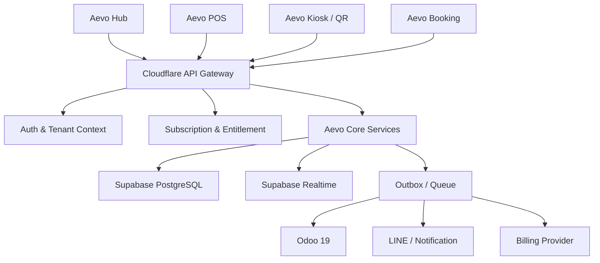

สำหรับ Aevo ผมแนะนำให้ใช้โครงสร้างแบบนี้:

> **หนึ่ง API Gateway กลาง + Modular API ภายใน + แยก Frontend ตามแอป**

ไม่ควรให้ POS, Kiosk, Booking และ Hub ต่อ Supabase โดยตรงทุกจุด เพราะจะทำให้ Business Logic กระจายและควบคุมสิทธิ์ยาก

## ภาพรวมการเชื่อมต่อ



---

# 1. Gateway ควรทำหน้าที่อะไร

Cloudflare Worker + Elysia ควรเป็น Gateway กลางของระบบ:

```text
Frontend App
    ↓
API Gateway
    ↓
Authentication
    ↓
Tenant Resolution
    ↓
Permission Check
    ↓
Subscription Check
    ↓
Domain Service
    ↓
Supabase / External Service
```

Gateway ไม่ควรเป็นเพียง Router แต่ควรเป็นจุดควบคุมกลางสำหรับ:

- ตรวจ Session
- ตรวจ User
- ตรวจ Organization
- ตรวจ Store
- ตรวจ Role/Permission
- ตรวจ Subscription/Entitlement
- Validate Request
- Rate Limit
- Idempotency
- Audit Log
- Error Format
- Request Trace
- เรียก Domain Service

---

# 2. แบ่ง API เป็น 4 Surface

ควรแยก API ตามลักษณะของผู้เรียก ไม่ใช่แยกเป็นคนละ Server ตั้งแต่แรก

## 2.1 Hub API

สำหรับเจ้าของร้านและผู้ดูแลระบบ

```text
/api/v1/hub/*
```

ตัวอย่าง:

```text
GET    /api/v1/hub/me
GET    /api/v1/hub/apps
GET    /api/v1/hub/subscriptions
POST   /api/v1/hub/subscriptions
GET    /api/v1/hub/organizations
POST   /api/v1/hub/stores
GET    /api/v1/hub/billing
GET    /api/v1/hub/audit-logs
```

หน้าที่:

- Organization
- Store
- Users
- Roles
- Apps
- Subscription
- Billing
- Integration
- Audit Logs

## 2.2 Staff API

สำหรับ POS, Admin, KDS และพนักงาน

```text
/api/v1/staff/*
```

ตัวอย่าง:

```text
GET    /api/v1/staff/catalog/products
POST   /api/v1/staff/orders
POST   /api/v1/staff/orders/:id/pay
POST   /api/v1/staff/orders/:id/refund
POST   /api/v1/staff/cash-sessions/open
POST   /api/v1/staff/cash-sessions/:id/close
GET    /api/v1/staff/reports/sales
GET    /api/v1/staff/preparation/tasks
```

ต้องตรวจ:

- User Session
- Store Access
- Staff Permission
- POS Subscription
- Cash Session Status

## 2.3 Public API

สำหรับลูกค้าที่ไม่ต้อง Login เช่น QR Ordering และ Public Booking

```text
/api/v1/public/*
```

ตัวอย่าง:

```text
GET  /api/v1/public/stores/:storeSlug/menu
POST /api/v1/public/stores/:storeSlug/orders
GET  /api/v1/public/orders/:publicToken
GET  /api/v1/public/venues/:venueSlug/availability
POST /api/v1/public/bookings
GET  /api/v1/public/bookings/:publicToken
```

Public API ต้องใช้:

- Public Store Token หรือ Slug
- Rate Limit
- CAPTCHA หรือ Bot Protection เมื่อจำเป็น
- ห้ามเปิดข้อมูลภายใน
- ห้ามใช้ Staff JWT แทน Public Token
- จำกัดข้อมูลที่ส่งกลับ

## 2.4 Device API

สำหรับ POS Device, Kiosk, KDS และ Queue Display

```text
/api/v1/device/*
```

ตัวอย่าง:

```text
POST /api/v1/device/pair
POST /api/v1/device/refresh
GET  /api/v1/device/context
GET  /api/v1/device/catalog
POST /api/v1/device/orders
GET  /api/v1/device/preparation
```

Device ไม่ควรใช้ User Login ปกติทุกกรณี ควรใช้:

```text
Device ID
Device Token
Store ID
Mode
Capability
```

ตัวอย่าง:

```text
Device 01
- Store: Main Branch
- Mode: POS
- Capability: order.create, payment.receive

Device 02
- Store: Main Branch
- Mode: KIOSK
- Capability: catalog.view, order.create

Device 03
- Store: Main Branch
- Mode: KDS
- Capability: preparation.view, preparation.update
```

---

# 3. Middleware Pipeline

ทุก Request ควรผ่าน Pipeline กลาง:

```text
Request
  ↓
CORS / Security Headers
  ↓
Request ID
  ↓
Rate Limit
  ↓
Parse Token
  ↓
Resolve Auth Context
  ↓
Resolve Organization/Store
  ↓
Check Device/App Mode
  ↓
Check Permission
  ↓
Check Subscription
  ↓
Validate Body/Params
  ↓
Run Domain Service
  ↓
Write Audit/Event
  ↓
Return Standard Response
```

## ตัวอย่าง Context

```ts
type RequestContext = {
  requestId: string;
  actorType: "user" | "device" | "public";
  userId?: string;
  deviceId?: string;
  organizationId?: string;
  storeId?: string;
  appId?: "hub" | "pos" | "kiosk" | "booking";
  mode?: "staff" | "pos" | "kiosk" | "kds" | "queue";
  permissions: string[];
  entitlements: string[];
};
```

ทุก Service ควรรับ Context นี้ ไม่ควรดึง User/Store จาก Request เองซ้ำหลายจุด

---

# 4. Authentication แยกตามประเภทผู้ใช้

## Staff/User

ใช้ Supabase Auth:

```text
Authorization: Bearer <supabase-access-token>
```

Gateway ตรวจ:

1. Token ถูกต้อง
2. User ยัง Active
3. Membership ยังไม่ถูก Suspend
4. มีสิทธิ์ใน Organization
5. มีสิทธิ์ใน Store

## Device

ใช้ Device Token:

```text
Authorization: Device <device-token>
```

Gateway ตรวจ:

1. Device ยัง Active
2. Token ยังไม่หมดอายุ
3. Device ผูกกับ Store
4. Mode ตรงกับ Endpoint
5. มี Capability ที่ต้องการ

## Public Customer

ใช้ Public Token:

```text
X-Public-Token: <public-token>
```

หรือ Token ใน URL สำหรับติดตาม Order:

```text
GET /api/v1/public/orders/:publicToken
```

Public Token ต้อง:

- สุ่มเดายาก
- อายุจำกัดตามประเภท
- ไม่เปิดเผย Internal ID
- อ่านได้เฉพาะข้อมูลของ Order นั้น

---

# 5. ไม่ควรให้ Frontend ต่อ Supabase ทุกเรื่อง

ควรแบ่งแบบนี้:

## ต่อ Supabase โดยตรงได้

เหมาะกับ:

- Auth
- Realtime Subscription
- Storage Upload ผ่าน Signed URL
- Static/Public Data ที่มี RLS เข้มงวด

## ควรผ่าน Gateway

เหมาะกับ:

- สร้าง Order
- รับ Payment
- Refund
- ปิดกะ
- Booking
- เปลี่ยน Role
- เปลี่ยน Subscription
- Odoo Sync
- Billing Webhook
- แก้ราคา
- ใช้ส่วนลด
- Device Pairing

เหตุผลคือ Logic เหล่านี้ต้องทำหลายขั้นตอนและต้องควบคุมสิทธิ์

```text
ไม่ควร:
Frontend → Supabase insert order โดยตรง

ควร:
Frontend → Gateway → Order Service → Supabase Transaction
```

ห้ามนำ `service_role` หรือ Secret Key ไปไว้ใน Frontend เด็ดขาด ตามแนวทางของ Supabase ([Supabase API Security](https://supabase.com/docs/guides/api/securing-your-api))

---

# 6. แบ่ง Internal Service ภายใน Gateway

เริ่มต้นยังไม่ต้องแยกเป็น Microservices จริง ให้แยกเป็น Module ภายใน Worker/API เดียว:

```text
apps/api/
├── modules/
│   ├── auth/
│   ├── tenancy/
│   ├── organizations/
│   ├── users/
│   ├── permissions/
│   ├── subscriptions/
│   ├── billing/
│   ├── catalog/
│   ├── ordering/
│   ├── payments/
│   ├── receipts/
│   ├── pos/
│   ├── kiosk/
│   ├── booking/
│   ├── notifications/
│   ├── devices/
│   ├── audit/
│   └── odoo/
```

แต่ละ Module ควรมี:

```text
routes/
schemas/
service/
repository/
policy/
events/
```

ตัวอย่าง:

```text
modules/booking/
├── routes/
├── schemas/
├── booking.service.ts
├── booking.repository.ts
├── booking.policy.ts
└── booking.events.ts
```

ข้อดีคือภายหลังถ้าต้องแยก Booking เป็น Service ก็ย้าย Module ได้ง่าย

---

# 7. API ของแต่ละ Domain

## Identity

```text
GET    /api/v1/me
GET    /api/v1/me/memberships
GET    /api/v1/organizations/:id
GET    /api/v1/organizations/:id/members
POST   /api/v1/organizations/:id/invitations
PATCH  /api/v1/memberships/:id
```

## Subscription

```text
GET    /api/v1/billing/plans
GET    /api/v1/billing/subscription
POST   /api/v1/billing/checkout
POST   /api/v1/billing/change-plan
POST   /api/v1/billing/cancel
GET    /api/v1/billing/invoices
GET    /api/v1/billing/portal
```

## Entitlement

```text
GET /api/v1/entitlements
GET /api/v1/entitlements/:feature
```

Backend ต้องตรวจเองทุกครั้ง ไม่ควรเชื่อแค่ Frontend:

```ts
await entitlement.require("booking.waitlist");
```

## Catalog

```text
GET    /api/v1/catalog/products
POST   /api/v1/catalog/products
PATCH  /api/v1/catalog/products/:id
DELETE /api/v1/catalog/products/:id
GET    /api/v1/catalog/categories
GET    /api/v1/catalog/modifiers
```

## Ordering

```text
POST /api/v1/orders
GET  /api/v1/orders/:id
POST /api/v1/orders/:id/confirm
POST /api/v1/orders/:id/pay
POST /api/v1/orders/:id/cancel
POST /api/v1/orders/:id/refund
GET  /api/v1/orders/:id/receipt
```

## POS

```text
POST /api/v1/pos/sessions/open
GET  /api/v1/pos/sessions/current
POST /api/v1/pos/sessions/:id/cash-in
POST /api/v1/pos/sessions/:id/cash-out
POST /api/v1/pos/sessions/:id/close
GET  /api/v1/pos/reports/shift
```

## Booking

```text
GET  /api/v1/booking/resources
GET  /api/v1/booking/availability
POST /api/v1/booking/bookings
GET  /api/v1/booking/bookings/:id
POST /api/v1/booking/bookings/:id/confirm
POST /api/v1/booking/bookings/:id/cancel
POST /api/v1/booking/waitlist
POST /api/v1/booking/check-in
```

---

# 8. ใช้ Unified Order Service

POS, Kiosk และ Booking ไม่ควรสร้าง Payment หรือ Receipt แยกกันเอง

```text
POS ───────┐
Kiosk ─────┼→ Order Service
QR ────────┤
Booking ───┘
```

ตัวอย่าง Booking:

```text
Booking Service
  ↓
ตรวจ Availability
  ↓
สร้าง Booking Record
  ↓
เรียก Core Order Service
  ↓
สร้าง Order Type = BOOKING
  ↓
สร้าง Payment
  ↓
สร้าง Receipt
  ↓
ส่ง Notification
```

ตัวอย่าง POS:

```text
POS Service
  ↓
สร้าง Order Type = POS
  ↓
รับเงิน
  ↓
สร้าง Receipt
  ↓
สร้าง Queue Ticket
  ↓
สร้าง Preparation Task
```

---

# 9. Transaction และ Idempotency

ทุก Endpoint ที่สร้างข้อมูลหรือรับเงินต้องรองรับ Idempotency:

```http
Idempotency-Key: 8b3c5e...
```

Endpoints สำคัญ:

```text
POST /orders
POST /orders/:id/pay
POST /bookings
POST /refunds
POST /billing/checkout
POST /device/pair
```

Flow:

```text
รับ Request
→ ตรวจ Idempotency Key
→ ถ้าเคยทำแล้ว ส่งผลลัพธ์เดิมกลับ
→ ถ้ายังไม่เคยทำ เริ่ม Transaction
→ บันทึก Result
→ ส่ง Response
```

ป้องกัน:

- กดปุ่มจ่ายเงินซ้ำ
- Internet หลุดแล้วกดใหม่
- Kiosk ส่ง Request ซ้ำ
- ลูกค้าสร้าง Booking ซ้ำ
- Webhook จาก Billing Provider ซ้ำ

---

# 10. Outbox สำหรับ Odoo และ Notification

ไม่ควรทำแบบนี้:

```text
สร้าง Order
→ รอ Odoo ตอบ
→ รอ LINE ตอบ
→ ค่อยตอบลูกค้า
```

ควรทำ:

```text
สร้าง Order + Outbox Event ใน Transaction เดียวกัน
→ ตอบลูกค้าว่าสำเร็จ
→ Worker ประมวลผล Odoo/LINE ภายหลัง
```

ตัวอย่าง Event:

```text
order.created
order.paid
order.refunded
booking.created
booking.confirmed
booking.canceled
subscription.started
subscription.expired
device.paired
```

ตาราง:

```text
outbox_events
- id
- event_type
- aggregate_type
- aggregate_id
- organization_id
- payload
- status
- attempts
- next_retry_at
- last_error
- created_at
```

Flow:

```text
Supabase Transaction
      ↓
outbox_events
      ↓
Cloudflare Queue
      ↓
Worker Consumer
      ├── Odoo Adapter
      ├── LINE Adapter
      ├── Email Adapter
      └── Web Push Adapter
```

---

# 11. Webhook Gateway

Webhook จาก External Provider ควรเข้าจุดเดียว:

```text
/api/v1/webhooks/*
```

ตัวอย่าง:

```text
POST /api/v1/webhooks/billing
POST /api/v1/webhooks/odoo
POST /api/v1/webhooks/line
POST /api/v1/webhooks/payment
```

แต่ละ Webhook ต้อง:

1. ตรวจ Signature
2. บันทึก Raw Payload
3. ตรวจ Event ID ซ้ำ
4. ตอบ 2xx เร็ว
5. ส่งเข้า Queue
6. ประมวลผลภายหลัง
7. Retry เมื่อผิดพลาด

ไม่ควรประมวลผล Logic ขนาดใหญ่ทั้งหมดใน Request เดียว

---

# 12. Error Format กลาง

ทุก API ควรตอบรูปแบบเดียวกัน:

```json
{
  "success": false,
  "error": {
    "code": "BOOKING_SLOT_UNAVAILABLE",
    "message": "ช่วงเวลานี้ถูกจองแล้ว",
    "details": {
      "resourceId": "resource_123",
      "startsAt": "2026-09-20T18:00:00Z"
    }
  },
  "requestId": "req_abc123"
}
```

ประเภท Error:

```text
AUTH_REQUIRED
AUTH_INVALID
FORBIDDEN
TENANT_NOT_FOUND
STORE_ACCESS_DENIED
APP_NOT_SUBSCRIBED
FEATURE_NOT_INCLUDED
VALIDATION_ERROR
RESOURCE_NOT_FOUND
CONFLICT
IDEMPOTENCY_REPLAY
RATE_LIMITED
EXTERNAL_SERVICE_ERROR
INTERNAL_ERROR
```

Frontend จะจัดการ Error ได้ง่ายและไม่ต้องอ่านข้อความจาก Backend แบบสุ่ม

---

# 13. Gateway Route Structure

แนะนำใช้ Versioned API:

```text
/api/v1/*
```

โครงสร้าง:

```text
/api/v1/auth/*
/api/v1/me/*
/api/v1/hub/*
/api/v1/catalog/*
/api/v1/orders/*
/api/v1/pos/*
/api/v1/kiosk/*
/api/v1/booking/*
/api/v1/devices/*
/api/v1/billing/*
/api/v1/integrations/*
/api/v1/webhooks/*
```

ไม่ควรแยก Domain เป็น Subdomain หลายตัวตั้งแต่ต้น เช่น:

```text
pos-api.aevo.com
booking-api.aevo.com
kiosk-api.aevo.com
```

เพราะจะทำให้:

- Auth Context ซ้ำ
- CORS ซับซ้อน
- Trace ข้ามระบบยาก
- Subscription Check กระจาย
- Deploy และ Monitoring ยุ่งยาก

ภายหลังถ้า Booking มี Traffic สูงมาก ค่อยแยก:

```text
api.aevo.com
booking-api.aevo.com
```

โดยยังใช้ Contract และ Auth กลาง

---

# 14. การเชื่อมต่อ Frontend

```text
apps/hub
apps/pos
apps/kiosk
apps/booking
       ↓
packages/api-client
       ↓
api.aevo.com/api/v1
```

ควรมี API Client กลาง:

```text
packages/api-client/
├── client.ts
├── errors.ts
├── auth-interceptor.ts
├── hub.ts
├── catalog.ts
├── orders.ts
├── pos.ts
├── booking.ts
└── billing.ts
```

แต่ละแอปเรียก:

```ts
api.booking.createBooking(input);
api.orders.pay(orderId);
api.billing.getSubscription();
```

ไม่ควรเขียน `fetch()` กระจายทั่วทุกหน้า

---

# 15. โครงสร้าง API ภายในที่แนะนำ

```text
apps/api/
├── src/
│   ├── app.ts
│   ├── routes.ts
│   ├── middleware/
│   │   ├── auth.ts
│   │   ├── tenant.ts
│   │   ├── permissions.ts
│   │   ├── entitlements.ts
│   │   ├── rate-limit.ts
│   │   ├── idempotency.ts
│   │   └── error-handler.ts
│   │
│   ├── modules/
│   │   ├── hub/
│   │   ├── billing/
│   │   ├── catalog/
│   │   ├── orders/
│   │   ├── pos/
│   │   ├── booking/
│   │   ├── kiosk/
│   │   ├── devices/
│   │   ├── notifications/
│   │   └── integrations/
│   │
│   └── shared/
│       ├── db.ts
│       ├── context.ts
│       ├── events.ts
│       ├── logger.ts
│       └── errors.ts
```

---

# 16. Flow สำคัญตัวอย่าง

## เปิด POS

```text
POS Frontend
  ↓ GET /me
Gateway ตรวจ Supabase Session
  ↓
ตรวจ Organization/Store
  ↓
ตรวจ POS Subscription
  ↓
ตรวจ pos.use
  ↓
ตรวจ Device Mode
  ↓
ส่ง Store Context กลับ
```

## สร้าง POS Order

```text
POS
  ↓ POST /orders
Gateway
  ↓ Auth + Store + Permission
Order Service
  ↓ Validate Catalog Snapshot
  ↓ ตรวจ Cash Session
  ↓ สร้าง Order
  ↓ สร้าง Outbox Event
  ↓
ตอบ Order กลับ POS
```

## ลูกค้าสแกน QR

```text
QR Customer
  ↓ GET /public/stores/:slug/menu
Public API
  ↓ ตรวจ Store Public Status
  ↓ ส่ง Catalog เฉพาะ QR Channel
ลูกค้าเลือกสินค้า
  ↓ POST /public/stores/:slug/orders
Public Order Service
  ↓ Rate Limit + Idempotency
  ↓ สร้าง Order
  ↓ ส่งเข้า Queue/KDS
```

## Booking

```text
Booking App
  ↓ GET /booking/availability
Gateway
  ↓ Auth/Subscription/Store
Booking Service
  ↓ ตรวจ Time Slot
  ↓ ตรวจ DB Constraint
  ↓ สร้าง Booking
  ↓ สร้าง Core Order
  ↓ ส่ง LINE Notification ผ่าน Queue
```

---

# 17. ข้อแนะนำสำคัญที่สุด

สำหรับระบบนี้ควรใช้:

```text
Cloudflare Worker/Elysia = API Gateway + Modular Backend
Supabase = Auth + PostgreSQL + RLS + Realtime + Storage
Cloudflare Queues = Background Jobs
Aevo Core = Domain Logic
Frontend Apps = UI ตามแต่ละผลิตภัณฑ์
```

และควรวางกฎ 5 ข้อนี้ตั้งแต่ต้น:

1. Frontend ไม่เข้าถึง Secret หรือ `service_role`
2. Order, Payment, Receipt และ Subscription ต้องผ่าน Service กลาง
3. ทุก Request ต้อง Resolve Organization/Store ก่อนทำงาน
4. ทุกการเขียนข้อมูลสำคัญต้องมี Idempotency
5. ทุกการเชื่อมต่อ Odoo, Billing และ LINE ต้องผ่าน Outbox/Queue

สถาปัตยกรรมที่เหมาะกับ Aevo ตอนนี้คือ:

```text
หลาย Frontend
      ↓
หนึ่ง API Gateway
      ↓
หลาย Modular Domain Services
      ↓
หนึ่ง Supabase Core
      ↓
หลาย External Adapters
```

เมื่อระบบโตขึ้นจึงค่อยแยก Booking, Billing หรือ Odoo เป็น Service/Gateway ของตัวเอง โดยไม่ต้องรื้อ Frontend และ Database Contract หลักครับ
