# แผนกลยุทธ์สถาปัตยกรรมและเทคโนโลยี Aevo Hub Ecosystem (Targeted Augmentation Architecture)

แผนแม่บทฉบับปรับปรุงใหม่นี้กำหนดทิศทางเชิงวิศวกรรมของ **Aevo Hub Ecosystem** บนพื้นฐาน: **Astro/PWA + Cloudflare Worker/Elysia + Supabase PostgreSQL (โครงการกลางเดียว) + Monorepo** โดยใช้แนวคิด **"Library เสริมเฉพาะจุด (Targeted Augmentation)"** และกำหนดให้ **Aevo Core เป็นเจ้าของ Business Logic เองทั้งหมด** ไม่นำระบบสำเร็จรูปตัวเดียว (เช่น Admin Generator แบบ AdminJS หรือ Full Third-party Auth/Billing ที่ซ่อน Business Model) มาครอบทั้งแพลตฟอร์ม เพื่อรักษาความยืดหยุ่นและป้องกันการผูกขาดในระยะยาว

---

## 1. ปรัชญาสถาปัตยกรรม: Core Ownership vs. Library Delegation

| ส่วนของระบบ | สิ่งที่ให้ Library / External ดูแล | สิ่งที่ Aevo Core ต้องเป็นเจ้าของเอง | Library / Tool ที่เลือกใช้ |
|---|---|---|---|
| **Authentication** | User ID, Email/Pass, OAuth, Session, Tokens, MFA | Organization, Store, Membership, Role, Permission Model | `@supabase/supabase-js`, `@supabase/ssr` |
| **Authorization / Permission** | Helper evaluate สิทธิ์ฝั่ง UI (`can(action, subject)`) | Ground Truth Security บน DB (RLS), RBAC Data Models | PostgreSQL RLS + Custom RBAC + CASL (`@casl/ability`) |
| **Subscription & Billing** | รับบัตร, ออก Invoice, Retry Payment, Renewal, Customer Portal | Entitlement Check, App Registry, Feature Gate, โควตาสาขา/อุปกรณ์ | Pluggable `BillingProvider` (Stripe / Opn / Xendit) + Aevo Entitlement Engine |
| **Trial 14 วัน** | - | สถานะ Trial, Grace Period, Free Limited Mode, อนุมัติพิเศษ | Aevo Core Trial State Machine บน PostgreSQL |
| **Data Fetching & State** | Caching, Retry, Query Invalidation, Optimistic Updates | API Business Logic, Transaction, Data Sanity | TanStack Query (`@tanstack/react-query`) + Elysia API |
| **Table & Data Grid** | Table State, Sorting, Filtering, Column Visibility | Server-side Pagination, Query Builder, Data Permissions | TanStack Table (`@tanstack/react-table`) |
| **Validation & Contracts** | Schema Definition, Type Inference, Request/Response Parsing | Domain Constraints, Business Rules | Zod (`zod`), `@elysiajs/openapi`, `openapi-typescript` |
| **Admin UI** | Headless Primitives, Accessible Components, Design Tokens | Business Workflows (กะเงินสด, KDS, Pairing, จองสนาม, Odoo Sync) | Custom Hub/Admin + Tailwind CSS + shadcn/ui + Radix UI + Lucide |
| **Offline POS** | IndexedDB Storage Engine & Cursor Handling | Local Order Queue, Draft Caching, Conflict Resolution | Dexie.js (`dexie`) |
| **Background Jobs & Queue** | Reliable Worker Delivery, Queue Scheduling, Backoff | Transactional Outbox, Event Mapping, Business Payload | Cloudflare Queues + Supabase `outbox_events` |
| **Notifications** | Push Service Delivery, LINE Messaging Platform | Notification Templates, Event Triggers, Customer Preferences | LINE Messaging API + Web Push (`@aevo/line`, `@aevo/push`) |
| **ERP Integration** | XML-RPC / JSON-RPC Protocol Transport | Outbox Processing, Model Mapping (Order → Sale Order), Idempotency | `@aevo/odoo` Custom Adapter |

---

## 2. การแบ่งชั้นสถาปัตยกรรม 4 ระดับ (Modular Monolith)

```mermaid
flowchart TD
    subgraph Apps["1. Frontend Applications (apps/)"]
        HUB["apps/hub (Launcher, Org, Billing, Users)"]
        POS["apps/pos (Cashier, Floor, KDS, Sessions)"]
        KIOSK["apps/kiosk (Self-order, QR Table)"]
        BOOKING["apps/booking (Court Timeline, Bookings, Check-in)"]
        ADMIN["apps/admin (Advanced Org Settings, Audit Logs)"]
    end

    subgraph UIComponents["Shared UI & Gating (packages/ui)"]
        GATES["PermissionGate | FeatureGate | AppEntitlementGuard"]
        UI_KIT["shadcn/ui + TanStack Table + Radix Primitives"]
    end

    subgraph ServiceLayer["2. Business Services & Gateway (packages/)"]
        API["apps/api (Elysia + Zod Contracts + CASL Policies)"]
        SUB_SRV["packages/subscriptions (Entitlements, 14-day Trial)"]
        BILL_SRV["packages/billing (BillingProvider Interface & Adapters)"]
        ORD_SRV["packages/ordering (Unified Commerce Engine - order_type)"]
        BKG_SRV["packages/booking-engine (Availability, Overlap Guard, Waitlist)"]
        ODO_SRV["packages/odoo (Outbox Mapper & Sync Worker)"]
    end

    subgraph Database["3. Single Central Supabase PostgreSQL (Per Environment)"]
        AUTH_DB["Supabase Auth (auth.users)"]
        CORE_DB["public: orgs, stores, members, roles, permissions, apps, subs"]
        COMMERCE_DB["commerce: orders, order_items, payments, receipts, refunds"]
        BOOKING_DB["booking: venues, resources, bookings, waitlists, availability"]
        OUTBOX_DB["integration: outbox_events, sync_jobs, dead_letters"]
        AUDIT_DB["audit: audit_logs (Append-Only)"]
    end

    Apps --> UIComponents
    UIComponents --> ServiceLayer
    ServiceLayer --> Database
```



---

## 3. รายละเอียดการออกแบบในแต่ละด้าน

### 3.1 Authentication & User Management
* **ใช้ Supabase Auth เป็นฐาน**: ดูแลเฉพาะ User ID, Email, Password, OAuth (Google/LINE), Session Cookie, Refresh Token, Password Reset และ MFA
* **ความปลอดภัยสำคัญ**: **ห้ามใช้ `user_metadata` ในการตัดสินสิทธิ์หรือเก็บ Role** เพราะ Client สามารถแก้ไขได้
* **โครงสร้าง User & Tenancy ที่ Aevo เป็นเจ้าของ**:
  ```text
  auth.users (Supabase Auth)
      ↓
  public.user_profiles
      ↓
  public.organizations
      ↓
  public.organization_memberships (User <-> Org)
      ↓
  public.membership_stores (User Access to specific Store)
      ↓
  public.roles & public.permissions (Custom RBAC)
  ```
* **ไม่ใช้ Clerk / Auth0 ในระยะนี้**: เพื่อป้องกันปัญหา User data synchronization ซ้ำซ้อน, ต้นทุนที่เพิ่มขึ้น และความขัดแย้งกับสิทธิ์ Multi-tenant ใน PostgreSQL RLS

---

### 3.2 Organization & Multi-tenancy
* ทุก Business Table มี Tenant Scope ชัดเจน:
  `organization_id`, `store_id`, `created_by`, `created_at`, `updated_at`
* **การป้องกันสองชั้น (Defense in Depth)**:
  1. **Application Layer**: Elysia API + Zod + CASL Policy (`@casl/ability`) ตรวจสอบสิทธิ์ก่อนประมวลผล
  2. **Database Layer**: PostgreSQL Row-Level Security (RLS) ป้องกันข้อมูลข้ามร้านค้าเสมอ

---

### 3.3 Subscription & Pluggable Billing Architecture
* **Aevo Core เป็นเจ้าของ**:
  * ข้อมูล App ที่เปิดใช้งาน (`public.apps`)
  * Feature Entitlements (`pos.use`, `kiosk.use`, `booking.use`, `booking.waitlist`, `reports.advanced`, `odoo.sync`)
  * โควตาสาขา, โควตาอุปกรณ์ Kiosk, โควตาสนาม/ห้อง
  * **ระบบทดลองใช้ฟรี 14 วัน (Aevo Core Trial Engine)**:
    * Lifecycle: `TRIALING` → `ACTIVE` → `PAST_DUE` → `GRACE_PERIOD` → `EXPIRED` → `CANCELED` → `READ_ONLY`
    * รองรับ Trial รายแอป, Trial รายองค์กร, Demo Mode โดยไม่ต้องใส่บัตรเครดิต
* **Billing Provider Interface กลาง**:
  ```typescript
  export interface BillingProvider {
    createCustomer(input: CreateCustomerInput): Promise<BillingCustomer>;
    createSubscription(input: CreateSubscriptionInput): Promise<BillingSubscription>;
    cancelSubscription(subscriptionId: string): Promise<void>;
    changePlan(input: ChangePlanInput): Promise<BillingSubscription>;
    getPortalUrl(customerId: string, returnUrl: string): Promise<string>;
    verifyWebhook(request: Request): Promise<BillingWebhookEvent>;
  }
  ```
* **Adapters**:
  * `StripeBillingAdapter`: เหมาะกับ Subscription สากล, บัตรเครดิต, และ Customer Portal
  * `OpnBillingAdapter` / `ThaiQrBillingAdapter`: สำหรับ PromptPay, บัตรในไทย และโอนเงินผ่านธนาคาร
  * `ManualInvoiceAdapter`: สำหรับลูกค้าระดับ Enterprise / B2B

---

### 3.4 Admin System & UI Components
* **หลีกเลี่ยง Admin Generator แบบ AdminJS**: ป้องกันปัญหา UI ไม่ตรงกับ Workflow หน้าร้าน เช่น การเปิด-ปิดกะ, การจัดการ KDS, การจับคู่อุปกรณ์ Kiosk และตารางคอร์ทกีฬา
* **Custom Admin บน Shared Package (`packages/ui`)**:
  * Headless Primitives: Radix UI
  * Styling & Tokens: Tailwind CSS + `class-variance-authority`
  * Icons: Lucide Icons (`lucide-react` / Astro SVGs)
  * Data Grids: TanStack Table (Server-side Pagination, Sorting, Search, Filtering, Export)
* **Components ควบคุมสิทธิ์เฉพาะทาง**:
  * `<PermissionGate permission="order.void">`: ซ่อน/ปิดการทำงานของปุ่มตามสิทธิ์
  * `<FeatureGate feature="booking.waitlist">`: แสดงฟีเจอร์ตามแผนการสมัคร
  * `<AppEntitlementGuard app="booking">`: ป้องกันการเข้าถึงหน้าแอปที่ไม่ได้เปิดใช้งาน

---

### 3.5 Data Fetching, State & Offline POS
* **Data Flow มาตรฐาน**:
  `Frontend UI → TanStack Query → Elysia API Gateway → Domain Service Layer → Supabase PostgreSQL`
* **Realtime Invalidation**:
  เมื่อได้รับข้อความจาก Supabase Realtime (เช่น `order.created`, `table.updated`) ให้ทำ `queryClient.invalidateQueries(...)` ดึงข้อมูลใหม่ผ่าน API เพื่อรักษาความถูกต้องของแคช
* **Offline POS ด้วย Dexie.js (IndexedDB)**:
  `POS Client → Dexie.js (Local Catalog & Draft Orders) → Local Queue → Sync Worker → Elysia API`

---

### 3.6 Background Jobs & Transactional Outbox
* ทุกการกระทำที่ส่งผลกระทบต่อภายนอก (Odoo, LINE, Web Push, Email ใบเสร็จ) **ต้องไม่เรียกใช้แบบ Synchronous ใน Request ของการขาย**
* โครงสร้าง:
  `Order / Payment Transaction → บันทึก Orders + บันทึก outbox_events ใน DB Transaction เดียวกัน → Cloudflare Queue / Outbox Worker → ประมวลผลส่ง Odoo 19 / LINE → บันทึกผลสำเร็จหรือ Dead Letter`

---

## 4. โครงสร้าง Monorepo Packages ที่ปรับปรุง (`packages/`)

```text
packages/
├── auth/                 # Session parsing, Supabase SSR helpers, Org/Store resolution
├── authorization/        # RBAC definitions, Permission constants, CASL ability builder
├── subscriptions/        # App registry, Plan definitions, Feature Entitlement engine, 14-day Trial state
├── billing/              # BillingProvider interface, Stripe adapter, Opn adapter, Webhook handlers
├── contracts/            # Single Source of Truth Zod schemas & TypeScript types (User, Catalog, Order, Booking, Subs)
├── db/                   # Supabase client, Repositories (Orders, Catalog, Booking, Subscriptions, Audit)
├── ordering/             # Unified Order state machine, minor-unit pricing, discounts, taxes
├── booking-engine/       # Slot availability calculation, Overlap prevention, Waitlist rotation
├── payments/             # Payment method adapters, cash session reconciliation, refunds
├── receipts/             # Thermal print formatting (58mm/80mm), e-receipt generators
├── realtime/             # Store channel formatting, presence envelopes, broadcast room
├── communication/        # Push notifications, LINE Official flex messages
├── audit/                # Immutable append-only audit logger
├── odoo/                 # JSON-RPC transport, Outbox event processor, Odoo 19 data mappers
└── ui/                   # Shared UI kit (PermissionGate, FeatureGate, DataTable, Modal, Dialog, Badges)
```

---

## 5. แผนการดำเนินงาน 5 ระยะ (5-Phase Execution Plan)

### Phase 1: Core Foundation & Platform Contracts
* [x] รวมศูนย์ Auth และ Tenancy (`public.organizations`, `public.stores`, `public.memberships`, `public.roles`, `public.permissions`)
* [x] สร้างโครงสร้าง Apps Registry & Subscriptions (`public.apps`, `public.app_subscriptions`)
* [x] ฟังก์ชัน RLS `private.is_app_entitled`
* [ ] แยกโมดูล `packages/authorization` รองรับ CASL policy rules (`@casl/ability`)

### Phase 2: Hub, Subscription & Pluggable Billing
* [x] Aevo Hub Portal UI (`/staff/hub`) แสดงรายการแอป, สถานะการใช้งาน, และการเปิดทดลองใช้ฟรี 14 วัน
* [x] API Endpoints `/api/hub/apps`, `/api/hub/subscriptions`, `/api/hub/subscriptions/trial`
* [ ] สร้างโมดูล `packages/billing` พร้อม Interface `BillingProvider`
* [ ] เพิ่ม `StripeBillingAdapter` และ `ManualInvoiceAdapter` สำหรับทดสอบ
* [ ] ขยายสถานะ Trial: `TRIALING`, `ACTIVE`, `PAST_DUE`, `GRACE_PERIOD`, `EXPIRED`, `CANCELED`, `READ_ONLY`

### Phase 3: Aevo Booking Domain & Decoupling POS
* [x] ย้าย Schema จาก Firebase เข้าสู่ PostgreSQL (`venues`, `bookable_resources`, `operating_hours`, `booking_pricing_rules`, `bookings`)
* [x] พัฒนา `packages/db/src/booking.ts` (Availability calculation, Overlap guard, Check-in code)
* [x] พัฒนา Staff Booking UI (`/staff/booking`) พร้อม Interactive Timeline Grid และ Check-in Modal
* [x] แยกตาราง Waitlist เข้าสู่ Booking Domain (`public.booking_waitlists`)
* [x] ผังโต๊ะอาหาร (Tables) ใน POS ทำงานร่วมกับ Booking ในฐานะ `BookableResource` ประเภท `'TABLE'`

### Phase 4: Unified Commerce (`order_type`) & Offline Architecture
* [x] เพิ่มคอลัมน์ `order_type` (`POS`, `KIOSK`, `QR_ORDER`, `BOOKING`, `SERVICE`) ในตาราง `public.orders`
* [x] อัปเดต Contracts (`CreateOrderInput`, `OrderSummary`, `OrderListItem`)
* [x] อัปเดต Orders Repository ให้ map และ query ด้วย `orderType`
* [ ] นำ Dexie.js (`dexie`) เข้ามาใช้เป็น Local IndexedDB Engine สำหรับ Offline POS และ Sync Queue

### Phase 5: Integration, Queue & Shared UI Kit
* [x] Odoo 19 Outbox Mapper & Dead-letter handling ใน `@aevo/odoo`
* [x] LINE Official & Web Push message formatters
* [ ] ยกระดับ Background Worker ไปใช้ Cloudflare Queues
* [ ] รวม UI Components หลักเข้าสู่ `packages/ui` (`PermissionGate`, `FeatureGate`, `AppEntitlementGuard`, `DataTable`)

---

## 6. แผนการตรวจสอบและทดสอบ (Verification Plan)

### 6.1 Automated Tests
* ทดสอบสิทธิ์การเข้าถึงและการแยกข้อมูล Multi-tenant: `bun test packages/db/test/tenant-isolation.test.ts`
* ทดสอบระบบ Booking Engine และ Waitlist: `bun test packages/db/test/booking.test.ts`
* ทดสอบระบบ Unified Order และ `order_type`: `bun test packages/db/test/orders.test.ts`
* ทดสอบ Subscriptions และ 14-day Trial: `bun test packages/db/test/subscriptions.test.ts`
* ทดสอบ Odoo Outbox Mapping: `bun test packages/odoo/test/odoo.test.ts`
* ตรวจสอบ Type Safety ทั่วทั้ง Monorepo: `bun run typecheck`

### 6.2 Manual Verification
* เปิดใช้งาน Hub (`/staff/hub`) ตรวจสอบการแสดงสถานะแอป, การนับถอยหลัง Trial 14 วัน
* เปิดใช้งาน Booking (`/staff/booking`) ทดสอบสร้างการจองสนาม, ตรวจสอบ Timeline Grid และการเช็คอินด้วยรหัส
* ทดสอบสร้างคำสั่งซื้อจาก POS และตรวจสอบค่า `order_type = 'POS'` ในตาราง orders
